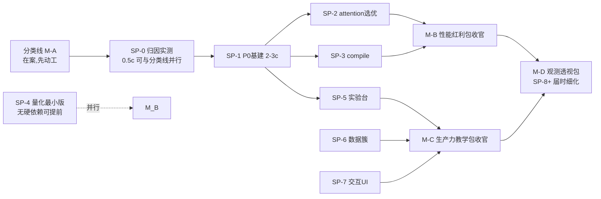

# 双主线 smallplan 集与推进计划（草案 v0.9，2026-10-31）

> 配套 `2026-10-31-dual-track-bigplan.md`。本文回答三个问题：
> ① 现在可以排哪些 smallplan；② 每个小计划的前置调研是否已就位；
> ③ 推进顺序与依赖。各 smallplan 在正式动工时仍按惯例进 PLAN MODE 细化（本文即其草稿底稿）。

## 0.75 执行状态（2026-10-31 收官）

- **SP-0 已完成**：归因报告 `2026-10-31-sp0-attribution.md`；结论=crash site 是真凶
  （+20~100%），T6-1 立项、设计优先级改为 P-α 键检查廉价化 > P-β 惰性建库 >
  P-γ ring buffer > P-δ 重放。
- **SP-1 已完成并收官**（同日）：switch_registry + signature_cache + app/spine 观测总线 +
  watchdog 迁移骑总线 + test_obs_spine 39 项；已提交推送（父仓 `53efd9b`）并 F 盘同步，
  **双盘冒烟 306/33/0**；验收细节与新踩坑见 `2026-10-31.md` §七。
- **SP-2+SP-3 合批已收官**（2026-10-31，父仓 `93b4aec`+`4132f3d`+`c782cdd`、子模块 `ceda01d`，
  双盘同步，CPU/GPU 冒烟均 **308/34/0**）：
  - `comfy/compile_manager.py`（中央 torch.compile 缓存，weakref+`_StrongRef` 兜底，
    自计量入 `comfydl.compile` 开关，`_compile_fn` 测试间接层）；`comfy_extras/nodes_compile.py`
    （`CdlCompileModel`，WaveSpeed `add_object_patch` 模式）；`comfy_extras/nodes_attention_select.py`
    （`CdlAttentionOptimizer` 自动选优 + `CdlAttentionBackend` 教学版，两阶段验证 + 可注入计时器
    benchmark + 签名缓存 `attention_bench` 命名空间 + clone 注入 override）。
  - 用户界面验收通过（模板卡、model/perf 三节点、报告双 SaveText）；其发现的缺口已补：
    **Settings > ComfyDL 原本无开关呈现** → 新增 `GET/PATCH /comfydl/switches` 通用路由 +
    `app/perf_assets/perftools.js`（Perf 组两个热切换， refusal 回弹）+ perf loader 注入 +
    增量 zh 分类补丁 `_patch_perf_category_i18n`（bulk i18n 整块标记会挡住新键的教训）。
  - GPU 实测（RTX 5060 Laptop, torch 2.11.0+cu130）：attention 基准 seq1024/16h/64d fp16 →
    **comfy_kitchen_int8 x2.16 当选**（0.242ms vs SDPA 0.524ms），flash/sage/xformers 未安装
    验证出局（设计行为）；compile 微基准：**inductor 在 Windows 无 triton 直接 TritonMissing**
    （已写入节点 tooltip/docstring），cudagraphs/aot_eager 在小 block 上无收益（x0.90/x0.94）。
  - 测试资产：test_compile 26 项、test_attention_select 32 项、test_obs_spine 增至 44 项
    （T5g-i 开关路由）；模板 78/78 + 44/44；FUNCTION/README 四文档无需变动（extras V3 不入
    FUNCTIONS 为既定边界，`--check` 全一致）。
  - 教训：父仓提交易漏子模块 gitlink，push 后须 `git submodule status` 复核。
  - **追加修复 `749a960`**：perftools.js 首次真启动即复现 motion.js 2026-10-30 记载过的同一
    白屏坑（registerExtension 立即处理 settings，早于 settings store bootstrap →
    "Setting values must be loaded" 未捕获错误炸掉整个 bootstrap 链）——已补
    `settingsStoreReady`（vue-app pinia `setting.isReady`）守卫 + 重试窗口延长至 20s。
    另：F 盘存在 10/4 robocopy 来的 CPU 克隆 `penv`（torch 2.13.0+cpu），用户误激活导致
    torchsde 缺失/CUDA 不可用假象；GPU 环境必须是 `penv_new`（torchsde/transformers 齐）。
- 下一步候选：SP-4（量化最小版）或按用户拍板 M-C 前移。

## 0.76 SP-4 立项（2026-10-31）

- 详细计划已落盘：`2026-10-31-sp4-quantization-plan.md`（T1 格式描述符+GGUF 移植 /
  T2 CdlLoadGGUF / T3 estimators 字节率适配（ADR-D3 硬捆绑） / T4 CdlQuantizationInspector /
  T5 test_quant_gguf + 脚本生成 fixture / T6 冒烟文档双盘）。预算 2-3 craft。
- 前置事实已核对：`gguf` 包两 venv 均未装（进 requirements 用户手动装，惰性 import
  pyodbc 先例）；Refs/ComfyUI-GGUF 在位；TensorVal.itemsize 扩展点确认；
  `custom_operations` 通道可用性动工首日核对。
- **SP-4 已实现收官（同日）**：提交链 `03ac48a`→`13444cb`（尺寸表真值+惰性 lora）→
  `b508a70`/`32972c4`/`ba1f845`/`c4b61ae`/`3921967`/`5db872a`（测试迭代修复），
  双盘同步至 `5db872a`。交付：`comfy/quant_formats.py`（GGMLTensor/GGMLOps/13 个纯 torch
  dequant 内核/gguf_sd_loader/GGUFModelPatcher/summarize_state_dict_bytes）+
  `comfy_extras/nodes_quant.py`（CdlLoadGGUF + CdlQuantizationInspector）+ estimators
  两条估算器 + requirements gguf>=0.13.0,<0.14。
- 门禁：GPU 侧 test_quant_gguf **47/47**（gguf 已装，全内核对照 gguf 参照逐位一致），
  P 侧 21/0/3 SKIP（等用户装 gguf 后自动解锁）；双盘节点冒烟 **308/36/0**（两新节点
  无 gguf 文件时按设计 SKIP）。
- **重大教训（ADR-D3 相关）**：①GGML 类型整数码绝不能凭记忆手写——首版表大范围错误
  （Q5_0=6 非 9、K 系整体偏移、IQ4_XS=136B/块非 72 等），靠 T4 全表对照测试当场揪出，
  最终从已装 gguf 0.13.0 权威导出重写；gguf 的 GGUFValueType 同理（INT32=5 非 4）。
  ②`comfy.lora` 在 `_lazy_modules.LAZY_SUBMODULES` 脱水清单里，量化模块顶层 eager
  import 它会连带 model_base→ldm 全树实体化、顶掉 `comfy.text_encoders` 的惰性代理，
  CLIPLoader/DualCLIPLoader 运行时属性访问即崩——**新增 comfy.* 顶层导入前必查
  LAZY_SUBMODULES 清单**。③GGMLTensor 持 mmap 句柄，Windows 下临时目录清理须
  ignore_cleanup_errors；loader 按 SD 惯例剥离 `model.diffusion_model.` 前缀。
- 待办：用户提供真实 GGUF 文件做 GPU 实测（加载 + 显存对比 + estimators verdict +
  Inspector 界面验收）。
- **硬禁用裁决落地（`0434d1a`，2026-10-31 用户拍板）**：量化族不做降级 error-continue——
  `nodes_quant.py` 模块级 `qf.require_gguf()`，gguf 缺失时导入失败、节点整体不进节点库
  （同 nodes_generation 缺 torchsde 的既有硬禁用契约），启动日志有可读 pip 提示；
  `require_gguf` 改抛 ImportError。P 盘冒烟 308/34/0（量化族整体缺席，属设计），
  F 盘 308/36/0 + 47/47 不变；test_quant_gguf T7 改双分支断言（装机态/硬禁用态）。
- **依赖安装实录（2026-10-31，用户提供）**：
  - F 盘 penv_new：`pip install "gguf>=0.13.0,<0.14"` 一步成功（sentencepiece 0.2.0 有
    cp312 wheel，顺带把 0.2.2 降回 0.2.0）→ 全层级测试已跑，47/47。
  - P 盘 penv（**Python 3.14 embedded**）：sentencepiece 无 cp314 wheel，源码构建失败
    （setup.py subprocess FileNotFoundError = 无 MSVC/cmake，U 盘开发机无工具链）；
    清华镜像 binary-only 也只有 0.2.1/0.2.2（违反 gguf 钉的 <=0.2.0）；pytorch.org nightly
    wheel 403。用户最终 `pip install gguf --no-deps` 装了本体，但 `import gguf` 失败
    （`gguf/__init__` 无条件 `from .vocab import *` → sentencepiece 硬依赖）。
  - **裁决选项（待用户拍板）**：A. P 盘接受优雅降级（pyodbc 先例）：CPU 开发机无 gguf，
    节点报可读错误、测试走 SKIP 层级，GGUF 作为 GPU 机专属能力——零代码改动；
    B. 等 sentencepiece 出 cp314 wheel 后补装解锁；C. 自行找 cp314 wheel 源手动装。
    当前设计对三个选项都安全（require_gguf() 可读报错 + 测试分级 SKIP）。

## 0.5 调整记录（2026-10-31 执行期，吸收另一 session 成果后）

前置状态变化（git log 核实，两仓干净 master）：
- **分类线已合并主干**（submodule `74e2623`，133 nodes）→ **M-A 收官**，第一动工位空出。
- **CDL App Panel 批次 4-23 已交付**（父仓 `e8a236c`→`c71dbb8`）：原生 dock 仪表盘、
  run scoping、builder 步跳转、增量进度行、motion 套件（全局开关）、**矢量实时图表
  （structured preview data，比 bitmap 便宜 10^4x）**、停止按钮；资产
  `app/cdlapp_assets/{cdlapp.js,cdlapp.css}` + `app/cdlapp_routes.py`。

由此对本计划的三项调整：
1. **SP-5 实验台对比视图的前端底座**：原"复用 profiler.js 侧栏结构"作废，改为
   **骑 cdlapp 矢量图表体系**；前置侦察对象改为 `cdlapp.js`/`cdlapp_routes.py`
   （30 分钟级，摸清 structured preview data 的 schema 与图表注册方式）。
2. **M-D 观测包（P6）的监控条/仪表**：可进 App Panel 仪表盘而非另起面板（spine 的
   WS 消息 `cdl.spine` 与 App Panel 的数据通道对接点在 P6 细化时定）。
3. **推进顺序生效**：M-A 收官 → 第一步 = SP-0 + SP-1（计划 `dual-track-p0-spine`
   已被用户接受，2026-10-31 开始执行）。

## 0. 调研就位度总览

| 专项 | 档案状态 | 还缺什么 |
|---|---|---|
| C1a attention 选优 | ✅ 行号级（benchmark 循环/缓存键/验证函数/apply 序列全齐） | 无——可直接写 smallplan |
| C1b 量化加载 | ✅ 行号级（GGMLTensor/cast_bias_weight/注入链/estimators 扩展点） | 我方 `comfy/ops.py` QuantizedTensor dispatch 细节（C1b 已带行号，够用）；GGUF 依赖 `gguf` 包版本核对（动工时 `pip show` 即可） |
| C2 实验台 | ✅ schema 与控制流齐（param_grid/QUEUE_STATUS/runs.csv 19 列/benchmark JSON/三层统一 schema 建议） | 我方 frontend_patch 面板注入模式（已有 C6 档案）；**对比视图的前端骨架**（P3 动工前需一次 30 分钟级侦察：现有 profiler.js 侧栏结构如何复用为 runs 面板） |
| C3 交互 UI | ✅ obvpm 全套可移植 + lf-nodes 模式 + Notebook 四机制 | 无重大缺口；Nodes 2.0 Vue 渲染器下 `computedHeight`/hidden 双标记的实测验证（动工时做） |
| C4 数据簇 | ✅ Data List 最小样例/Pack 反查序列/ShowText 回写路径/分片缓存键 | 无——可直接写 |
| C5 crash site | ✅ 现状数据流 + 开销热点 + 重设计挂点 + E7 三件套 | **SP-0 归因实测结果**（T6-1 立项前提） |
| C6/C7 观测透视 | ✅ 吸收/摒弃清单 + watchdog 同构确认 + PhaseTimer/净耗时算法 | 无——可直接写 |

结论：**七簇中六簇调研已就位**，仅 C5 需 SP-0 实测补数据，C2 需一次轻量前端侦察。

## 1. Smallplan 草案

### SP-0 开销归因实测（P-1，0.5 craft，立即可做）
- **目的**：分离 crash site 与 profiling 各自的真实运行开销，验证"几乎多一倍"的来源。
- **方法**：固定一张基准工作流（建议 tabular_regression_production 模板），四组配置各跑 3 次取中位：
  ① 全关（profiling 开关 off + crash site off + `--cdl-profiling-disable`）；
  ② 仅 crash site on；③ 仅 profiling on（默认档）；④ 两者全开。
  记录 wall time + `runs` 明细。P 盘 CPU 先跑定性，F 盘 GPU 复跑定量。
- **产出**：归因报告（每组耗时表 + 结论），写入本文件附录，直接决定 T6-1 去留。
- **注意**：不做视觉验收；只用现有开关，零代码改动（若发现开关粒度不够归因，记缺口不现场改）。

### SP-1 P0 基建（2-3 craft）
- **任务**：
  1. 观测总线：`app/obs_spine/`（名字动工定）——单 daemon 采样线程 + GPUSnapshot 风格版本化
     契约 + 单 WS 消息名（如 `cdl.spine`）+ rate 控制（0=全停）。先接 psutil/CPU+RAM，
     NVML provider 接口留好（P6 再接 GPU）。
  2. 签名缓存服务：统一缓存键构造（prompt 签名 + 代码版本 + 配置指纹）+ 存储目录约定
     （user 目录，防更新清空——AMDMonitor 教训）。
  3. 开关注册表：泛化 proflog 模式，`{id, 默认值, 热切换, 自我计量}` 注册 API + 设置面板呈现。
  4. watchdog 迁移：现有 `profiling_watchdog.py` 改骑总线（burst 状态机保留）。
- **验收**：总线开启时 1s 采样 CPU 占用可忽略（自证计量入面板）；全停后零线程存活；
  watchdog 行为与迁移前逐字节等价（现有 test 复跑）；专项测试新增 ≥15 项。
- **前置调研**：已就位（C6 档案 + watchdog 现状）。

### SP-2 P1a attention 选优双形态（1.5-2 craft）
- **任务**：
  1. 生产版 `CdlAttentionOptimizer`（名字动工定）：探测（try-import 13 后端）→ 运行时验证
     （真实小张量直调，参考 A4 validate_* 家族）→ benchmark（3 warmup + cuda sync +
     perf_counter ×10，A4 骨架直接移植）→ 版本化 JSON 缓存（键含 head_dim/seq_len/num_heads
     + 我方签名服务键；**缓存移出插件目录**）→ clone + `optimized_attention_override` 注入
     （`__wrapped__` 防二次包装 + **显式幂等标记**，补 A4 缺陷）。
  2. 教科书版 `CdlAttentionBackend`：手动选后端（SDPA/flash/sage/xformers 可用性探测）
     + speedup 报告 STRING 输出 + docstring 讲原理。
  3. 模板 `attention_lab.json`（教学门面验收件）。
- **依赖**：SP-1（签名缓存）软依赖，可先用手搓缓存键。
- **测试**：CPU 盘测 pytorch 后端正确性 + 假计时器测 benchmark 逻辑；GPU 盘冒烟测真
  speedup 数字合理性；幂等标记防重入断言。
- **前置调研**：✅ 已就位（C1a 档案）。

### SP-3 P1b compile 包装族（1.5-2 craft）
- **任务**：compile 管理器（中央缓存字典 key=id+编译参数 hash，返回包装副本）+ 生成栈
  compile 节点（WaveSpeed `add_object_patch` 模式 + `patch_optimized_module` 双补丁移植）+
  ADR-D4 落地（编译区域节点粒度归账的 meter 兜底标记）。
- **依赖**：SP-1（compile 管理器可先独立，后并入开关注册表）。
- **测试**：**独立冒烟分类**（`--categories compile`），不进默认冒烟；F 盘验证真加速；
  P 盘验证幂等与缓存逻辑（编译 mock）。
- **前置调研**：✅ 已就位（C1a 档案 ⑤⑥）。

### SP-4 P2 量化加载最小版（2-3 craft）
- **任务**：
  1. 格式描述符接口（bytes_per_element/dequantize/state_dict）——GGUF 首个实现
     （GGMLTensor 子类 + GGMLOps + patch_weight_to_device patch，C1b 档案全套移植）。
  2. `CdlLoadGGUF` 节点（unet_gguf 目录注册 + dequant_dtype/patch_dtype 参数）。
  3. **estimators 字节率适配（硬捆绑，ADR-D3）**：TensorVal.itemsize 扩展 +
     QUANT_ALGOS/GGUF 字节率表，估算 verdict 对量化模型正确。
  4. 教学门面：`CdlQuantizationInspector`（读 safetensors/gguf 元数据 → 逐层字节率表 +
     有效 bits 统计 STRING 输出）——Quantization Lab 的第一块砖。
- **依赖**：无硬依赖（可与 SP-2/3 并行）。
- **前置调研**：✅ 基本就位；动工首日核对 `gguf` 包在 penv/penv_new 的可用性。
- **测试**：小 GGUF 文件固件（<5MB）进 cdl_smoke_tests/data；字节率断言精确到
  NVFP4 0.5B+1/16B 级。

### SP-5 P3 实验台（3-4 craft）
- **任务**：
  1. runs 三层 schema（ADR-D10）：索引层 runs.csv（E6 19 列裁剪 + params_digest/metrics_final）
     + 明细层每 run JSON（E3 结构 + direction 字段修 GridSearch 缺陷）+ `_RunLogHandler`
     逐条 flush 崩溃日志。
  2. `CdlGridSearchTrain`：param_grid JSON + direction(min/max) + 复用 TrainingLoop 机制
     （EternalKernel "每组新建实例"模式修正为复用已验证早停/回滚）。
  3. auto-queue：QUEUE_STATUS 自循环 + ExecutionBlocker（ComfyLab 协议移植）。
  4. 对比视图：runs 面板（profiler.js 侧栏结构复用）——曲线族叠加 + 最优高亮（"中"档雄心）。
  5. 教学模板：`hyperparameter_exploration.json`。
- **依赖**：SP-1 总线（runs 采样并入）；**前置侦察**：profiler.js 侧栏结构 30 分钟级摸底。
- **测试**：扫描确定性（同 seed 同网格同结果）；direction=max 选对最优；崩溃日志完整性
  （kill -9 模拟，Windows 下 taskkill）。

### SP-6 P4 数据簇（3 craft）
- **任务**：Data List 双语义族（OUTPUT_IS_LIST/INPUT_IS_LIST + ContainsDynamicDict）+
  CdlDatasetPack/Unpack（列→端口动态绑定，前端 web.js 移植）+ DatasetPreview 升级
  （ShowText 回写路径）+ 分片加载（start_idx/num_samples，缓存键补分片参数修 NNT 缺陷）。
- **前置调研**：✅ 已就位（C4 档案）。
- **测试**：双列表语义往返一致；Pack 反查含子图；空值规则 is_empty_entry 断言。

### SP-7 P5 交互教学 UI（3-4 craft）
- **任务**：富 widget 引擎（obvpm 原生模式：computeLayoutSize/mouse/draw + hidden 双标记 +
  computedHeight getter）首个实例 = 图片对比滑块/直方图 widget + Notebook 单元格
  （四机制移植，Tier 2 默认关 + 警告横幅）+ 变量巡检路由。
- **前置调研**：✅ 已就位（C3 档案）；动工首日做 Nodes 2.0 实测验证。
- **测试**：widget 契约单测（JS 语法配平 linter）+ Notebook 中断/flush/巡检专项。

### SP-8+（M-D 阶段，动工前再细化）
P6 观测包 / P7 原理透视 / T6-1 crash site 重设计（视 SP-0）——等 M-B/M-C 推进到一半时
按当时的 spine 实况细化，本文不预写。

## 2. 推进顺序（"小计划的计划"）

排序理由：
1. **分类线仍是第一动工项**（已定稿，不因本计划让位）；SP-0 零代码改动，可穿插做。
2. SP-1 是 M-B/M-C 的公共依赖，紧随其后。
3. SP-4 无硬依赖且与教学线（C7 Quant Lab）联动，可作机动批次插入。
4. SP-8+ 不预写——M-D 细化时 spine 已落地，届时档案需按实物更新，现在写必过期。
5. **合批原则**：SP-2+SP-3 可并为一个 CRAFT 序列（同属 C1，文档/测试摊薄）；
   SP-6+SP-7 同理可合（同属教学体验线）。

## 3. 待用户审阅清单（与 bigplan §9 同源，此处为执行序）

1. SP-0 是否授权立即执行（与分类线并行）？
2. SP-2+SP-3 合批、SP-6+SP-7 合批是否认可？
3. 实验台按"中"档（SP-5 含对比视图闭环）排，还是先"轻"后追加？
4. M-C 是否需要前移（若"目的二"权重高，SP-5/6/7 可提到 SP-2/3 之前，仅依赖 SP-1）。
