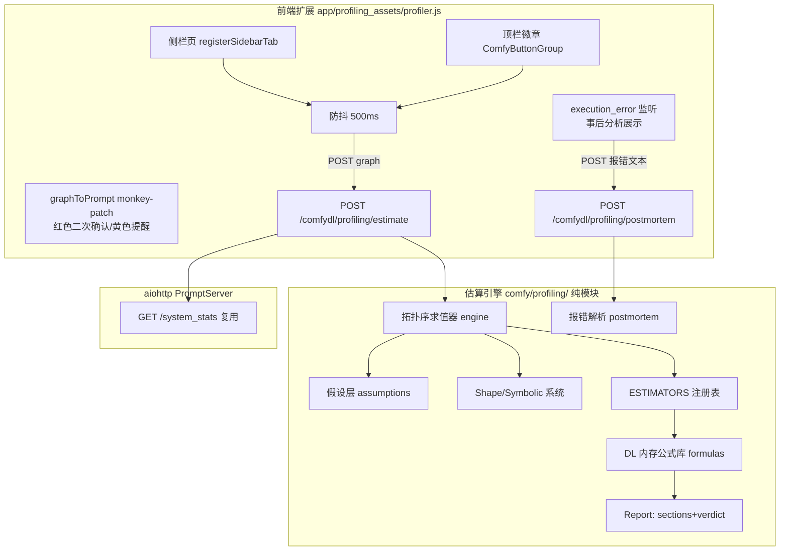

## User Requirements

用户在 ComfyDL_UI（ComfyUI 教学改装版）中新增 **Profiling Tools（M1：Memory Size 内存分析）** 功能。导火索：1MB Tiny Shakespeare 压测中 batch_size=0（全库一批）导致单张量 13.3GB 分配失败而 OOM，整条流水线无任何内存预警。用户已拍板：M1 不做运行时护栏（不动训练节点）、纳入事后分析、红色判定时弹确认框且可强制继续；**必须提供中英双语文案**。

## Product Overview

一个"事前估算 + 事中提醒 + 事后分析"三段式内存分析工具：实时根据当前工作流的参数与数据流，按深度学习内存公式估算峰值内存，与设备预算比对并给出三色判定；OOM 已发生时解析报错定位问题并给出修复建议。

## Core Features

- **实时内存估算**：工作流参数/连线变化后自动重算（防抖），输出峰值内存上界近似 + 置信度 + 依据文本
- **三色判定**：绿（安全）/ 黄（可能 OOM，仅提醒）/ 红（一定 OOM，按 Run 时弹醒目警告，可点"仍然运行"强制继续）
- **Profiling 侧栏页**：设备预算卡（总量/空闲/已用）+ 总估算与判定徽章 + 按节点分解表（形状链、权重/激活/优化器状态分项、估算依据）+ 假设编辑区（文本长度等未知量给默认假设档位、可手动覆盖，明示"基于假设 N tokens"）
- **顶栏内存徽章**：靠近 Run 按钮处常驻显示估算数字与颜色；挂载失败时降级为侧栏/命令入口
- **事后分析（Post-mortem）**：OOM 报错发生后自动捕获，解析"试图分配的字节数"，反推是哪个节点/张量、多大，给出建议参数（如"batch_size=1024 可解"）
- **诚实原则**：未覆盖的节点类型显式标"未知"，不瞎猜、不报错
- **中英双语**：面板、徽章、确认框、事后分析全部文案双语

## Visual Effect

深色原生 ComfyUI 风格面板，跟随现有主题；三色判定徽章醒目（绿/琥珀/红）；内存数字用等宽字体；按节点分解为紧凑表格；红色确认弹窗带醒目警告图标与免责说明。

## Tech Stack Selection

- **估算引擎**：纯 Python 包，放主仓 `comfy/profiling/`（已核实无重名；对齐 `comfy/lm_protocol.py`、`loss_preview.py`、`training_metrics.py` 纯模块先例，零 UI 依赖、零 torch 执行——只做静态公式计算）
- **HTTP API**：aiohttp `PromptServer` 路由（照抄 `app/template_catalog.py` 的注册模式），新建 `app/profiling_routes.py`
- **前端扩展**：原生 JS ES Module（无构建步骤，学 ComfyUI-Manager v3.41 手法），资产放 `app/profiling_assets/`，经自建静态路由分发 + `app/frontend_patch.py` 启动期幂等注入 loader（踩坑 19 铁律：绝不直改 site-packages）
- **测试**：纯 Python 单测 + aiohttp TestServer 真实路由层集成测试（踩坑 21：动态路由必须经路由层测试）；双环境（P 盘 CPU / F 盘 GPU）各跑全量冒烟
- **语言兼容**：不用 Python 3.12+ 语法（F 盘 Py3.12 运行约束）

## Implementation Approach

四层架构：前端扩展（侧栏页 + 顶栏徽章 + Run 拦截 + post-mortem 监听）→ HTTP API（estimate / postmortem）→ 估算引擎（拓扑序抽象求值 + estimator 注册表 + 假设层 + 内存公式库）→ 设备预算（复用 `/system_stats` 与 `model_management` 的 total/free 口径）。

关键决策与理由：

1. **静态图抽象求值而非真实执行**：拓扑序遍历、逐节点跑 estimator、传播符号形状。纯静态分析 <100ms 量级，防抖 500ms 无压力；避免真实分配内存（那正是要预防的事故）。
2. **estimator 注册表 + 显式 unknown**：`ESTIMATORS: dict[node_id, callable(EstimationCtx) -> NodeEstimate]`，未注册节点输出 unknown 而非猜测——信任比覆盖率重要。M1 只覆盖 LM 文本流水线 + spec 链 + 训练节点族（正好覆盖 golden case）。
3. **假设层设计**：文本规模是最大未知量。STRING widget 按 len() 计（token ≈ 字符数/4 或按 vocab 切分），未知量给默认档位 + 面板覆盖 + 报告明示"基于假设 N tokens"。
4. **公式库（上界近似）**：LMTrain 峰值 ≈ 参数 P + 梯度 G + AdamW(m,v=2P) + Σ激活(B×T×E×每层系数) + logits(B×T×V)；attention Q/K/V/O/softmax、FFN 逐层展开。输出置信度与免责说明，M2 再校准。
5. **顶栏徽章**：Manager 官方手法——动态 import `scripts/ui/components/buttonGroup.js` 取 `ComfyButtonGroup/ComfyButton`，插在 `app.menu.settingsGroup.element` 之前；try/catch 降级（挂不上只剩侧栏 + 命令面板）。
6. **Run 二次确认 = monkey-patch `app.graphToPrompt`**（保存原函数 → await → 校验 → 返回；Run 提交必经点，不受 Vue 重构影响）；红色时弹 `extensionManager.dialog.confirm`，三级容错（confirm/toast → catch → 自研 modal）。
7. **i18n**：profiler.js 内嵌 zh/en 字符串字典，按前端当前 locale 切换、默认英文——自包含、不依赖 gen_locales 管线（该生成器只管节点 docstring 口径）。
8. **Post-mortem**：前端 `api.addEventListener("execution_error")`（含 node_id/exception_message）→ POST 报错文本 → 后端正则解析字节数 → 结合当前工作流估算状态归属张量 + 反推建议 batch_size。

## Architecture Design



数据流：图变更 → 防抖 → 序列化 graph → POST estimate → 引擎拓扑求值 → Report（分项内存 + 三色 verdict + 假设标注）→ 徽章/侧栏渲染；Run → graphToPrompt 包装 → 红 verdict → 确认框（可强制）→ 继续/取消；执行 OOM → execution_error → postmortem → 面板展示张量归属 + 建议参数。

## Directory Structure

```
ComfyDL_UI/
├── comfy/
│   └── profiling/                     # [NEW] 估算引擎纯模块包（零 UI 依赖）
│       ├── __init__.py               # 对外入口：estimate_workflow(graph, assumptions) -> Report；导出公共类型
│       ├── shapes.py                 # Shape 系统：dim 为 int 或 Symbolic；形状算术与格式化
│       ├── assumptions.py            # 假设层：默认档位（文本规模等）、用户覆盖合并、"基于假设 N"标注
│       ├── formulas.py               # DL 内存公式库：attention Q/K/V/O/softmax、FFN、logits、AdamW 状态、上界求和
│       ├── estimators.py             # ESTIMATORS 注册表：NLP 族（VocabBuild/Encode/Decode/SlidingWindow）、
│       │                             #   spec 链（Embedding/TransformerBlock）、LM 族（Build/Train/Forward/Generate）、
│       │                             #   TrainingLoop；未注册 → 显式 unknown
│       ├── engine.py                 # 拓扑序抽象求值器：EstimationCtx、符号形状传播、三色 verdict 判定
│       └── postmortem.py             # OOM 报错解析：字节数提取、张量归属反推、建议参数计算
├── app/
│   ├── profiling_routes.py           # [NEW] PromptServer 路由：POST /comfydl/profiling/estimate、
│   │                                 #   POST /comfydl/profiling/postmortem；graph 解析与错误处理
│   ├── profiling_assets/             # [NEW] 前端资产目录
│   │   ├── profiler.js               # 前端扩展：侧栏页/顶栏徽章/graphToPrompt 拦截/事后分析/zh-en 字典
│   │   └── profiler.css              # 面板与徽章样式（跟随 ComfyUI 主题变量）
│   └── frontend_patch.py             # [MODIFY] 追加 loader 注入：按内容标记幂等插入
│                                     #   <script type="module" src="/comfydl/profiling/profiler.js">，
│                                     #   失败不阻塞启动（沿用现有补丁模式）
├── server.py                         # [MODIFY] 挂载 /comfydl/profiling/{path:.*} 静态路由直发
│                                     #   app/profiling_assets/（照 template_catalog 路由注册模式）+ profiling_routes
├── cdl_smoke_tests/
│   └── test_profiling.py             # [NEW] 引擎单测（金样例反推/verdict/unknown/假设覆盖）
│                                     #   + TestServer 路由集成测试（estimate/postmortem 真实路由层）
└── docs/
    └── profiling-m1-memory-estimation.md  # [NEW] 设计文档：架构、公式、假设层、阈值、验收记录
```

另需小改：`docs/branding-and-frontend-patch.md` 增补新注入项说明。**不改任何节点文件**（护栏已排除，无 FUNCTIONS/README 四件套更新）。

## Implementation Notes (Execution Details)

- **金样例 TDD 先行**：estimator 首个验收断言 = golden case 参数（1MB 语料、window=64、vocab=256、d_model=256、2×TransformerBlock、batch_size=0）推出 k_proj 单张量 ≈13.3GB、任一单张量 > free → 红 verdict、反推 B≈202,587。公式与 `nodes_lm.py:593-600` 的 batch_size=0=全库语义、`nodes_nlp.py` stride=1 切窗逐一对齐——estimator 读的是节点输入定义与控件值，不 import 节点模块。
- **性能**：静态分析纯公式无 IO，单次估算 <100ms；前端防抖 500ms；徽章文本更新直接改 DOM，不重建组件。
- **容错（三条降级链）**：顶栏徽章挂载失败 → 只剩侧栏 + registerCommand；dialog.confirm 不可用 → 自研 modal；execution_error 无字节数 → 显示原始报错不解读。所有前端失败路径静默降级，绝不阻断正常工作流执行。
- **Vue 就绪轮询**：扩展 setup() 早于 Vue onMounted，100ms 轮询 extensionManager（上限 30s）再初始化（Manager 同款）。
- **幂等验收**：frontend_patch 注入断言同时验磁盘与被服务副本（`*/served`，踩坑 14）；重启不重复注入。
- **路由测试**：estimate/postmortem 必须经 aiohttp TestServer 真实路由层（踩坑 21），纯函数测试不够。
- **Blast radius**：M1 零节点行为改动、零 chunk 补丁（新 JS 是合法扩展使用者，非打补丁），回滚 = 删文件 + 撤注入项。
- **待核实项（动工第一步）**：registerSidebarTab 的 tab 对象结构、execution_error 事件载荷字段名——从前端包 1.51.9 chunk/类型定义逆向确认（读允许，改禁止）。

## Design Approach

Profiling UI 是 ComfyUI 应用内扩展面板，非独立网页——设计首要原则是**融入原生**：复用 ComfyUI 暗色主题的 CSS 变量与现有侧栏/面板视觉语言（圆角卡片、细边框、半透明面板背景），保证主题切换跟随、不突兀。

### 页面规划（侧栏页单屏，自上而下五块）

1. **设备预算卡**：横向三格（总量/空闲/已用），等宽大数字 + 环形占用指示条
2. **总估算与判定徽章**：当前估算峰值（如 13.67 GB）+ 大号三色 verdict 徽章（绿 SAFE / 琥珀 MAYBE OOM / 红 CERTAIN OOM）+ 置信度与免责小字
3. **假设编辑区**：折叠面板，列出所有假设（文本规模档位等），行内可改数值，标题明示"基于假设：N tokens"
4. **按节点分解表**：紧凑表格——节点名 | 形状链 | 权重/激活/优化器状态分项 | 依据；未知节点灰显标"unknown"；行 hover 高亮
5. **事后分析区**：无 OOM 时隐藏；触发后显示醒目红色卡片——"分配失败：13.3GB @ LanguageModelTrain.k_proj 输出"，下方给建议参数按钮组（如"设 batch_size=1024"）

### 顶栏徽章与确认框

- 徽章：紧凑胶囊（图标 + 彩色数字），靠近设置区，悬停出 tooltip 明细，点击开侧栏页
- 红色确认弹窗：原生 dialog 风格 + 醒目警告图标 + 三色边框，按钮"仍然运行（红）"/"取消"，附免责说明"启发式上界估算，可能误报"
- 黄色提醒：toast 轻提示不打断

### 交互与动效

verdict 变化时徽章颜色平滑过渡（200ms）；估算重算时数字轻微脉冲提示更新；分解表行展开动画。全部微动效克制、不干扰。

## Agent Extensions

### SubAgent

- **code-explorer**
- Purpose: 动工第一步从前端包 `comfyui_frontend_package` 1.51.9（只读，禁止修改）的 chunk 与类型定义中，逆向核实两个未定契约：① `registerSidebarTab` 的 tab 对象完整结构（id/icon/title/view/component 等字段）；② `execution_error` WebSocket 事件载荷字段（node_id/exception_message 等），以及 graphToPrompt 拦截在前端的调用点确认
- Expected outcome: 产出 tab 结构与事件载荷的准确字段清单（附 chunk 来源），使 profiler.js 一次写对、不靠试错