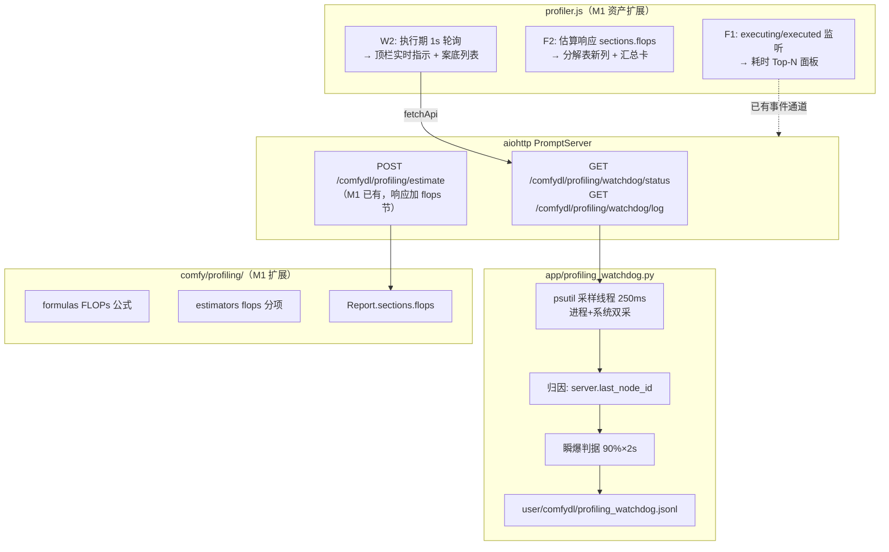

## 用户需求

在已交付的 Profiling M1（内存静态估算）基础上，为 ComfyDL_UI 交付 M2 最小闭环。项目定位已从教学工具转向真实生产与高效调优，用户对算力成本与系统安全提出三类新需求：

1. **逐节点实测耗时**：工作流执行时记录每个节点真实花费的时间，在面板中按耗时排序展示，回答"时间花在哪了"。
2. **静态计算量分解**：在不运行工作流的前提下，按当前参数推算每个节点/每次训练的计算量（FLOPs）及其构成（注意力/前馈/输出投影各占多少），并显示汇总卡。
3. **瞬爆监控（watchdog）**：某些节点会瞬间吃满系统资源（例证：大语料下 Vocab Build 节点瞬间占满整个 CPU，系统卡顿、其他程序无法流畅使用）。需要执行期低开销后台监控，捕获此类事件并记录在案（重启不丢），同时在界面实时显示当前执行节点与 CPU/内存占用，事后可在面板查看完整记录。

## Product Overview

一个"算力账本 + 执行监控"组合工具：静态侧按参数算出计算量分项账单（与 M1 内存账并列展示）；实测侧在每次执行时采集逐节点真实耗时与系统资源占用，捕捉瞬爆事件形成历史案底，为后续（M3）的吞吐校准、MFU、瓶颈归因与具体优化建议积累数据。

## Core Features

- **计算量分解**：估算响应新增计算量部分，分解表新增一列，按注意力/前馈/输出投影等类别分项，含训练总计算量（约为前向 3 倍）与推理口径，配汇总卡与 6ND 经验公式交叉验证
- **耗时 Top-N 面板**：执行结束后展示每节点实测耗时条形排序，缓存命中的节点明确标注，不误导
- **执行中实时指示**：顶栏徽章旁实时显示当前执行节点名 + CPU%/内存%，空闲时隐藏
- **瞬爆事件案底**：CPU 占用超阈值且持续超时长的节点被执行期监控捕获，写入本地记录文件（重启不丢），面板以醒目红色卡片展示：节点、峰值、持续时长、数据规模快照
- **诚实边界**：本批只报计算量与实测事实，不做时间预测、不报吞吐效率（留给 M3 实测校准）；中英双语文案全覆盖

## Tech Stack Selection

全部沿用 M1 既有栈，零新依赖（psutil 已是核心依赖，双环境已装已验证）：

- **F2 引擎**：`comfy/profiling/` 纯 Python 包扩展（formulas/estimators/engine），保持零 torch 执行、零 UI 依赖
- **W2 后端**：新模块 `app/profiling_watchdog.py`（服务层），psutil 采样线程 + `PromptServer.instance.last_node_id` 归因 + jsonl 落盘
- **W1/W3/F3-F5 明确排除**在 M2 外（用户拍板），不建空入口
- **前端**：`app/profiling_assets/profiler.js/css` 原生 JS ES Module 扩展，无新注入项（M1 loader 已注入），fetchApi 走既有 /api 孪生
- **语言兼容**：Python ≤3.12 语法（P 盘 3.14 开发、F 盘 3.12 运行）

## Implementation Approach

**F2（静态 FLOPs）——复用 M1 形状传播，加第二本账**：estimator 已输出 B/T/E/V/H/F 全部符号参数，只需在 formulas.py 增加计算量公式、NodeEstimate 增加 flops 分项（kind：attn/ffn/logits/other）、Report 聚合 `sections.flops`。TDD 先行：金样例手算对照 + 逐层展开与 6ND 经验公式交叉验证（M1 T2 范式）。诚实边界：不推时间、不推吞吐。

**F1（逐节点实测耗时）——纯前端，零后端改造**：`execution.py:496/578` 已有 executing/executed 事件（每节点粒度、含 display_node 与 prompt_id），profiler.js 加监听构建节点时间线；`main.py:420` 的 node:None 标记整图结束。缓存命中的节点 executing/executed 几乎同时——用耗时 < 5ms 判定并标注，避免误导。

**W2（watchdog）——低开销采样 + 现成归因锚点**：

- 采样线程 250ms 一拍：`psutil.Process().cpu_percent()` + `memory_info().rss` + `psutil.cpu_percent()` 系统级——进程级与系统级双采，区分"ComfyUI 进程吃满"与"整机被拖卡"（用户例证的根因定位需要）
- 归因：直接读 `PromptServer.instance.last_node_id`（executing 事件出口处实时维护），零事件管道改造
- 瞬爆判据：进程 CPU% ≥ 阈值 且持续 ≥ 时长（默认单核归一 90% × 2s，Windows 上 psutil 多核归一口径需按核数换算）；事件写入 `user/comfydl/profiling_watchdog.jsonl`（append-only），字段含 data_scale_hint（从最近一次 M1 估算 Report 取该节点规模——引擎与监控的第一次握手）
- 生命周期：随 PromptServer 启动，服务关闭必须 join（防僵尸线程拖累冒烟器/CI）；线程内部全 try/except，异常只记日志绝不外泄
- 实时显示通道选型倾向 **1s 轮询 GET 路由**（不占 WebSocket 通道、实现简单、降级容易），动工第一步结合代码最终确认

**关键决策与理由**：watchdog 放 `app/` 层而非 `comfy/profiling/`——前者是服务侧基础设施，后者保持纯模块先例（引擎不 import UI/服务机制）。

**性能**：采样开销目标 <1% CPU（psutil 单次调用微秒级，250ms 间隔）；前端 F1 仅执行期监听、W2 轮询仅执行期激活（空闲时不轮询）；F2 与 M1 内存估算共用同一次拓扑遍历，不重复求值。

## Architecture Design



数据流：图变更 → 一次拓扑遍历同时产出内存与 FLOPs 两本账 → 面板并列展示；执行开始 → executing/executed 事件构建时间线（F1）+ watchdog 同步采样归因（W2）→ 瞬爆超阈值落盘案底 → 前端轮询实时显示 + 事后列表。

## Directory Structure

```
ComfyDL_UI/
├── comfy/
│   └── profiling/
│       ├── formulas.py             # [MODIFY] 新增 FLOPs 公式：线性 2·B·T·in·out、attention 四投影+scores、
│       │                          #   FFN 两条、logits 投影；训练=3×前向、6ND 交叉验证辅助函数
│       ├── estimators.py          # [MODIFY] 16 类 estimator 输出 flops 分项（kind: attn/ffn/logits/other，
│       │                          #   含 single 值与依据文本）；NLP 族 python_loop 类节点 flops 记 unknown
│       ├── engine.py              # [MODIFY] Report 聚合 sections.flops（总计/最大分项/训练与推理口径）
│       └── shapes.py              # [MODIFY] 如需：值对象携带计算成本类型标注（为 M3 W1 预留，不实现逻辑）
├── app/
│   ├── profiling_watchdog.py      # [NEW] watchdog 核心：ProfilingWatchdog 类（start/stop/snapshot/recent），
│   │                              #   psutil 250ms 采样线程、last_node_id 归因、瞬爆判据（阈值可配、
│   │                              #   多核归一）、jsonl append；线程安全、异常自吞、关闭 join
│   ├── profiling_routes.py       # [MODIFY] 新增 GET watchdog/status（实时快照）与 watchdog/log
│   │                              #   （最近 N 条案底）；沿用 RouteTableDef 逐条声明并挂 self.routes
│   └── profiling_assets/
│       ├── profiler.js            # [MODIFY] F1 executing/executed 时间线 + 耗时面板；F2 分解表新列
│       │                          #   + 汇总卡；W2 执行期轮询 + 顶栏实时指示 + 案底列表；zh/en 字典补齐
│       └── profiler.css           # [MODIFY] 新块样式：耗时条形、计算量卡、实时指示、案底红卡
├── server.py                      # [MODIFY] watchdog 生命周期挂接（构造启动 + 关闭路径 join）
├── cdl_smoke_tests/
│   └── test_profiling_m2.py      # [NEW] F2 单测（金样例手算对照、6ND 交叉验证、unknown 节点口径）
│                                  #   + watchdog 单测（判据/归因/jsonl 读写）+ TestServer 路由集成测试
└── docs/
    └── profiling-m2-compute-and-watchdog.md  # [NEW] 设计文档：公式、判据、字段、降级链、验收清单
```

另：`docs/branding-and-frontend-patch.md` 视情况补一句（无新注入项时仅说明 M2 扩展同一资产）。**不改任何节点文件**（无 FUNCTIONS/README 四件套更新）。

## Key Code Structures

```python
# app/profiling_watchdog.py — 核心新抽象（接口级定义）
class ProfilingWatchdog:
    def __init__(self, server, *, interval_s: float = 0.25,
                 cpu_threshold: float = 90.0, sustain_s: float = 2.0,
                 log_path: str | None = None) -> None: ...
    def start(self) -> None: ...            # 启动守护线程（幂等）
    def stop(self, timeout_s: float = 5.0) -> None: ...  # join，服务关闭路径调用
    def snapshot(self) -> dict: ...          # 实时快照：当前节点/进程CPU%/MEM%/系统CPU%
    def recent(self, limit: int = 50) -> list: ...  # 最近案底（读 jsonl 尾部）
```

```python
# comfy/profiling/formulas.py — FLOPs 公式（签名级）
def lm_forward_flops(batch: int, seq: int, d_model: int, vocab: int,
                     n_layers: int, n_heads: int, d_ffn: int) -> int: ...
def lm_training_flops(**same) -> int: ...    # = 3 × forward（反向 2×）
```

## Implementation Notes (Execution Details)

- **踩坑 25 规程**：watchdog 挂在服务构造层，冒烟器不启动服务——必须真启动 `python main.py` 验证一次（启动日志、采样运行、Ctrl+C 干净退出无僵尸线程），TestServer 集成测试另覆盖路由层
- **psutil API 细节**：`cpu_percent()` 首次调用返回 0（需预热一拍或 interval 参数）；Windows 进程 CPU% 为多核归一口径（100% = 全部核），阈值判定按 `os.cpu_count()` 换算成单核口径，P 盘与 F 盘核数不同需实测适配
- **F1 缓存命中语义**：耗时 < 5ms 的 executing→executed 对标注"缓存命中"，不进 Top-N 排序主榜
- **W2 与 M1 引擎握手**：瞬爆事件的 data_scale_hint 从最近一次 estimate 结果中查该节点规模；查不到则记 null，不阻塞记录
- **降级链**：psutil 导入失败 → watchdog 静默禁用（日志一条，面板显示"监控不可用"）；轮询失败 → 静默重试；jsonl 写失败 → 事件暂存内存环形缓冲并告警一次。任何失败不阻断工作流执行
- **基线不回退**：全量冒烟 290/23/0（313 节点）+ test_profiling.py 37 项，P/F 双环境各跑一遍；P 盘提交后 F 盘 fetch + ff-only 同步（F 盘 git 用单次 `-c safe.directory` 覆盖）
- 未经用户验收不 commit/push；临时文件及时清理；执行期轮询仅执行中激活，空闲页面零额外请求

## 设计方案（M1 Profiling 侧栏的显著扩展）

延续 M1 的"融入原生"原则：复用 ComfyUI 暗色主题 CSS 变量与既有面板视觉语言，全部新块挂在现有 Profiling 侧栏页内，不新增页面或注入项。

### 侧栏页新增/扩展块（自上而下）

1. **计算量汇总卡（F2）**：与内存峰值卡并列的横向卡片，等宽大数字显示总 FLOPs（自动 GFLOPs/TFLOPs 换算），下挂小字构成比（attn/ffn/logits 三色横条）
2. **按节点分解表扩展（F2）**：现有表格新增 FLOPs 列，与内存列并列；unknown 灰显口径不变
3. **耗时 Top-N 面板（F1）**：执行结束后出现的块，横向条形图按耗时降序，条形长度对数映射，缓存命中节点灰显标注；顶部显示总耗时
4. **瞬爆案底区（W2）**：默认隐藏，有记录时显示醒目红色卡片——节点名/类型、峰值 CPU%、持续时长、数据规模快照，按时间倒序
5. **顶栏实时指示（W2）**：徽章右侧微型胶囊，执行中显示当前节点名（截断）+ CPU%/MEM%（CPU 按颜色分档），空闲淡出；与内存徽章共用色彩体系

### 交互与动效

实时指示的 CPU% 数字每秒刷新带 200ms 透明度过渡；耗时条形进场有 300ms 展开动画；案底红卡左侧有警示色描边。全部克制、不干扰画布操作。

## Agent Extensions

### SubAgent

- **code-explorer**
- Purpose: 动工第一步（medium 强度，只读）：①探明 PromptServer 的关闭/清理路径（server.py / main.py 中 watchdog 应挂接 start 与 join 的确切位置，确认有无现成 shutdown hook）；②梳理 `app/profiling_assets/profiler.js`（约 747 行）的内部结构（模块划分、事件监听注册方式、DOM 更新模式、i18n 字典组织），为 M2 扩展定位准确的插入点；③确认前端轮询所需的 fetchApi 用法在 profiler.js 中的现有先例
- Expected outcome: 产出 watchdog 生命周期挂接点的准确行号与代码摘录、profiler.js 结构地图（各功能区起始行），使 M2 扩展一次写对、不破坏 M1 既有行为