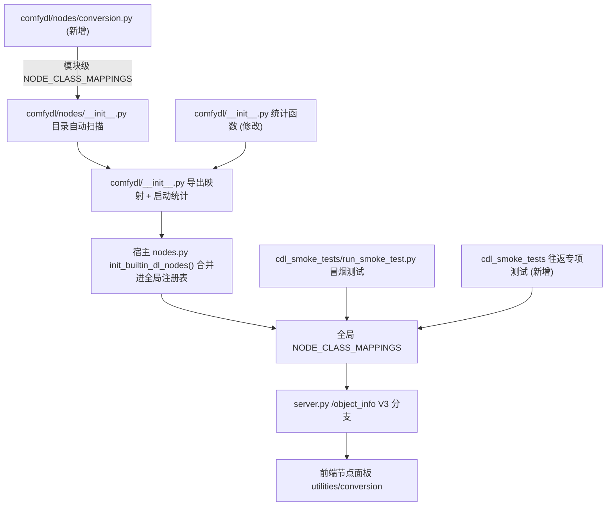

## Product Overview

新增一组「Comfy 语义类型 ↔ 通用张量 TENSOR」的双向转换节点，让 IMAGE / MASK / LATENT / AUDIO / SIGMAS 等携带语义的类型能够进入通用张量运算链路，算完再无损地还原回原类型。节点代码物理上位于 ComfyDL 子模块，但在加载逻辑上作为 Comfy 核心节点注册，分类为 utilities/conversion。

## Core Features

- 通用收集节点：接收 IMAGE / MASK / LATENT / AUDIO / SIGMAS 中任意一种（单一联合输入槽，按接线类型自动判定），输出通用 TENSOR。
- 通用发放节点：接收通用 TENSOR，同时提供 IMAGE / MASK / LATENT / AUDIO / SIGMAS 五个相互独立的具名输出槽，用户连哪根线就得到哪种类型。
- 无损往返元数据：LATENT 保留 noise_mask / batch_index / type；AUDIO 保留 sampler_rate。元数据以「平行槽位」形式与 TENSOR 并列传输，不使用字典打包。
- 张量集合类单独成节点：LORA_MODEL（字典型张量集合）与 LOSS_MAP（损失序列）因结构特殊，各自单独做打包/解包节点对，作为预留能力（当前插件内无产出节点，仅静态可用）。
- 所有转换节点的 widget 默认值开箱可用，无需改动任何参数即可产出有效输出。
- 视觉表现：节点出现在 ComfyUI 节点面板的 utilities/conversion 分类下，显示名为英文的转换语义（如 A → B 风格），带完整 docstring 与搜索别名，槽位类型颜色遵循各类型既有配色。

## Tech Stack

- 语言与运行时：Python 3.14（嵌入式解释器），PyTorch（张量载体），运行环境为宿主 `ComfyDL_UI` 的虚拟环境 `penv\`。
- 节点 API：ComfyUI V3 节点接口 `comfy_api.latest.io`（`io.ComfyNode` + `define_schema` + `io.Schema`）。
- 测试：既有 `cdl_smoke_tests\run_smoke_test.py` 进程内冒烟测试器；新增一个往返专项测试脚本。
- 文档：ComfyDL 的 4 份说明文件（中英双语 README 与 FUNCTIONS），在工作区根另有一份内容相同的独立克隆需要同步。

## Implementation Approach

### 核心架构决策：采用「联合输入 + 具体类型输出槽」，完全不用 MatchType

本轮探查在源码层面核实了三条决定性事实，据此把架构从「B/C 二选一」提升为更强的第三条路：

1. 后端对 MatchType **无条件放行**。`comfy_execution/validation.py` 第 31-34 行原文注释即写明「validation for this is handled by the frontend」。这意味着任何 MatchType 方案在后端拿不到任何错配保护。
2. 后端校验取的是上游**静态** `RETURN_TYPES[槽位]`（`execution.py` 第 934-937 行）。只有**具体类型输出槽**才能进入 `validate_node_input` 的精确匹配；联合类型串只能做集合求交，MatchType 直接短路放行。
3. 用户认为的「输出无连线会被 DAG 剪枝，所以未接锚点不会发生」**不成立**。剪枝判据是「能否反向到达某个 `OUTPUT_NODE=True` 节点」（`execution.py` 第 779-780 行 `execute_outputs` 入队 + `validate_prompt` 第 1163-1165 行收集输出节点），与「锚点是否接线」完全无关。把发放节点输出接到任意预览节点、锚点留空，该节点照样执行，而后端又因 MatchType 放行而不报错 → 形成静默错配。

因此放弃锚点方案，改用官方同类节点的既有范式：`comfy_extras/nodes_number_convert.py` 的 `NumberConvertNode` 用 `io.MultiType.Input("value", [io.Int, io.Float, io.String, io.Boolean])` 做联合输入，输出端全部使用**具体类型槽**（`io.Float.Output` / `io.Int.Output`），零 MatchType，分类同为 `utilities`。这是与本次需求最同构、且经过官方验证的写法。

该架构的健壮性严格优于 B/C：

- 输出槽类型是静态确定的，前端可做物理隔离（每种类型一个槽、各有配色），不存在「连错类型」的路径。
- 同时命中后端 `validate_node_input` 的精确类型校验，获得后端保护（MatchType 拿不到）。
- 不存在锚点状态，用户 q-2 提出的整个问题域自动消失，无需 `required_input_missing` 兜底，也无需依赖本仓库无法验证的前端逻辑。
- 未使用的输出槽返回 None，不会对被连线槽位产生任何影响。

### 节点拆分

| 节点 | 输入 | 输出 |
| --- | --- | --- |
| 通用收集 | 一个联合输入槽，容纳 IMAGE/MASK/LATENT/AUDIO/SIGMAS | TENSOR + 平行元数据槽（origin / noise_mask / batch_index / latent_type / sampler_rate） |
| 通用发放 | TENSOR + 上述平行元数据（全部 optional） | IMAGE、MASK、LATENT、AUDIO、SIGMAS 五个具名具体类型槽 |
| LORA 打包（预留） | LORA_MODEL | TENSOR + keys / shapes / dtypes 元数据槽 |
| LORA 解包（预留） | TENSOR + 上述元数据 | LORA_MODEL |
| LOSS_MAP 打包（预留） | LOSS_MAP | TENSOR + shapes / dtypes 元数据槽 |
| LOSS_MAP 解包（预留） | TENSOR + 上述元数据 | LOSS_MAP |


「能明确单入单出」的五类坐进通用两节点；「特殊结构」的 LORA_MODEL / LOSS_MAP 按用户指示单独做节点对，采用可逆的「flatten + concat、元数据记形状」打包规则，并在 docstring 与说明文件中明确标注为预留/实验性（插件内当前无产出节点，仅静态可用）。

### 元数据平行槽位设计（用户明确选择，不用字典打包）

| 槽位 | 类型 | 语义 | 往返要求 |
| --- | --- | --- | --- |
| origin | `io.String` | 来源类型名（IMAGE/MASK/LATENT/AUDIO/SIGMAS/LORA_MODEL/LOSS_MAP） | 诊断与兜底 |
| noise_mask | `io.Tensor` | LATENT 的噪声掩码 | LATENT 无损往返 |
| batch_index | `io.Array`（Type=list） | LATENT 的批次索引 list[int] | LATENT 无损往返 |
| latent_type | `io.String` | LATENT 的 type 字段（audio / hunyuan3dv2） | LATENT 无损往返 |
| sampler_rate | `io.Int` | AUDIO 的采样率 | AUDIO 无损往返 |


关键约束：源码中 AUDIO 字段名实际拼作 `sampler_rate`（`comfy_api/latest/_io.py` 第 665-670 行 `AudioDict.sampler_rate`），实现与文档必须沿用该拼写，不得改成 `sample_rate`。

发放节点侧这些槽位全部声明为 optional，未连接时不参与还原（例如未接 sampler_rate 时用开箱可用的默认值）。这既满足「精细控制」，又避免强制连线的负担。

### 转换语义与形状策略

- IMAGE / MASK / SIGMAS 三类在 ComfyUI 里本就是 `torch.Tensor`，因此收集与发放方向均为**恒等传递**（只做 `.contiguous()` 与必要的 dtype 规范化），保证往返严格无损。
- LATENT 收集时取 `samples`，其余字段走平行槽位；发放时按「samples + 已连接的元数据字段」重建字典，未连接的字段不出现在结果字典里，从而与原始字典逐键一致。
- AUDIO 收集时取 `waveform`，`sampler_rate` 走平行槽位；发放时重建 `{"waveform": ..., "sampler_rate": ...}`。
- 发放节点对明显不合形状约定的输入做轻量校验并给出可读错误（例如 IMAGE 要求 4 维且最后一维为 1/3/4），但不对 dtype 做破坏性改写。

### 性能与可靠性

- 所有转换均为零拷贝或单次 `contiguous`/`view` 级别操作，复杂度 O(1)（不计张量本身拷贝），不引入额外遍历或中间大张量。
- 平行槽位全部 optional，未连接时直接跳过，不产生多余张量构造。
- 节点内不缓存状态、不写全局变量，满足 ComfyUI 无状态执行与缓存签名要求。
- 预留的 LORA/LOSS_MAP 打包需要一次确定性排序与拼接，复杂度 O(N)，N 为张量个数；解包为 O(N)。要求同批张量 dtype 一致，否则给出明确错误而非静默降级。

### 注册方式（零改动的引用逻辑）

核实结论：在 `comfydl/nodes/` 下新建一个 .py、模块级写 `NODE_CLASS_MAPPINGS = {...}` 即可，其余注册表**无需任何改动**：

- `comfydl/nodes/__init__.py` 第 51-64 行按目录自动扫描所有 .py 并合并模块级 `NODE_CLASS_MAPPINGS`。
- `comfydl/__init__.py` 第 18 行导出该映射；宿主 `nodes.py` 第 722-760 行 `init_builtin_dl_nodes()` 直接 `import comfydl` 并把映射合并进全局 `NODE_CLASS_MAPPINGS`，同时设置 `RELATIVE_PYTHON_MODULE`，并带节点名碰撞检查（因此节点名必须保持 `Cdl` 前缀，避免与核心节点冲突）。
- V3 类自带 legacy 兼容层：`_ComfyNodeBaseInternal.INPUT_TYPES()` 是 `@final` classmethod，由 schema 派生（`comfy_api/latest/_io.py` 第 2178-2183 行），因此 V3 类既能被 legacy 通路识别，也能被 `/object_info` 的 V3 分支（`server.py` 第 754 行 `GET_NODE_INFO_V1()`）正确处理，MultiType 与平行槽位能如实暴露给前端。

## Implementation Notes

- **必须先查文档**：动手前先阅读 `Comfy_CustomNode_Docs_md/` 下相关文档，并以 `ComfyUI_Docs_Work/` 为最高权威；V3 写法、`io.MultiType.Input`、`io.Array` 的可输入性、`io.Schema` 字段语义均以这两处与源码为准。
- **分类属性陷阱（必须处理）**：`comfydl/__init__.py` 第 23-39 行 `_print_startup_info()` 在 import 时立即执行，用 `getattr(cls, "CATEGORY", ...)` 统计分类；而 V3 类的 CATEGORY 由 `GET_SCHEMA()` 内部惰性赋值（`_io.py` 第 2200-2203 行）。若不在统计前触发 schema 解析，新节点会被统计成 Unknown/None，导致启动统计与文档数量口径错误。需先核实 `_CATEGORY`/`CATEGORY` 的赋值机制，再选择「统计时对 V3 类解析 schema」或「类上显式声明分类」的修法。
- **命名**：沿用 `Cdl` 前缀与既有 `"A → B"` 显示名风格（参照 `comfydl/nodes/tensor_basic.py` 的 `"Tensor \u2192 String"`），并补充 `search_aliases`（参照官方 `NumberConvertNode`），覆盖 `to tensor`、`convert`、`cast`、`image to tensor` 等检索词。文档与注释优先英文。
- **默认值开箱可用**：`sampler_rate` 需给典型默认值（44100）且落在 [min, max] 内；`latent_type` 的 STRING 默认值需具备明确语义（建议空串表示「非特殊类型」，该空值本身有明确语义，符合规则例外）。
- **冒烟测试**：`_synthesise()` 已内建 union 支持（`run_smoke_test.py` 第 471-481 行按逗号拆分取第一个可造值的替代），联合输入会自动取 IMAGE 分支的 dummy，因此通用节点理论上可直接 PASS，无需改动冒烟器；仍需实跑确认。若 `io.Array` 等新槽位的 dummy 缺失导致 SKIP，则需在 `_INPUT_OVERRIDES` 中补充 dummy 使其真正执行。
- **盲区补充**：冒烟测试只能命中联合输入的**第一个**分支（IMAGE），MASK/LATENT/AUDIO/SIGMAS 路径与元数据往返都不会被覆盖。必须新增一个往返专项测试，逐类型验证「收集 → 发放」与原始对象逐键一致（LATENT 与 AUDIO 为重点）。
- **回归红线**：改动仅限新增文件与 `comfydl/__init__.py` 的统计函数，不得触碰现有 100+ legacy 节点的任何行为；运行全量冒烟必须零 FAIL。
- **交付面与 git 权限**：`git config --global safe.directory` 当前**仅**配置了 `P:/Dev/ComfyUI_Refs/ComfyDL_UI`，子模块 `ComfyDL_UI/comfydl` 与独立克隆 `ComfyDL` 均会报 dubious ownership。按规则不得擅自修改 git config，执行阶段需先请用户手动补两条 `safe.directory`（或明确授权），再完成子模块提交与父仓库子模块指针同步。
- **临时文件清理**：往返专项测试过程中产生的临时文件必须清理，测试脚本本身作为长期资产保留于 `cdl_smoke_tests\` 并说明用途。

## Architecture Design

本次是纯后端节点层扩展，不引入新架构模式，沿用既有「目录扫描 + 映射合并 + 全局注册表」的 ComfyDL 注册链路。



数据流：上游 Comfy 类型对象进入通用收集节点，经类型判定后张量化；元数据经平行槽位并行传递；下游通用发放节点按被连线的输出槽重建对应类型对象，未连线槽位返回 None。

## Directory Structure

整体为「一个新节点文件 + 一处统计函数修改 + 一个新测试脚本 + 8 份说明文件」，注册表零改动。

```
p:/Dev/ComfyUI_Refs/ComfyDL_UI/           # 宿主仓库（Git 操作根目录，分支 master）
├── comfydl/                               # ComfyDL 子模块工作区
│   ├── __init__.py                        # [MODIFY] 修复 _print_startup_info()：对 V3 类触发 schema 解析或显式声明分类，使 utilities/conversion 正确计入分类统计，节点总数随新增自动更新
│   ├── nodes/
│   │   └── conversion.py                  # [NEW] 本次核心文件。定义 6 个 V3 节点类与模块级 NODE_CLASS_MAPPINGS/NODE_DISPLAY_NAME_MAPPINGS：
│   │                                      #   1) 通用收集：io.MultiType.Input 容纳 IMAGE/MASK/LATENT/AUDIO/SIGMAS，输出 io.Tensor.Output 与 origin/noise_mask/batch_index/latent_type/sampler_rate 平行槽位；LATENT 取 samples、AUDIO 取 waveform，IMAGE/MASK/SIGMAS 恒等传递
│   │                                      #   2) 通用发放：io.Tensor.Input 加全部 optional 元数据输入，输出 io.Image/io.Mask/io.Latent/io.Audio/io.Sigmas 五个具名槽，未连线槽返回 None；LATENT/AUDIO 按已连接元数据重建字典，保持与原始字典逐键一致
│   │                                      #   3) LORA_MODEL 打包/解包（预留）：flatten+concat 为单 TENSOR，keys/shapes/dtypes 走平行 io.Array 槽位，解包时精确还原
│   │                                      #   4) LOSS_MAP 打包/解包（预留）：同上的可逆规则，处理 loss 张量序列
│   │                                      #   统一要求：英文模块 docstring 与逐节点详细 docstring（做什么、入什么、出什么）、search_aliases、category="utilities/conversion"、widget 默认值开箱可用、轻量形状校验与可读错误
│   ├── FUNCTIONS.md                       # [MODIFY] 新增 6 个节点的功能说明条目；更新节点总数与分类数量统计；新增 utilities/conversion 分类表项
│   ├── FUNCTIONS_zh.md                    # [MODIFY] 同上的中文版
│   ├── README.md                          # [MODIFY] 更新节点总览数量、分类清单，补充转换节点的用法示例
│   └── README_zh.md                       # [MODIFY] 同上的中文版
├── cdl_smoke_tests/
│   ├── run_smoke_test.py                  # [MODIFY] 默认无需改动；若新槽位 dummy 缺失导致 SKIP，则在 _VALUE_FACTORIES 或 _INPUT_OVERRIDES 补充，确保新节点 PASS 且全量零 FAIL
│   └── test_conversion_roundtrip.py       # [NEW] 往返专项测试：逐类型构造样例（重点 LATENT 带 noise_mask/batch_index/type、AUDIO 带 sampler_rate），断言「收集 → 发放」与原件逐键/逐值一致，并覆盖 LORA/LOSS 预留节点的还原精度；自建沙箱并及时清理临时文件

p:/Dev/ComfyUI_Refs/ComfyDL/               # 独立克隆（自带 .git，内容与子模块一致，需同步）
├── nodes/conversion.py                    # [NEW] 从 comfydl 同步
├── FUNCTIONS.md / FUNCTIONS_zh.md         # [MODIFY] 从 comfydl 同步
└── README.md / README_zh.md               # [MODIFY] 从 comfydl 同步
```

## Key Code Structures

以下为通用两节点的目标形态示意（示意优先级：schema 结构；具体槽位命名与元数据细节以实现期核实结果为准）。

```python
# 通用发放节点的 schema 形态示意（零 MatchType，输出全为具体类型槽）
class CdlFromTensor(io.ComfyNode):
    @classmethod
    def define_schema(cls) -> io.Schema:
        return io.Schema(
            node_id="CdlFromTensor",
            display_name="Tensor \u2192 Comfy Value",
            category="utilities/conversion",
            search_aliases=["tensor to image", "convert", "cast", "dispatch"],
            inputs=[
                io.Tensor.Input("tensor"),
                io.String.Input("origin", optional=True, default=""),
                io.Tensor.Input("noise_mask", optional=True),
                io.Array.Input("batch_index", optional=True),
                io.String.Input("latent_type", optional=True, default=""),
                io.Int.Input("sampler_rate", optional=True, default=44100, min=1, max=384000, step=1),
            ],
            outputs=[
                io.Image.Output(display_name="IMAGE"),
                io.Mask.Output(display_name="MASK"),
                io.Latent.Output(display_name="LATENT"),
                io.Audio.Output(display_name="AUDIO"),
                io.Sigmas.Output(display_name="SIGMAS"),
            ],
        )

    @classmethod
    def execute(cls, tensor, origin=None, noise_mask=None, batch_index=None,
                latent_type=None, sampler_rate=44100) -> io.NodeOutput:
        # 张量恒等传递，按已连接元数据重建 LATENT / AUDIO 字典，未使用槽位返回 None
        ...
        return io.NodeOutput(image, mask, latent, audio, sigmas)
```

```python
# 通用收集节点的输入形态示意
inputs=[
    io.MultiType.Input("value", [io.Image, io.Mask, io.Latent, io.Audio, io.Sigmas],
                       display_name="value"),
]
# 输出：io.Tensor.Output(display_name="TENSOR") + 平行元数据槽位（origin/noise_mask/batch_index/latent_type/sampler_rate）
```

## Agent Extensions

### SubAgent

- **code-explorer**
- Purpose: 跨文件核实 V3 节点范式与既有约定，确认 `io.MultiType.Input` / `io.Array` / `io.Tensor` 的可用性、`utility/conversion` 目录下官方节点的组织方式、以及 ComfyDL 现有节点的 docstring 与命名风格。
- Expected outcome: 产出一份可直接落地的「槽位类型映射表 + V3 schema 骨架 + 命名与文档模板」，消除实现期的写法猜测。

### Skill

- **lsp-code-analysis**
- Purpose: 做精确符号级导航，定位 `io.MultiType` / `io.MatchType` / `io.Array` 在 `comfy_api/latest/_io.py` 中的定义与全部引用点，并核实 `_ComfyNodeBaseInternal` 的 `CATEGORY` / `GET_SCHEMA` 赋值链，避免仅靠文本搜索导致的误判。
- Expected outcome: 确认槽位类型与 schema 字段的准确签名，并给出 `comfydl/__init__.py` 分类统计退化问题的确定性修法。