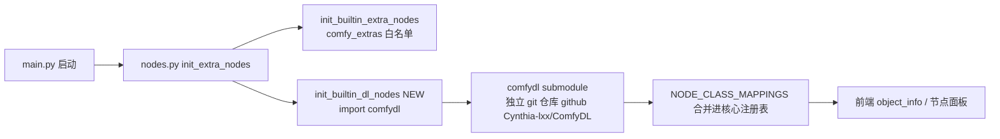

## 需求概述

用户希望完成两件事，且顺序有强约束：

1. **整体提交并推送 ComfyDL_UI（master 分支）**：将脱水任务 1~6 的全部收尾提交推送至 `origin/master`，并打里程碑 tag `v0.2.0-dehydrated` 一并推送（用户已确认采纳）。
2. **将 ComfyDL 迁移为 ComfyDL_UI 的内置模块（实验性尝试）**，满足两条硬性要求：

- 运行形态：ComfyDL 不再作为 `custom_nodes/` 下的第三方插件被扫描加载，而是成为 comfy core 的一部分（由核心节点初始化链注册）；
- 物理形态：保留独立 git 项目结构（git submodule），能在其内部正常开发 ComfyDL 并对 ComfyDL 仓库做独立提交。
- 由于侵入性极大，所有迁移改动必须落在**新实验分支**（`experiment/embed-comfydl`）上并推送远端做备份对比，master 不受影响。

3. **修复先回传**：`custom_nodes/ComfyDL` 安装副本内 2 处未提交修复（`__init__.py` 的 sys.path 修复、`requirements.txt` 补录）先 commit+push 到独立仓库 `github.com/Cynthia-lxx/ComfyDL`，再从该仓库同步迁移基准，保证两处同源。

## 产品概述

- 迁移后 ComfyDL 的 106 个教学节点与 14 个分类仍完整可用，由 ComfyDL_UI 启动时经核心加载链注册（等同内置模块），前端节点面板分组保持不变；
- `comfydl/`（原 ComfyDL checkout）作为 ComfyDL_UI 仓库的 git submodule 被版本控制（`.gitmodules` + gitlink），可在其内部独立开发提交；
- 若 submodule 未初始化，主程序以日志提示 `git submodule update --init` 的方式友好降级，不崩溃。

## 核心功能/验收点

- master 推送成功、tag `v0.2.0-dehydrated` 推送成功；
- ComfyDL 独立仓库收到修复 commit（origin/main 领先）;
- 实验分支创建并推送成功；迁移后 `custom_nodes/ComfyDL` 消失、顶层 `comfydl/` 作为 submodule 就位；
- 启动日志出现 `[ComfyDL] 已注册 … 个节点`，核心 `NODE_CLASS_MAPPINGS` 含 106 个 cdl 前缀节点（与任务 6 基线一致），无 IMPORT FAILED；
- 迁移相关提交全部落在实验分支并推送，master 无迁移改动。

## 技术栈

- 无新语言/框架引入；沿用现有 ComfyUI（Python）运行时与 git 工作流。
- 关键技术机制：**git submodule**（独立仓库纳入主仓库版本控制）＋ **核心节点初始化链改造**（nodes.py 的 `init_extra_nodes` 序列）。
- 冒烟验证沿用 penv 虚拟环境（`P:\Dev\ComfyUI_Refs\ComfyDL_UI\penv\Scripts\python.exe`），嵌入式 Python 3.14 兜底。

## 实施策略

### 背景事实（已核实）

- ComfyDL_UI：origin=`github.com/Cynthia-lxx/ComfyDL_UI.git`，master HEAD `bb7b984`，工作区 clean，ahead 3（`744c25a`/`0e37979`/`bb7b984`），无既有 tag，远端认证可用。
- `custom_nodes/ComfyDL`：独立 git（origin=`github.com/Cynthia-lxx/ComfyDL.git`），main=`3c137ac`，含 2 处未提交修复；工作区根 `P:\Dev\ComfyUI_Refs\ComfyDL` 是同源另一份 checkout（无修复）。
- 加载锚点：`nodes.py:init_extra_nodes()`（726 起）序列 = `init_public_apis()` → `init_builtin_extra_nodes()` → （可选 api）→ `init_external_custom_nodes()`；`load_custom_node`（521）为核心动态加载器。
- ComfyDL 包结构对内置友好：顶层 `__init__.py` 用相对导入 + 自插 sys.path（`_PLUGIN_ROOT`），`nodes/__init__.py` 用 `importlib.import_module(f'.{mod}', package=__package__)` 动态聚合 17 个子模块；因此 `import comfydl` 作为普通顶层包即自洽（仓库根启动时在 sys.path）。

### Phase A — master 收口（先于迁移，全部在 master）

1. 在 `custom_nodes/ComfyDL` 副本的独立 git 中提交 2 处修复并 `push origin main`；
2. `P:\Dev\ComfyUI_Refs\ComfyDL` 另一 checkout `git pull origin main` 同步；
3. ComfyDL_UI：`git pull origin master --rebase`（预期无冲突）→ 打 tag `v0.2.0-dehydrated` → `git push origin master` + `git push origin v0.2.0-dehydrated`。

### Phase B — 实验分支迁移（experiment/embed-comfydl）

1. 从 master 切 `experiment/embed-comfydl` 并 `push -u origin`；
2. 将 `custom_nodes/ComfyDL`（连同其 `.git`）整体移动为仓库根 `comfydl/`，确保内容完整、旧位置清空；
3. 登记 submodule：新建 `.gitmodules`（`path=comfydl`，`url=https://github.com/Cynthia-lxx/ComfyDL.git`），`git add` 后对 `comfydl` 记录 gitlink（sha = 回传后的 ComfyDL main HEAD，保证远端可检出）；此实现保留原 checkout 历史与工作树，无需重新 clone；
4. 核心内置注册：在 `nodes.py` 的初始化链中新增 `init_builtin_dl_nodes()`——尝试 `import comfydl`，成功后把其 `NODE_CLASS_MAPPINGS`/`NODE_DISPLAY_NAME_MAPPINGS` 合并进核心全局注册表，在 `init_extra_nodes` 内 `init_builtin_extra_nodes()` 之前调用；失败时记 warning 并提示 submodule 未初始化（不崩溃）。该函数独立成段、改动面小，前端 object_info 与 CATEGORY 分组自动继承；
5. 冒烟验证（命令可回放）后按语义拆分提交并推送实验分支；
6. 在 `docs/` 新增双语迁移说明（代码注释英文）。

### 性能与可靠性

- `import comfydl` 仅在启动初始化执行一次（torch 等已在进程内），无热路径开销；合并映射为 O(N)（N=106），可忽略；
- submodule 缺失走 try/except 降级并输出可执行提示，避免 clone 后启动即崩；
- 网络操作（push/pull）若在非交互环境遇认证失败，立即停止并输出精确命令交用户手动执行并发回结果；禁止 master force push。

### 风险与回退

- Phase A 远端副作用（ComfyDL 修复 push、ComfyDL_UI master+tag push）为用户明示要求；
- Phase B 全部隔离在实验分支，回退 = 丢弃实验分支，master 不受影响；
- gitlink sha 必须与回传后的 ComfyDL commit 一致（实施前用 `git ls-remote` 校验）。

### 架构（改造后数据流）



注：`custom_nodes` 扫描机制保留但不再承载 ComfyDL；`comfydl` 以 gitlink 记录于主仓库，可独立开发提交。

## 目录结构

```
ComfyDL_UI/                                  # 仓库根
├── .gitmodules            # [NEW] path=comfydl, url=github.com/Cynthia-lxx/ComfyDL.git
├── comfydl/               # [NEW→submodule] 由 custom_nodes/ComfyDL 整体移入（含 .git），
│                          #   独立仓库 main HEAD（回传修复后）；此后内部开发独立提交
├── nodes.py               # [MODIFY] init_extra_nodes 链新增 init_builtin_dl_nodes()
│                          #   import comfydl 并合并 NODE_CLASS_MAPPINGS /
│                          #   NODE_DISPLAY_NAME_MAPPINGS；submodule 缺失时 warning 降级
├── custom_nodes/          # [MODIFY] 删除 ComfyDL 子目录；保留 example_node/websocket_image_save
├── docs/
│   └── comfydl-builtin.md # [NEW] 双语迁移说明：结构、注册机制、submodule 维护与回退方法
├── main.py                # 不动（启动链已覆盖）
├── .gitignore             # 不动（comfydl 在顶层不受 /custom_nodes/ 忽略影响）
└── requirements.txt       # 不动（IPython/matplotlib/matplotlib-inline 已在 master 记录）
独立仓库（ComfyDL 项目，随 .git 进入 comfydl/）
├── __init__.py            # [MODIFY→COMMIT] sys.path 修复（先在安装副本提交回传）
└── requirements.txt       # [MODIFY→COMMIT] 补录 IPython/matplotlib-inline
```

## 关键代码结构（指引性，实现时以精读 nodes.py 为准）

```python
# nodes.py — 新增内置 ComfyDL 注册（与 init_builtin_extra_nodes 同风格）
async def init_builtin_dl_nodes():
    """Load comfydl (d2l teaching nodes) as built-in core nodes.

    comfydl is a git submodule; if missing, degrade gracefully with a hint.
    """
    import_failed = []
    try:
        import comfydl  # top-level package; repo root is on sys.path at startup
    except Exception as e:
        logging.warning("comfydl built-in nodes unavailable (run: git submodule update --init): %s", e)
        return import_failed
    for name, cls in comfydl.NODE_CLASS_MAPPINGS.items():
        NODE_CLASS_MAPPINGS[name] = cls
    for name, display in comfydl.NODE_DISPLAY_NAME_MAPPINGS.items():
        NODE_DISPLAY_NAME_MAPPINGS[name] = display
    return import_failed
# init_extra_nodes() 中在 init_builtin_extra_nodes() 之前 await init_builtin_dl_nodes()
```

## Agent Extensions

### SubAgent

- **code-explorer**
- 用途：迁移实现前对 nodes.py 的全局注册表结构、`load_custom_node` 的 synthetic import 机制、object_info 生成路径及 main.py 启动调用链做精读确认，确保 `init_builtin_dl_nodes` 的实现点与合并方式最小侵入且不破坏既有 custom_nodes/comfy_extras 注册流程。
- 预期产出：确认确切注册锚点与数据流，形成可落地的最小改造清单（改哪个函数、在哪行插入、需要新增哪些 import），避免凭假设改动核心文件。