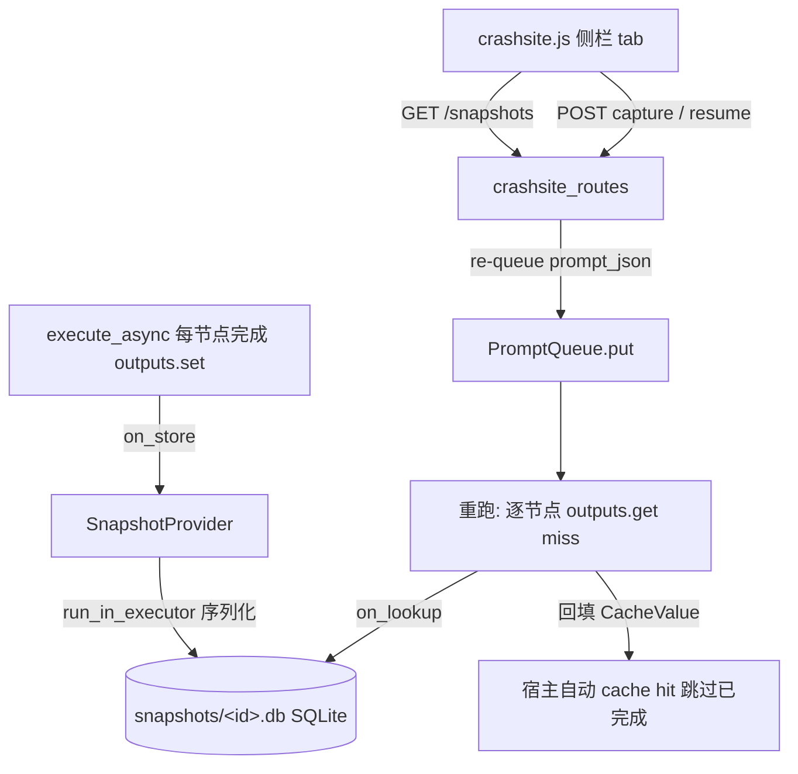

## 产品概述

Crash site M1 核心闭环（大计划 `2026-10-07-crashsite-bigplan.md` 三 Phase 中的第一阶段）：工作流执行现场的自动快照与断点恢复。执行期间每个节点完成后其输出被增量序列化进快照库；用户可通过独立侧栏面板一键"保存现场"或对历史快照执行"恢复"——恢复即服务端重新入队原 prompt，宿主缓存机制（CacheProvider on_lookup 回填）自动跳过已完成节点、仅重算剩余部分。

## 核心功能（M1 scope，bigplan 既定）

- **增量 capture**：CacheProvider.on_store 每节点输出落 SQLite（后台线程池序列化，防卡事件循环）；
- **恢复**：on_lookup 按输入签名 SHA256 从库回填 CacheValue，宿主自动 cache hit 跳过已完成节点；
- **端点**：快照列表 / 手动 capture / 服务端 re-queue 恢复；
- **最小 UI**：独立侧栏 tab（快照列表 + 保存现场 + 恢复按钮，宿主变量取色，en/zh）；
- **诚实边界**：MODEL 类拒收、cdlDataloader 标注不可救、NONE cache 模式不支持、subgraph 内部节点不覆盖（M1 降级为 expand 节点输出）。

## 技术栈

- 后端：Python 3.14 / aiohttp 路由（RouteTableDef + server.py 逐条重声明范式）/ 标准库 sqlite3（不走 SQLAlchemy）/ safetensors.torch.save|load bytes 往返（`comfy/training_protocol.py:949` 先例）/ torch.load(weights_only=True, map_location="cpu")
- 前端：原生 JS + CSS 宿主补丁层资产（零构建，frontend_patch 注入先例）
- 测试：cdl_smoke_tests check 范式 + aiohttp TestServer（client_max_size=100MB，坑 23）+ 真启动验证（坑 25）

## 架构（ADR 已定，见 bigplan）



## 关键实现决策

1. **SnapshotProvider**（`app/crashsite/provider.py`）：继承 `comfy_api.latest._caching.CacheProvider`；on_store 经 `asyncio.get_running_loop().run_in_executor` 丢线程池序列化写库（on_store 本身经 asyncio.create_task 调度，绝不能同步做 GB 级序列化）；on_lookup 同样线程池读 BLOB 反序列化。主键 = cache_key_hash（输入签名），prompt_id 仅元数据。
2. **序列化层**（`app/crashsite/serialize.py`）：按 bigplan §3 类型映射——tensor/LATENT/IMAGE/MASK/TENSOR/SIGMAS→safetensors（GPU 张量先 .detach().cpu().clone()）；AUDIO 双键名兼容；CONDITIONING 展平+JSON sidecar；CdlDataset 按字段拆分；MODEL(ModelPatcher) 抛不可救标记（should_cache 阶段拒收）；cdlDataloader 标记不可救；标量→JSON。
3. **should_cache 门控**：检查 value.outputs 对象类型——ModelPatcher 返回 False（不进库）；`_estimate_value_size` 现成函数做体积记录。
4. **快照库**（`app/crashsite/store.py`）：std sqlite3，每快照一个 .db 落 `user/comfydl/snapshots/`；schema = snapshots(id, created_at, prompt_id, prompt_json, note, status) + node_outputs(snapshot_id, node_id, slot, output_type, format, size_bytes, sha256, data BLOB) + meta；PRAGMA page_size=64K/WAL。
5. **注册与端点**：server.py L283 区（profiling_watchdog 同段）register_cache_provider + set 快照库根；`app/crashsite/routes.py`：GET /comfydl/crashsite/snapshots（列表+体积）、POST /capture（空闲时全量收割当前 cache）、POST /resume（读库 prompt_json → PromptQueue.put 复用原 prompt_id）；RouteTableDef + server.py 逐条重声明（/api 孪生自动）。
6. **前端**（`app/crashsite_assets/`）：新 crashsite.js/css，registerSidebarTab(id "comfydl-crashsite")，快照卡片列表（时间/prompt 摘要/节点数/体积/恢复按钮）+ 运行中"保存现场"按钮；frontend_patch 注入仿 _patch_profiling_loader；i18n en/zh；不受 profiling master switch 影响（ADR-1）。

## 目录结构

```
ComfyDL_UI/
├── app/crashsite/
│   ├── __init__.py            # [NEW] 包入口
│   ├── provider.py            # [NEW] SnapshotProvider（on_store/on_lookup/should_cache/on_prompt_*）
│   ├── serialize.py           # [NEW] 类型→格式映射与往返（safetensors/JSON/torch.save）
│   ├── store.py               # [NEW] SQLite 快照库封装（schema/CRUD/体积统计）
│   └── routes.py              # [NEW] GET snapshots / POST capture / POST resume
├── app/crashsite_assets/
│   ├── crashsite.js           # [NEW] 侧栏 tab 最小 UI（列表/保存/恢复）+ i18n en/zh
│   └── crashsite.css          # [NEW] 面板样式（宿主变量取色，沿用 profiler 面板范式）
├── server.py                  # [MODIFY] provider 注册 + 路由合并（L283 区）
├── app/frontend_patch.py      # [MODIFY] crashsite 资产注入（仿 profiling loader）
├── cdl_smoke_tests/test_crashsite.py  # [NEW] 单元（序列化往返/门控/库）+ 集成（TestServer 端点）+ 恢复链路（spike 断言转正）
└── docs/crashsite.md          # [NEW] 功能文档（范围/诚实边界/使用方法）
```

## 执行守则

- 计划开头前置阅读：行号现状核对（server.py L283 区、execution.py PromptQueue.put、frontend_patch 注入函数、frontend_management 资产服务）；
- 结尾：memory 写入（2026-10-07.md 新节 + MEMORY.md 索引）+ 提交推送 + F 盘同步（fetch + reset --hard + submodule update）；
- 铁律：commit 前 git rev-list --count（当前 101，无庆典节点）；临时文件即用即删；改动只落 ComfyDL_UI；真启动验证 EXIT=0；全程 CRAFT 逐项推进。

# Agent Extensions

<extensions>

## Agent Extensions

### SubAgent

- **code-explorer**
- Purpose: M1 前置阅读——核对 server.py L283 区现状、PromptQueue.put 签名、frontend_patch 的 profiling loader 注入函数与资产服务方式、profiler.js sidebar tab 挂点行号（防行号漂移误改）。
- Expected outcome: 精确行号/函数签名核对表，供实施直接引用。