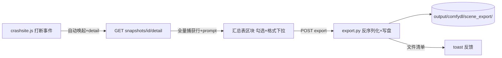

## Product Overview

为 ComfyDL Crash site 补齐 git-fire M2"现场导出"能力：打断/失败后，事故现场面板顶部出现"现场导出"汇总表，列出该快照中所有可救援的节点输出与 workflow JSON，用户逐行勾选、按需覆盖导出格式，一键把选定内容写到 `output/comfydl/scene_export/<快照id>/`，文件自动进入 Results assets 生态。

## Core Features

- **汇总表区块**：面板顶部新增"现场导出"区块，针对最近一个 interrupted/completed 快照，逐行列出捕获的节点输出（class_type #node_id · 槽位数 · 体积）+ workflow prompt JSON 一行，默认全部勾选
- **格式选择**：每行按数据类型预选最合理的默认格式，下拉可覆盖——张量/结构容器→.safetensors（候选 .pt）；标量→.json（候选 .txt）；CdlDataset→.db（候选 .safetensors）；state_dict→.pt（候选 .safetensors）；序列化失败的行禁用导出
- **导出执行**：新端点反序列化所选输出并按目标格式写盘，prompt JSON 勾选时写为 `prompt.json`；返回导出文件清单，前端 toast 展示目标目录
- **自动唤起**：打断/失败后 toast 提示并自动打开侧栏面板定位到汇总表，不打断画布操作
- 双语（en/zh）、沿用 cs-* 样式族与 host CSS 变量

## 边界

- 不改变 M1/M2 恢复语义；导出是只读操作，不修改快照库
- 输出为"反序列化对象→目标格式文件"，不做中途新格式发明（.db 指含 blob+meta 的 sqlite 载体）
- 训练节点内 checkpoint 续跑（M3）不在本计划内

## Tech Stack

- 后端：Python 3.14（兼容 3.12 语法），sqlite3 / safetensors / torch（既有依赖），aiohttp RouteTableDef
- 前端：原生 JS/CSS 扩展（crashsite.js 既有模式，en/zh I18N，host CSS 变量）
- 测试：cdl_smoke_tests/test_crashsite.py（aiohttp TestServer + 沙箱）

## Implementation Approach

### 关键决策

1. **导出目标根用 `folder_paths.get_output_directory()`**：已核实 `run_smoke_test._bootstrap` 通过 `--output-directory` + chdir 把 output 指进沙箱，测试天然隔离，无需额外 monkeypatch；写盘路径 `output/comfydl/scene_export/<snapshot_id>/`，文件名 `{class_type}_{node_id}_s{slot}.{ext}`，统一过 `store.os_path_safe` 防穿越
2. **新端点自动获得 /api 孪生**：已核实 server.py 对 `crashsite_routes.routes` 逐条 merge（277-281 行），新增路由零 server.py 改动
3. **导出实现独立成 `app/crashsite/export.py`**：格式映射表 + 反序列化落盘，不塞进 routes（SoC）；大 BLOB 的反序列化与写盘走 `run_in_executor`（照 provider.py 既有模式，GB 级负载不阻塞事件循环）
4. **汇总表数据走新的 detail 端点**：`list_snapshots` 的 captured 截断 20 条不够渲染汇总表；GET detail 返回 manifest + 全量捕获行（node_id/slot/class_type/format/size_bytes）+ prompt JSON，一次请求渲染整表
5. **格式映射以 serialize.py 的 format tag 为唯一事实源**：st/dict-st/list-st→safetensors(.pt)；json→json(.txt)；dataset-st→db(.safetensors)；pt/pickle→pt(.safetensors)；failed→禁用

### 性能与可靠性

- 反序列化在 executor 线程执行；导出是低频操作，O(选中行数) 次 sqlite 读取，无瓶颈
- 单行导出失败不影响其余行：逐行 try/except，失败行在响应中标注原因（courtesy 规则）
- 同名快照重复导出：目录已存在时覆盖写（幂等），不追加序号

### 架构



## Directory Structure

```
ComfyDL_UI/
├── app/crashsite/export.py            # [NEW] 格式映射表 + 反序列化落盘（executor 线程、逐行容错、路径净化）
├── app/crashsite/store.py             # [MODIFY] 新增 snapshot_detail()（manifest+全量捕获行）
├── app/crashsite/routes.py            # [MODIFY] GET /comfydl/crashsite/snapshots/{id}/detail、POST /comfydl/crashsite/export
├── app/crashsite_assets/crashsite.js  # [MODIFY] 汇总表区块渲染/勾选/格式下拉/导出按钮；打断后 toast+自动开侧栏；双语
├── app/crashsite_assets/crashsite.css # [MODIFY] 汇总表行/复选框/下拉样式（cs-* 族）
├── cdl_smoke_tests/test_crashsite.py  # [MODIFY] detail/export 端点断言（落盘内容、格式覆盖、404/400、failed 行禁用）
└── docs/crashsite.md                  # [MODIFY] 现场导出章节
```