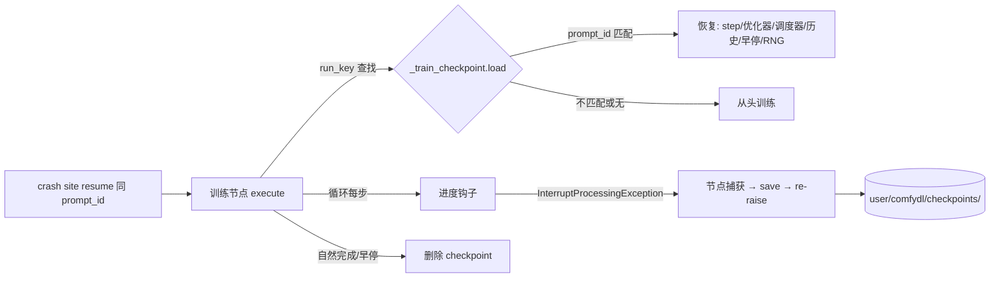

## 产品概述

crash site M3：训练节点断点续训。用户打断一个长时间训练（如 10000 步 regression train）后点击 Resume，训练节点从断点步继续，而不是从头重跑——补齐 git-fire 故事线最后一块"只有断点、没有继续"的拼图。

## 核心特性

- **打断即存档**：训练节点循环内的打断异常（InterruptProcessingException 经进度钩子从节点栈内抛出）被节点捕获，在 re-raise 前把完整训练状态原子落盘：模型 state_dict、优化器、调度器、loss 历史、早停状态（best_state/best_len/stopped_at/耐心计数器）、RNG 状态
- **resume 自动续跑**：crash site resume 复用原 prompt_id；节点重执行时发现 checkpoint 的 prompt_id 与当前一致 → 从断点步继续，最终 loss_history 与不间断训练等长且前缀连续
- **新 Run 自动弃用**：新 Run 是新 prompt_id，节点发现 checkpoint 来源不一致 → 删除存档、从头训练（用户不会意外"接着旧进度练"）
- **完成即清理**：训练自然完成（含早停）后删除 checkpoint 文件，不残留垃圾
- **优雅降级**：裸执行（冒烟单测直调 execute、无宿主上下文）时 checkpoint 功能整体不启用
- **覆盖三个训练节点**：Regression Train、Training Loop、Language Model Train（结构同构，共享同一助手模块）
- 续跑时进度条从断点步起步（进度可见），loss 曲线保持完整连续

## 边界

- 仅对 InterruptProcessingException 存档；节点自身报错（如 NaN 崩溃）不存档——resume 重放确定性错误没有意义
- 硬崩溃（进程被杀）不在保护范围（与惰性捕获同一取舍）
- checkpoint 存放 `user/comfydl/checkpoints/`，与快照库同目录约定

## 技术栈

- 后端：Python 3.14（兼容 3.12 语法），torch（state_dict/RNG state）、hashlib（run_key）、folder_paths（user 目录）、comfy_execution.utils.get_executing_context
- 测试：cdl_smoke_tests 框架（沙箱 + 真执行器 + 全局 progress hook 注入，L1/L2 与 test_progress_reporting.py 已有先例）

## 实现方案

### 关键决策

1. **身份判据 = run_key + prompt_id 双钥匙**：run_key = sha256(widget 值 + 输入张量字节摘要 + node_id)，定位 checkpoint 文件；prompt_id（经 `comfy_execution.utils.get_executing_context()` 在节点内获取，裸执行为 None）判定续跑/弃用——crash site resume 复用原 prompt_id，新 Run 是新 prompt_id，语义天然区分，无需额外开关 widget
2. **存档时机 = 仅打断瞬间**：打断异常从进度钩子抛出、恰好穿过训练循环栈帧，节点 try/except 捕获后保存再 re-raise——状态最精确（正停在断点步），且无需周期性落盘（硬崩溃本就不在保护范围，与惰性捕获取舍一致）；周期存档与 widget 开关均不做（YAGNI）
3. **共享助手 `comfydl/nodes/_train_checkpoint.py`**：只管存储与身份（run_key 计算、原子写 tmp+os.replace、加载校验、过期清理），节点自组状态载荷（dict of state_dict + 杂项）——三个训练节点结构同构但状态字段各异，助手不感知业务
4. **性能边界**：run_key 对输入张量做字节级摘要（输入几 MB 级时毫秒级，仅节点启动一次）；checkpoint 载荷与模型体积同量级，torch.save 一次、打断时才发生，不碰热路径
5. **完成清理 + 卫生**：自然完成/早停删除 checkpoint；每次保存时顺带清理 mtime 超期（7 天）的孤儿存档

### 架构

## 实现要点

- `_train_checkpoint.py`：`current_prompt_id()`（get_executing_context，None 即禁用）、`run_key(parts)`（canonical json + 张量 bytes 摘要）、`load(run_key, prompt_id)`（不匹配即删除返回 None）、`save()`（tmp+replace 原子写 + 7 天孤儿清扫）、`discard()`
- 三节点接入模式一致：execute 开头算 run_key → load 判定续跑（恢复 start_step 与全部状态）→ 训练循环 try/except InterruptProcessingException（保存当前状态后 re-raise）→ 完成后 discard；进度条 update_absolute 的 done 值从 start_step 起算
- Regression Train 特有：shuffle_gen（本地 torch.Generator）状态入载荷；早停四件套（stopper 计数器、best_state、best_len、stopped_at）入载荷
- 测试核心手段：`comfy_execution.utils.CurrentNodeContext` 构造伪执行上下文（裸执行可测）；全局 progress hook 计数并在第 k 步抛 InterruptProcessingException（真打断模拟）；真执行器 E2E 走 test_crashsite L1/L2 模式（同 prompt_id 二次 execute 验证续跑）