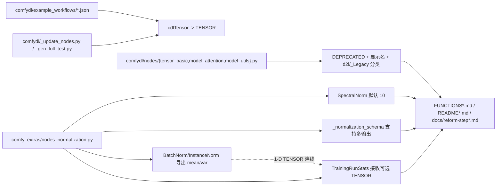

## Product Overview

本轮是 ComfyDL 节点库的"收尾 + 打磨"迭代：把早期教学节点与新建核心节点之间的重复项做**软归档**，修好示例工作流里已失效的旧类型连线，并让光谱归一化与归一化系列的默认值/输出更符合实际使用。同时把"Show Heatmaps 升级"的既定决策落盘，作为下一轮的施工图。

## Core Features

### 1. d2l 重叠节点软归档

对与核心节点能力重叠的 7 个教学节点做**软归档**：节点保留可用、位置与显示名明确标注为弃用、统一归入 Legacy 分类并指向替代核心节点。旧工作流（含 All-Nodes Demo）不因归档而断链或报错，节点总数保持不变。

### 2. 示例工作流旧类型连线修复

修复示例工作流中仍引用旧张量类型名的连线，使这些工作流在节点类型统一后能正常加载与运行；同时修正工作流生成脚本，避免后续重新生成时又写回旧类型名。

### 3. 光谱归一化默认值调整

光谱归一化节点的幂迭代次数默认值由 1 提升到 10，新建节点开箱即得到更接近真实谱范数的结果；区间与可调性不变，已保存工作流中显式记录过的数值不受影响。

### 4. 归一化导出本次批统计量

批归一化与实例归一化节点在原有"归一化结果"之外，额外输出**本次调用实际使用的逐通道统计量（均值/方差）**，可一键连线喂给"Training Run Stats"节点；后者新增可选统计量输入，有连线时以连线数值为准、未连线时保持原有手工填写方式，输出名与数量不变。

### 5. 热力图决策落盘（下一轮）

本轮不实现 Show Heatmaps 升级，仅把已拍板的结论（3D 采用半透明玻璃立方体、真 3D 另设节点并按 1/2/3 维分别呈现、抽样上限默认 262144 且 0 为不抽样逃生口、错误策略默认退化为前 n 轴）持久化存档，防止上下文丢失。

## Visual Effect

归档节点在节点库中带明确的"已弃用"标识并集中出现在 Legacy 分类下；其余改动不改变任何画布内节点的外观与连线形态。

## Tech Stack

- 语言/运行时：Python（ComfyUI 自定义节点，V1 与 V3 两套节点 API 并存）
- 计算库：PyTorch（`torch.nn.functional`），可视化沿用 matplotlib
- **不新增任何依赖**（遵循仓库 AGENTS.md「Prefer fewer dependencies」）
- 测试：既有 `ComfyDL_UI/cdl_smoke_tests/`（pytest 风格脚本）

## 现状与改动目标（均已实读核实）

### 目标 1：d2l 重叠节点软归档

范围以仓库自身的历史决策记录为准（`docs/reform-step1-activation-tensor.md:188-197`、`docs/reform-step2-network-layers.md:112-121`、`docs/reform-step3-normalization.md:266-270` 的重叠表），共 7 个：

| 节点 | 位置 | 已存在的核心等价能力 |
| --- | --- | --- |
| `CdlActivation` | `comfydl/nodes/tensor_basic.py:307` | 14 个核心激活节点 |
| `CdlReshape` | `comfydl/nodes/tensor_basic.py:264` | `BasicReshape` |
| `CdlBroadcast` | `comfydl/nodes/tensor_basic.py:221` | `BasicBroadcast` |
| `CdlAddNorm` | `comfydl/nodes/model_attention.py:228` | `NormalizationLayerNorm` + 核心 Add 组合 |
| `CdlTransformerEncoderBlock` | `comfydl/nodes/model_attention.py:263` | 由核心层组合 |
| `CdlTransformerEncoder` | `comfydl/nodes/model_attention.py:309` | 由核心层组合 |
| `CdlModelMode` | `comfydl/nodes/model_utils.py:71` | `TrainingMode`（作用于 TENSOR 图） |


**机制（沿用上游既有约定，不发明新标记）**：

- 已核实 `server.py:783` 对 V1 节点读取 `getattr(obj_class, "DEPRECATED", False)` 并下发 `info['deprecated']` → ComfyDL 的 V1 节点可直接加 **`DEPRECATED = True`** 类属性。
- 显示名后缀 `(DEPRECATED)` 是上游同一约定（`comfy_extras/nodes_dataset.py:944` 等），改 `NODE_DISPLAY_NAME_MAPPINGS` 即可。
- 分类改为 `"d2l/_Legacy/<原子分类>"`（如 `d2l/Tensor Basic` → `d2l/_Legacy/Tensor Basic`），`NODE_CLASS_MAPPINGS` 的 **key（节点 id）不改** → 旧工作流仍可加载运行，`[ComfyDL] Loaded N nodes.` 计数不变。
- 每个被归档节点的 docstring 顶部补一行"已弃用 + 请改用哪个核心节点"。
- **需在文档中如实说明的例外**：`CdlModelMode` / `CdlAddNorm` / `CdlTransformerEncoder*` 按 `reform-step3` 的记载是"载体不同（操作 `cdlModel` 而非 TENSOR）"而非严格重复，本次按用户决定一并软归档，文档需注明"若仍需 `cdlModel` 级 train/eval 切换或模块内 AddNorm，可继续使用（功能未变）"。此为可回退决策，若用户不同意可在计划确认阶段否决这三项。
- 复核项：`CdlDense*` 经全仓搜索**不存在**（最接近的 `CdlLinReg` 是线性回归训练节点，语义不同）；`CdlConv2d` / `CdlReshape` 之外是否还有核心等价物，由 recon 步骤以核心节点清单为准复核，无等价物则不动。

### 目标 2：示例工作流旧类型连线修复

`cdlTensor` 是已在 `comfydl/nodes/__init__.py:31` 变成 `TENSOR` 别名的历史类型名，但示例 JSON 里仍以旧字符串保存连线类型：

| 文件 | `"cdlTensor"` 处数 |
| --- | --- |
| `comfydl/example_workflows/ComfyDL All-Nodes Demo.json` | 126 |
| `.../Object Detection Utilities.json` | 23 |
| `.../Linear Regression Demo.json` | 22 |
| `.../LeNet Inference Demo.json` | 9 |
| `.../Kaggle-Style Data Pipeline.json` | 6 |
| `.../_archived/nlp_vocab_pipeline.json` | 3 |
| `.../_archived/bbox_conversion_pipeline.json` | 7 |


做法：**仅替换 JSON 中作为类型名出现的 `"cdlTensor"` → `"TENSOR"`（同理 `"cdlBbox"` → `"BBOX"`）**，不动节点 id、连线 id、widget 值；替换后用 `json.loads` 逐个校验语法。同步修正 `comfydl/example_workflows/_gen_full_test.py`（生成时不再写旧类型名），并把该规则追加进 `comfydl/_update_nodes.py` 的 `replacements` 列表——该脚本在注释里自称"可重放的迁移记录"，是同类替换的既有落点。历史文档（`docs/reform-step1-activation-tensor.md` 等）中叙述性的 `cdlTensor` 保持原样，不做全局替换。

### 目标 3：SpectralNorm 默认值

文件：`ComfyDL_UI/comfy_extras/nodes_normalization.py`

- `NormalizationSpectralNorm.define_schema`：`io.Int.Input("n_power_iterations", default=1 → 10, min=0, max=20, step=1)`（846-849 行）
- `execute` 签名默认值：`n_power_iterations: int = 1 → 10`（883 行）
- docstring 第 823-824 行"1 already gives a usable estimate…"改写为以 10 为默认的说明
- 成本：每次调用多 9 轮 `matrix @ v` / `matrix.mT @ u`（O(mn) 级矩阵向量乘），对教学规模权重可忽略；换来更接近真实谱范数。区间 `0..20` 不变，10 在区间内。
- 兼容性：仅"新建节点"的默认档位变化，工作流中已保存的显式 widget 数值不受影响。

### 目标 4：归一化导出本批统计量

同一文件，四处协同改动：

**(a) `_normalization_schema(...)`（247-277 行）增加输出参数**
当前硬编码 `outputs=[io.Tensor.Output(display_name="output")]`，5 个归一化节点共用。增加一个默认参数，让 BatchNorm/InstanceNorm 传 3 个输出、其余 3 个节点（LayerNorm/GroupNorm/RMSNorm）行为完全不变。

**(b) `NormalizationBatchNorm.execute`（437-458 行）**

- 统一归约维：`dims = (0,) + tuple(range(2, tensor.dim()))`，rank<2 时退化为全归约标量，保证"输出恒可用"
- train 分支：先自行算一次 `mean = tensor.mean(dim=dims)`、`var = tensor.var(dim=dims, unbiased=False)`（biased，与 `F.batch_norm` 内部口径一致），再调 `F.batch_norm(tensor, mean, var, weight, bias, training=False, eps=eps)` —— 用同一份统计量出结果，**单次归约、不写 running stats**，替代现有 `training=True` 调用
- eval 分支：沿用已广播的 running 统计量作为导出值，语义统一为"本次归一化实际使用的统计量"
- rank<2 早退分支同样返回该标量统计量，避免下游断流
- 返回 `io.NodeOutput(output, mean, var)`

**(c) `NormalizationInstanceNorm.execute`（461 行起）**
输出仍走 `F.instance_norm`；额外导出与 BatchNorm **同口径**的逐通道统计量（总方差分解，使导出量能直接进 eval 槽）：

- `gm = tensor.mean(dim=spatial)` → `(N, C)`，`gv = tensor.var(dim=spatial, unbiased=False)` → `(N, C)`
- `mean = gm.mean(dim=0)` → `(C,)`
- `var = gv.mean(dim=0) + gm.var(dim=0, unbiased=False)` → `(C,)`（组内方差均值 + 组间均值方差）

**(d) `TrainingRunStats`（320-371 行）**
新增两个可选 `io.Tensor.Input("mean" / "var", optional=True)`；有连线时以连线张量（flatten 成 1-D）为输出，未连线时保持现有字符串解析路径（含解析失败回退与告警）。输出名 `running_mean` / `running_var` 与数量不变，现有连线不受影响。

**(e) 过时说明文字必须同步**（否则文档自相矛盾）

- 模块头 37-40 行"Running statistics are numbers, not tensors…"
- 325-328 行"today you read them off the tensors yourself; the normalization nodes do not export them yet"（改完后此说法不成立）
- 385-388 行"To carry statistics from one run into the next one, feed their values into a Training Run Stats node…"

**性能与兼容性**：BatchNorm 把"框架内部一次归约 + 导出再算一次"压成一次归约；InstanceNorm 增加一次与归一化同阶的 `(N,C,spatial)` 归约，可忽略。新增输出为**追加式**（索引不变），旧工作流仍可加载。符合 AGENTS.md「Keep node changes backward compatible by default」。

## Architecture Design

本轮不引入任何新架构模式，全部改动落在既有分层内：

- **核心层**：`comfy_extras/nodes_normalization.py`（V3 `io.ComfyNode`）——归一化/Training 家族，唯一改 schema/execute 的文件
- **教学层**：`comfydl/nodes/*.py`（V1 `INPUT_TYPES` + `NODE_CLASS_MAPPINGS`）——仅加弃用标记与分类，由 `comfydl/nodes/__init__.py` 动态聚合注册（51-64 行）
- **资产层**：`comfydl/example_workflows/*.json` + 生成/迁移脚本
- **文档层**：`comfydl/FUNCTIONS*.md`、`README*.md`、`docs/reform-step*.md`



## Directory Structure

```
p:/Dev/ComfyUI_Refs/
├── ComfyDL_UI/
│   ├── comfy_extras/
│   │   └── nodes_normalization.py      # [MODIFY] SpectralNorm 默认值 1→10；_normalization_schema 增加 outputs 参数；
│   │                                   #   BatchNorm/InstanceNorm 追加 mean/var 输出（train 复用同一份统计量、eval 回显所用统计量）；
│   │                                   #   TrainingRunStats 增加可选 TENSOR 输入；同步三处过时 docstring
│   ├── comfydl/
│   │   ├── nodes/
│   │   │   ├── tensor_basic.py         # [MODIFY] CdlBroadcast/CdlReshape/CdlActivation 加 DEPRECATED、显示名后缀、
│   │   │   │                           #   CATEGORY → "d2l/_Legacy/Tensor Basic"、docstring 指向核心替代节点
│   │   │   ├── model_attention.py      # [MODIFY] CdlAddNorm/CdlTransformerEncoderBlock/CdlTransformerEncoder 同上处理
│   │   │   ├── model_utils.py          # [MODIFY] CdlModelMode 同上处理（指向 TrainingMode）
│   │   │   └── __init__.py             # [MODIFY] 顶部分类注释同步（d2lcore→d2l，补 _Legacy 说明）；不改注册逻辑
│   │   ├── _update_nodes.py            # [MODIFY] replacements 追加 ('"cdlTensor"','"TENSOR"') / ('"cdlBbox"','"BBOX"')
│   │   ├── example_workflows/
│   │   │   ├── ComfyDL All-Nodes Demo.json      # [MODIFY] 126 处类型名替换
│   │   │   ├── Object Detection Utilities.json  # [MODIFY] 23 处
│   │   │   ├── Linear Regression Demo.json      # [MODIFY] 22 处
│   │   │   ├── LeNet Inference Demo.json        # [MODIFY] 9 处
│   │   │   ├── Kaggle-Style Data Pipeline.json  # [MODIFY] 6 处
│   │   │   ├── _archived/nlp_vocab_pipeline.json        # [MODIFY] 3 处
│   │   │   ├── _archived/bbox_conversion_pipeline.json  # [MODIFY] 7 处
│   │   │   └── _gen_full_test.py                # [MODIFY] 生成时写 TENSOR/BBOX，不再写旧别名
│   │   ├── FUNCTIONS.md                # [MODIFY] SpectralNorm 默认值行、BatchNorm/InstanceNorm 输出列、
│   │   ├── FUNCTIONS_zh.md             #   Training Run Stats 输入列、7 个 d2l 节点的分类与弃用标记
│   │   ├── README.md                   # [MODIFY] 节点说明同步（节点数/分类数若变化需四处同改）
│   │   └── README_zh.md                # [MODIFY] 同上
│   ├── docs/
│   │   ├── reform-step2-network-layers.md   # [MODIFY] 把"是否归档留待后续决定"更新为已软归档及理由
│   │   ├── reform-step3-normalization.md    # [MODIFY] 同上 + 记录批统计量导出
│   │   ├── comfydl-builtin.md               # [MODIFY] 若含分类/节点表则同步
│   │   └── dehydrate_manifest.md            # [MODIFY] 若含分类/节点表则同步
│   └── cdl_smoke_tests/
│       └── run_smoke_test.py           # [MODIFY] 为 BatchNorm/InstanceNorm/TrainingRunStats 补 (N,C,H,W) 形态 dummy
│                                       #   与"连线覆盖手填控件"用例
└── .codebuddy/memory/
    ├── 2026-09-11-heatmap-next.md      # [MODIFY] §6 待拍板项写入本轮拍板结果；新增"两节点 + 1D/2D/3D 呈现"条目
    └── MEMORY.md                       # [MODIFY] 追加一条索引/长期事实
```

## Key Code Structures

`_normalization_schema` 是被 5 个归一化节点共用的内部契约，其签名变化是本轮唯一的跨模块接口改动：

```python
def _normalization_schema(
    node_id: str,
    display_name: str,
    description: str,
    inputs: list,
    search_aliases: list[str] | None = None,
    outputs: list | None = None,   # 新增；None 时保持 [output]，仅 BatchNorm/InstanceNorm 传 3 个
) -> io.Schema: ...
```

InstanceNorm 的逐通道方差导出（非显然数学，实现需照此口径，以与 BatchNorm 及 eval 槽对齐）：

```python
# gm/gv: shape (N, C)；总方差 = 组内方差均值 + 组间均值方差
mean = gm.mean(dim=0)                                  # (C,)
var  = gv.mean(dim=0) + gm.var(dim=0, unbiased=False)  # (C,)
```

## Implementation Notes

- **爆炸半径控制**：`_normalization_schema` 被 5 个节点共用，改签名前须用引用分析确认调用点全集，默认参数保证未传 `outputs` 的 3 个节点零行为变化。
- **不改节点 id**：软归档只动 `CATEGORY` / `NODE_DISPLAY_NAME_MAPPINGS` / 类属性，`NODE_CLASS_MAPPINGS` 的 key 不动，否则 `ComfyDL All-Nodes Demo.json` 等会直接缺节点。
- **JSON 只做类型字符串替换**：不要用会重排键序或重格式化的方式改写工作流，避免产生无意义的巨大 diff；替换后逐个 `json.loads` 校验。
- **性能**：BatchNorm 训练分支由"框架内部算一次 + 导出再算一次"降为一次归约；InstanceNorm 多一次同阶归约；Sample/SpectralNorm 的额外开销均为 O(mn) 级，与主计算同阶或更低。热路径只有 `torch` 归约与 `F.batch_norm`，不引入 Python 循环。
- **日志**：沿用 `_warn(...)` 既有告警通道，不新增 print/日志；不打印张量内容，避免大 payload。
- **向后兼容**：所有节点改动均为追加式（新增输出、新增可选输入、默认值调整），已保存工作流仍可加载；除目标 2 的类型字符串外不改任何既有连线语义。
- **文档同步是硬规则**：项目约定"每次改动节点后 4 份说明文件同步 + 跑冒烟"，且节点数/分类数变化必须四处同改；软归档不删节点，故计数应保持不变——这正是验证点之一。
- **临时文件及时清理**：自检脚本用完即删，不留在仓库里。
- **git 命令**：所有 git 调用带 `-c safe.directory=...`（多 checkout 环境），子模块与主仓 gitlink 需分别提交。

## Verification

1. `penv\Scripts\python.exe cdl_smoke_tests\run_smoke_test.py`（先 `--filter` 命中改动节点，再跑全量）
2. 启动日志校验：`[ComfyDL] Loaded N deep learning nodes.` 计数与改动前一致
3. 逐个工作流 `json.loads` 通过，并在 UI 中加载 `ComfyDL All-Nodes Demo.json` 确认无缺节点、无断链
4. 归一化节点：4D `(N,C,H,W)` dummy 下确认 `mean/var` 形状为 `(C,)`、数值与 `tensor.mean((0,2,3))` / `tensor.var((0,2,3), unbiased=False)` 一致；eval 分支确认回显所用 running 统计量
5. 归档节点：在节点库中确认已出现在 `d2l/_Legacy/*` 且带弃用标识，同时仍可被旧工作流实例化执行

## 附录：下一轮 Show Heatmaps 升级的既定决策（存档）

本轮**不实施**，仅落盘，供下一轮直接施工。

**呈现方式（用户拍板）**：做**两个不同的节点**——

- 节点 A：matplotlib 渲染的**半透明玻璃/亚克力立方体**（正交半透明切面 + 浅色棱边），输出 IMAGE；零新依赖、算力最低，不触碰脱水边界。
- 节点 C：**真 3D 对象**节点，把 1 / 2 / 3 维都搓成 3D：1 维呈现为**可拖动的、平放的条形码状渐变色条带**（不要 0 厚度，留一点厚度，并明确标注其为 1 维）；2 维同理（1、2 维均可做成**全不透明**）；3 维按前述要求做半透明立方体。
- 总原则："以最大化压缩计算量为主"；可创建真 3D 对象的前提是"不太吃算力"，并参考 Comfy 文档与 Comfy 原有 3D API 源码。已核实：`comfy_extras/nodes_load_3d.py`（Load3D/Preview3D）**不在脱水白名单**（`nodes.py:679-700`），仅 `comfy_api/latest/_io.py` + `_util/geometry_types.py` 保留类型骨架 → 走真 3D 需要把 3D 节点重新请回，成本最高，需在下一轮单独评估。

**其余已定参数**

- 抽样上限 `max_samples` 默认 **262144（约 512²）**；`0` 一律保留为"不抽样"逃生口
- `on_error`（`advanced=True` 控件）默认 **`fallback_first_n`**（选不出合法维度时退化为取前 n 个轴，工作流不中断）
- 通用原则：无论加什么功能都不要显著提升计算量

**仍待拍板（下一轮开工前需问）**：未被选中轴的降维方式（`mean`/`max`/`first`/`mid`）；`auto` 的"信息量"度量与 n 的来源；抽样是否需要 anti-alias（池化）档位。

## Agent Extensions

### SubAgent

- **code-explorer**
- Purpose: 在改动开始前对仓库做一次跨文件、跨目录的核对式勘察——确认 d2l 侧与核心节点重叠的**完整**节点集合（以 `docs/reform-step1/2/3` 的重叠表为准，并复核 `CdlConv2d`/`CdlLinReg` 等是否另有核心等价物），以及仍残留 `cdlTensor` / `cdlBbox` 旧类型字符串的**全部**文件（工作流 JSON、生成脚本、迁移脚本、文档）。
- Expected outcome: 一份可执行的范围清单——归档节点 id 与其所在文件行、需替换类型字符串的文件与处数；据此确定软归档范围与 JSON 修复文件列表，规避漏改或误改。

### Skill

- **lsp-code-analysis**
- Purpose: 在修改 `comfy_extras/nodes_normalization.py` 的共享辅助函数 `_normalization_schema` 之前，用语义级引用分析确认其全部调用点，并核对被软归档的 7 个 d2l 节点类是否在别处被直接引用（避免仅改 schema 而遗漏受影响节点）。
- Expected outcome: 确认 `_normalization_schema` 的调用点全集（应为 5 个归一化节点，BatchNorm/InstanceNorm 之外的 3 个行为零变化），以及归档节点无其他代码引用，从而把本轮唯一的跨模块接口改动控制在已知爆炸半径内。