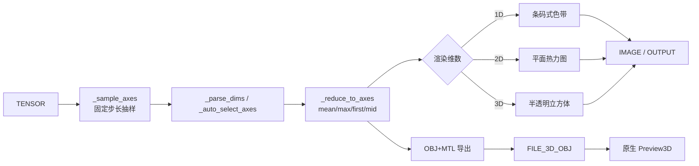

## 需求概述

升级 `d2l/Visualization` 分类下的 Show Heatmaps 两个孪生节点（`CdlShowHeatmaps`、`CdlShowHeatmapsOutput`），使其在真实整幅图像（如 1920x1080）输入下不再因整张量渲染而耗时/占用内存，并修复维度语义错误；同时新增一个真 3D 对象导出节点，配套一个可承载 3D 预览的原生薄节点。

## 核心功能

- **抽样降耗时**：新增「最大抽样数量」控件（默认 262144，`0` 表示不抽样）。当张量元素数超出预算时，按单一固定步长做等间距抽样，保证抽样后总量不超过预算、密度平均、计算量极小；不引入池化/抗锯齿等额外开销。
- **1/2/3 维渲染**：1 维渲染成商品条码式色带；2 维渲染成常规平面热力图；3 维渲染成有透视结构的立方体，且立方体保持半透明（可看到内部与背面）。
- **维度选择**：允许用户手动指定查看哪些维度（支持负索引、1~3 个轴），也可选择自动选择。
- **自动选择策略**：前 n 个、后 n 个、信息量最大的 n 个、信息量最小的 n 个（信息量以「轴长度/元素数」为代理，n 即渲染维数）。
- **降维归约**：未被选中的轴以均值（默认，可切换 max/first/mid）归约成单个代表值，保证最终恰好是 1~3 维。
- **错误策略（高级控件）**：可选择「直接报错」或「回退为取前 n 个维度」，回退时保持节点健壮可用；报错时信息需说明该 shape 为何不适合。
- **向后兼容**：2 维输入 + 不抽样 + 自动选择时，输出外观与旧版一致；旧版「多子图阵列」行为按新语义改为单张图。
- **真 3D 导出节点**：把采样/降维后的 1/2/3 维热力数据导出为通用 3D 文件（含材质透明度），交由系统原生 3D 预览节点展示；1 维为有厚度的平放条码色带并明确标注维度，2 维为可平放的有厚度平面，3 维为半透明立方体。
- **视觉原则**：无论新增何种能力，整体计算量不得明显上升。

## 技术栈

- 语言/运行时：Python（宿主嵌入式 venv `ComfyDL_UI\penv\Scripts\python.exe`）
- 数值与渲染：`torch`、`numpy`、`matplotlib`（`Agg` 非交互后端）、`PIL`
- 宿主/节点 API：ComfyDL_UI 宿主（V1 legacy 节点风格）+ `comfy_api.latest`（`IO`/`UI`/`Types`）+ `folder_paths`
- 3D 文件：手写 OBJ + 同名 MTL 文本（零新依赖；不引入 trimesh/plyfile/pygltflib）
- 测试：`cdl_smoke_tests/run_smoke_test.py`

## 实现方案

- **先零行为变化重构**：把形状提升、抽样、选轴、降维、渲染从两个孪生节点中抽出为模块级 helper，两节点共用；先跑冒烟确认输出逐像素可比对，再加新功能。
- **抽样为纯 view**：步长 `s = ceil(numel / max_samples)`，各轴统一 `::s` 切片（例：10 取 4 ⇒ s=3 ⇒ 索引 0/3/6/9）。切片只在 `torch→numpy` 时按抽样后尺寸拷贝，O(1) 规划、O(抽样后元素数) 内存；若 `Π ceil(size_i/s)` 仍超预算，用收紧 `s` 的确定式循环补一刀（至多几次迭代）。`max_samples==0` 或 `numel<=max_samples` 时不抽样（保留全量逃生口）。严禁对大张量 `reshape`/`contiguous`/算术。
- **信息量代理（用户拍板）**：以轴长度（元素数）为信息量；`most_informative_n` = 长度最大的 n 个轴，`least_informative_n` = 长度最小的 n 个轴，`n` = 渲染维数。
- **渲染分流**：1D → `aspect="auto"` 色带并隐藏 y 轴刻度；2D → 现有 `imshow`；3D → `projection="3d"` + 正交半透明切面 + 浅色棱边（`alpha≈0.5~0.7`），禁用昂贵的 `ax.voxels` 体素路径。性能瓶颈仅在 matplotlib（子图数 × 子图像素数 × `fig.canvas.draw()`），抽样后显著下降。
- **真 3D 导出节点**：手写 OBJ 文本，透明度只能走 MTL 的 `d`（OBJ 顶点色不含 alpha）；返回 `Types.File3D` 子类实例并覆写 `save_to(path)`，在写出 `.obj` 后同目录写出同名 `.mtl`。
- **原生薄节点**：新增 `comfy_extras/nodes_preview_3d.py`，镜像上游 `nodes_load_3d.py` 的 V3 `ComfyExtension` 写法，仅注册 `Preview3D`（收文件 → 落 output → `UI.PreviewUI3D`）；并把该文件名加入 `nodes.py` 的 `extras_files` 白名单（硬编码列表，漏加即不注册）。
- **可扩展性/向后兼容**：新增控件默认值开箱可用（`max_samples=262144`、`dims="auto"`、`axis_reduce="mean"`、`on_error="fallback_first_n"` 且 `advanced=True`）；`advanced` 在 V1 节点直接可用，无需迁移 V3。旧的多子图阵列能力按需求 1 收敛为单张图，`titles` 语义改为「单张图标题」，需在 docstring 与文档写明。

## 关键技术约束（已验证，勿踩坑）

1. `advanced` 控件 V1 写法可用：`("COMBO", {"options": [...], "default": ..., "advanced": True})`；宿主逐字下发 `INPUT_TYPES`，不做字段白名单过滤。
2. 前端 3D 画布只认硬编码节点 id（`Preview3D` 等），自定义节点无法自带画布 → 3D 导出节点只能「产出文件 → 用户连线给原生 `Preview3D`」。
3. `Preview3D.execute` 对 `Types.File3D` 会 `save_to(output/preview3d_<uuid>.obj)` 重命名，兄弟 `.mtl` 不会被复制 → 必须用覆写 `save_to` 的子类同步写 MTL，否则材质/透明度丢失。
4. `IO.File3DOBJ` 的 `io_type == "FILE_3D_OBJ"`；`Types.File3D` 是具体类，`file_format` 缺省从后缀推断，须为 `obj`。
5. venv 内无 3D 解析库，遇 pip 依赖不得自行安装：须把包名 + PIP 路径 + 命令告知用户并等其安装后验证（本方案已按零新依赖设计）。
6. 计数口径三套独立，勿互相「纠正」：ComfyDL banner 108→109；宿主注册表 246→247；四份说明「内置节点库」140→141（Preview3D 归核心 32→33）。`_update_readme.py` 会重建类别表与 FUNCTIONS 计数，但不管 README 的 "provides N nodes across M categories" 总句，需手改。



## 目录结构

```
ComfyUI_Refs/
├── ComfyDL_UI/                              # 宿主（含 comfydl 子模块挂载点）
│   ├── nodes.py                             # [MODIFY] extras_files 白名单加入 nodes_preview_3d.py
│   ├── comfy_extras/
│   │   └── nodes_preview_3d.py               # [NEW] 仅注册 Preview3D 的 V3 薄节点（约 40 行）
│   ├── cdl_smoke_tests/
│   │   └── run_smoke_test.py                 # [MODIFY] 增 1D/3D/4D dummy 与输出/性能校验
│   └── comfydl/                              # 插件子模块（git 仓库 ComfyDL）
│       ├── nodes/
│       │   ├── visualization.py              # [MODIFY] 重构 helper + 新控件 + 1/2/3D 渲染 + 3D 导出节点
│       │   └── ...                           # 视需要新增 3D 导出辅助模块（同目录、d2l/Visualization 分类）
│       ├── FUNCTIONS.md                      # [MODIFY] Show Heatmaps 两节 + 新节点说明
│       ├── FUNCTIONS_zh.md                   # [MODIFY] 同上（中文）
│       ├── README.md                         # [MODIFY] 类别表/节点数/总句计数
│       ├── README_zh.md                      # [MODIFY] 同上（中文）
│       └── _update_readme.py                 # 同步器，提交前运行 --check
└── ComfyDL/                                  # 独立 checkout，收尾时 git pull 验证
```

说明：`visualization.py` 内部按「模块级 helper（抽样/选轴/降维/渲染） + 两个孪生节点委托调用 + 真 3D 导出节点」组织，沿用文件既有 legacy 登记风格（模块级空 dict + 类后逐条赋值），不引入新架构模式。

## 关键接口（接口级，非实现体）

```python
# comfydl/nodes/visualization.py —— 两孪生节点与 3D 导出节点共用
def _sample_axes(shape, max_samples):
    """返回纯 view 切片元组；max_samples=0 或未超预算时返回全切片。确定性、无池化。"""
def _parse_dims(dims, ndim):
    """'auto' / '0,1' / '-2,-1' 解析为轴索引列表；非法返回 None（交由 on_error 决定）。"""
def _auto_select_axes(shape, mode, n):
    """按轴长度选 n 个轴：first_n / last_n / most_informative_n / least_informative_n。"""
def _reduce_to_axes(tensor, keep_axes, how):
    """把非保留轴 mean/max/first/mid 归约，输出维度数 = len(keep_axes)（1~3）。"""
```

```python
# 真 3D 导出节点的返回值：覆写 save_to 的 Types.File3D 子类
class _ObjWithMtl(Types.File3D):
    format = "obj"
    def save_to(self, path):  # 写出 .obj 后，同目录写同名 .mtl（d = 透明度）
        ...
```

## 执行注意事项

- **性能**：热点是 matplotlib 绘制；抽样后元素数即上界。渲染前不得对全量张量做任何算术/拷贝；`fig.canvas.draw()` 仅在 OUTPUT_NODE 分支调用一次。
- **日志**：沿用项目既有日志方式；抽样决策（原始 numel、步长、抽样后 numel）可 info 级记录便于排障，不打印大张量内容；错误分支信息需说明「shape + 为何不适合」。
- **影响面控制**：仅改动目标节点与其文档；其他可视化节点不受影响；旧 2D 外观在 `max_samples=0 + dims=auto` 下须与旧版逐像素一致，已知的有意变更（多子图阵列取消、`titles` 语义）须在 docstring 与文档中显式记录。
- **验证**：冒烟零 FAIL（当前基线 224 PASS / 22 SKIP / 0 FAIL）；用 `time.perf_counter()` 对比 1920x1080 与 192x108 改前/改后耗时；`_update_readme.py --check` 全绿；子模块与主仓提交、push，独立 checkout 拉取复核。

## Agent Extensions

### SubAgent

- **code-explorer**
- Purpose: 跨文件核查文档同步目标与计数口径（4 份说明文件的节点计数、README 总句、`extras_files` 白名单、宿主注册表），以及冒烟用例中 1D/3D/4D dummy 的注入点。
- Expected outcome: 产出精确的文件+行号定位清单与三套计数基准，确保文档与注册零遗漏。

### Skill

- **lsp-code-analysis**
- Purpose: 对 `visualization.py` 的重构做影响分析（`_fig_to_image_tensor`、`CdlShowHeatmaps`/`CdlShowHeatmapsOutput` 的引用与调用关系），确认抽取 helper 不破坏其它可视化节点。
- Expected outcome: 得到引用/被调用清单，验证重构影响面仅限目标节点，避免误改无关逻辑。