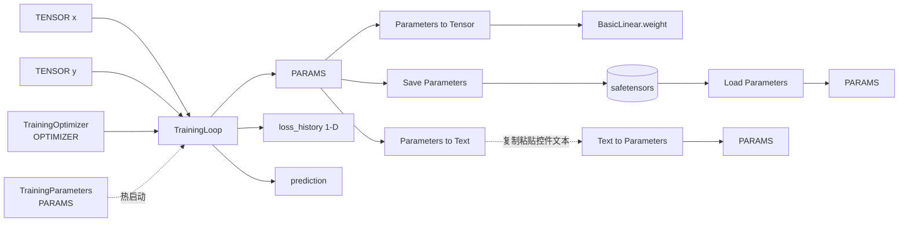

## 产品概述

在 ComfyUI 脱水改装宿主（ComfyDL_UI）的「Network & Layers/Training」分类下补齐深度学习训练闭环：新增「可学习参数」与「优化器」两类可在连线上流转的数据对象，以及一个在**节点内部**完成前向、反向与参数更新的训练节点，使「打开节点、不改任何参数即可训出结果」成立。训练产物可落盘、可编码进控件随工作流保存，也可回流到既有推理图继续使用。

## 核心功能

- **可学习参数对象**：把连入的张量（或按形状 + 初始化方式新建的张量）包装成带名字的可学习参数；多份参数可合并为一份；可按名字取出为普通张量，直接接到既有的 Linear 等推理节点上，形成「训练 → 推理」的闭环。
- **优化器节点**：用下拉与数值控件选择 SGD / Adam / AdamW / RMSprop 及学习率、动量、beta、eps、权重衰减、amsgrad，向训练节点提供一致的优化器设定（超参在控件上，设定经连线传递）。
- **训练节点**：给定输入张量、目标张量、优化器设定与步数，在节点内完成前向、反向与优化器更新；输出训练后的可学习参数、末次损失、逐步损失历史与预测结果；可选接入已有参数做热启动继续训练。
- **参数持久化（两条通道）**：保存 / 加载节点把参数写成 safetensors 文件并可读回；另有「参数转文本 / 文本转参数」节点，把参数编码成一段可复制粘贴的控件文本，随工作流一起保存。
- **损失历史**是普通一维张量，可直接接既有可视化节点观察收敛；参数名与层号对齐，便于人工核对与复用。

## 视觉与交互

不新增独立界面，一切沿用节点画布既有形态：节点库中出现 9 个新节点，新增「可学习参数」「优化器设定」两类插槽（使用前端默认配色），文字提示与报错沿用既有中英混合风格。

## 技术栈

- 语言/运行时：Python 3.14；venv 位于 `ComfyDL_UI\penv\`，兜底 `P:\python.ps1`。
- 宿主：ComfyUI v0.34.0 脱水改装版（`ComfyDL_UI/`，唯一 `.git`，master）。
- 节点 API：V3 `comfy_api.latest`（`io.Schema` / `io.ComfyNode` / `@comfytype`），与 step1–step5 完全一致。
- 数值：`torch`（本机无 GPU，自动 CPU）+ 标准库；落盘复用 `comfy.utils.save_torch_file`（safetensors，`comfy/sd.py` 已在用，无需新依赖）。
- **不新增任何 pip 依赖**，不改 `comfy/` 既有文件（只新增一个文件），不动 `ComfyUI-original/`。

## 关键事实（已核实，方案据此定型）

1. `ComfyDL_UI/execution.py:751` 用 `with torch.inference_mode():` 包住**整轮** prompt 执行 → 跨节点 autograd 不可用，且 `inference_mode` 产生的 inference tensor 不能参与反向（"Inference tensors cannot be saved for backward"）。
→ **前向 + 反向 + optimizer.step 必须发生在同一个节点内部**，循环也只能在节点内（`steps` 控件）。这正是上游 `TrainLoraNode`（`ComfyUI-original/comfy_extras/nodes_train.py`）的做法：`with torch.inference_mode(False):` 自建前向、`x.detach()` 脱离 inference tensor。
2. 本项目既有节点全是**无状态**的（权重走 slot），跨运行状态必须走**连线**（节点缓存键只由已连线输入 + 生产者控件值决定）。因此「优化器设定」「可学习参数」都必须是 slot 上的 payload，超参留在控件上——既符合项目铁律，也让缓存正确性白拿。
3. `comfy_api/latest/_io.py` 已有 `@comfytype(io_type="LORA_MODEL")` → `Type = dict[str, torch.Tensor]` 的先例（`:681`），`Tensor` 在 `:449`，`def Custom` 在 `:133`。新增自定义类型无需动前端（未登记的类型走默认配色）；**不**去改 site-packages（踩坑 7：前端包升级即丢失，收益不抵风险）。
4. 上游 `nodes_train.py` 在本构建中**不存在**（`comfy_extras/` 无该文件，`weight_adapter` 只在 `docs/dehydrate_manifest.md`、`comfy/_lazy_modules.py`、`comfy/sd.py` 出现）→ 该文件仅作为**语义参照**，其 LoRA/扩散模型路线不可照搬。

## 实现方案

### 方案总览

1. **两个新数据类型**（`comfy_api/latest/_io.py` 追加 `@comfytype`）：

- `PARAMS` = 有序命名参数字典 `dict[str, torch.nn.Parameter]` —— 可退化覆盖「单个 nn.Parameter」（name=`weight`）与「整模型」（`layer0.weight` / `layer0.bias` / …）；名字与 safetensors 落盘、与 step5 的 state_dict 词汇天然对齐；是纯数据 payload。
- `OPTIMIZER` = 优化器**配置对象**（dataclass `OptimizerConfig`）—— 只承载超参，不跨 prompt 保存 Adam 动量（跨 prompt 无状态可表达，文档中明确列为非目标）。
- **选型说明（回答 Q1「选最好用的一项」）**：不选「绑定 step5 的 MODEL」——训练真实扩散模型需要 `ldm` / 采样器 / `weight_adapter`，在脱水构建中不存在，绑定是死路径，会重蹈 L2 占位节点覆辙；不选「无名张量列表」——丢失名字就无法与 safetensors、与既有 state_dict 词汇对齐。命名字典是唯一同时满足「可退化、可落盘、可桥接既有 TENSOR 推理图」的载体。

2. **框架侧 helper 新文件** `comfy/training_protocol.py`（纯新增，**零改动既有 `comfy/*.py`**，与 step5 的 `comfy/model_protocol.py` 同构）：`OptimizerConfig` dataclass + `build_optimizer()`、参数 ↔ `nn.Module` 的命名映射（`layer{i}.weight` / `layer{i}.bias`，`load_state_dict(strict=False)` 语义）、参数文本编解码（safetensors → base64）、以及节点共用的校验/告警工具。只依赖 `torch` / `comfy.utils` / `comfy.model_management`，**不 import `comfy.sd`、不 import `comfy.lora`**。
3. **节点新文件** `comfy_extras/nodes_training.py`（9 个节点，全部 `CATEGORY = "Network & Layers/Training"`，与既有 `TrainingMode`/`TrainingRunStats` 同族）：

| 节点 id | 显示名 | 职责与关键设计 |
| --- | --- | --- |
| `TrainingParameters` | Learnable Parameters | 创建 `PARAMS`。控件 `name`(STRING `"weight"`)、`shape`(STRING `"2,3"`)、`init`(COMBO `normal`/`zeros`/`ones`/`xavier_uniform`/`kaiming_uniform`，default `normal`）；可选 `tensor` slot → 把连入张量包装成同名参数（**连线优先于 shape**） |
| `TrainingParametersMerge` | Merge Parameters | 合并两份 `PARAMS`；名字冲突时加后缀并告警，保证不静默丢权重 |
| `TrainingParametersExtract` | Parameters to Tensor | `PARAMS` + `name`(STRING `"weight"`) → `TENSOR`（`.detach()` 输出）。**这是训练产物回流既有推理图（`BasicLinear.weight`）的桥**；名字不存在时抛可操作错误并列出全部可用名字 |
| `TrainingOptimizer` | Optimizer | 仅承载配置，输出 `OPTIMIZER` 走连线。控件 `optimizer`(COMBO `AdamW`/`Adam`/`SGD`/`RMSprop`, default `AdamW`)、`lr`、`momentum`、`beta1`、`beta2`、`eps`、`weight_decay`、`amsgrad` 全部给典型默认值且在区间内 |
| `TrainingLoop` | Training Loop | **核心**：节点内 `for step in range(steps)` 完成前向 + 反向 + `optimizer.step()`。输入 `x`/`y`(TENSOR)、`optimizer`(OPTIMIZER，连线)、可选 `params`(PARAMS，热启动)；控件 `hidden`(STRING `"8"`，空 = 单层线性)、`activation`(COMBO `relu`/`gelu`/`tanh`/`sigmoid`/`none`)、`loss`(COMBO `mse`/`l1`/`cross_entropy`)、`steps`(INT 200)、`batch_size`(INT 0 = 全批)、`seed`(INT 0)；输出 `params`(PARAMS)、`loss`(标量 TENSOR)、`loss_history`(1-D TENSOR)、`prediction`(TENSOR, detach) |
| `TrainingSaveParameters` | Save Parameters | safetensors 落盘并**透传** `params`（对齐上游 `SaveLoRA` 的落盘方式，但保留输出便于链式续训）；`OUTPUT_NODE=True` |
| `TrainingLoadParameters` | Load Parameters | `path` STRING（默认给可直接照抄的示例相对路径，相对 output 目录解析，亦支持绝对路径）→ `PARAMS`；文件缺失时报可操作错误 |
| `TrainingParametersToText` | Parameters to Text | `PARAMS` → `text` STRING（safetensors + base64），供用户复制粘贴到下一个节点的控件里 |
| `TrainingTextToParameters` | Text to Parameters | `text` STRING（默认值为一个**可解码的极小常量 blob**，满足「不改参数即可用」）→ `PARAMS` |


4. **训练节点的执行细节（必须照此实现）**：

- 体内 `with torch.inference_mode(False):`（对齐上游），输入一律 `x.detach().clone().to(device, torch.float32)`、`y` 同理，彻底脱离 inference tensor。
- device 取 `comfy.model_management.get_torch_device()`，CPU 自动兜底；`seed` 同时决定初始化与批采样（`torch.manual_seed` + 局部 `torch.Generator`），保证同输入同结果。
- 结构由 `hidden` 声明（`""` → 单层线性回归；`"8,16"` → 两层隐层），`in_features = x.shape[-1]`、`out_features = y.shape[-1]` 自动推断；激活只加在隐层之间，输出层恒为线性。
- `loss=cross_entropy` 时校验 `y` 形态（类别索引需 `long`／概率需 one-hot），不合法时给出可操作 `RuntimeError` 并说明接受形态，绝不静默降级。
- 收尾：`optimizer.zero_grad(set_to_none=True)`、逐参数 `param.grad = None`，输出张量全部 `detach()` → 不把 autograd 图带进 Comfy 的输出缓存。
- `steps` 上限保护 + 大值告警；`batch_size=0` 为全批（默认，教学场景最稳）。

### 性能与复杂度

- 训练开销 = `steps × (前向 + 反向)`，量级 `O(steps · batch · Σ(W_i·W_{i+1}))`；默认（隐层 `8`、`steps=200`、全批）在本机 CPU 上为亚秒级。
- 单步内无额外 Python 循环（向量化 batch）、无 `.item()` 逐样本调用（损失历史在步末取一次）；不落 `reshape`/`contiguous` 冗余拷贝。
- 既有 274 个节点的执行路径**零改动**，新增节点仅在用户拖入画布时才被求值（惰性），不影响启动/内存。
- 未新增前端资源、未改 site-packages → 无前端升级丢失风险。

### 架构图



### 实现注意事项

- 复用既有约定：`io.Schema(node_id=..., display_name=..., category=..., description=..., search_aliases=..., inputs=[...], outputs=[...])`；节点文件末尾照抄 `NetworkLayersExtension` / `NormalizationExtension` 的 `ComfyExtension` + `comfy_entrypoint()` 写法。
- `TRAINING_CATEGORY = "Network & Layers/Training"` 已存在于 `comfy_extras/nodes_normalization.py:62` → **在新文件内独立定义常量，不去改既有文件**，避免波及 step3 节点。
- `nodes.py` 的 `extras_files` **硬编码白名单**（漏加即不注册）→ 追加一行 `nodes_training.py`，纯追加、不 churn 既有条目。
- 每个新节点必须写 **What / In / Out** 三段式英文 docstring，写明 shape 语义、命名约定、连线优先级、报错策略。
- 全部 widget 默认值「开箱可用」：STRING 给可直接运行的示例（`"weight"` / `"2,3"` / `"8"`），数值 default 在 `[min,max]` 内取典型值，COMBO default 必在选项内。
- 冒烟器 `cdl_smoke_tests/run_smoke_test.py` 从 host `NODE_CLASS_MAPPINGS` 自动发现节点（`_load_registry:138`），但按**输入类型**选 fixture → 必须为 `PARAMS`/`OPTIMIZER` 注册新工厂，并为训练节点准备成对的 `x`/`y`；断言要**实质性**（训练后损失末值显著低于首值、Save→Load 键值与往返一致、text 往返无损），不能只断言「不抛异常」。
- 计数口径更新：宿主注册表 274 → **283**（分类 44 不变，`Training` 已存在）；四份说明文件「内置节点库」168 → **177 / 32**；ComfyDL banner **109 / 20 不变**（新节点属核心，不属 submodule）。`comfydl/_update_readme.py --check` 必须全绿，且其不覆盖的 README 总句需手改。
- 子模块链路：说明文件在 `comfydl/`（submodule）→ 需 `comfydl` 提交并 push main → 主仓 `git add comfydl` 更新 gitlink → push master → 独立 checkout `P:\Dev\ComfyUI_Refs\ComfyDL` `git pull`。
- **不新增示例工作流**（用户已明确放弃该项）；临时校验脚本用完即删。
- git 命令需带 `-c safe.directory=…`；**未经用户明确要求不得 commit**。

## 目录结构

```
ComfyDL_UI/                                  # 仓根（唯一 .git，master）
├── comfy/
│   └── training_protocol.py                 # [NEW] 框架侧纯 helper：OptimizerConfig 数据类、build_optimizer()、
│                                            #   参数↔nn.Module 命名映射（layer{i}.weight/.bias，strict=False 语义）、
│                                            #   safetensors↔base64 文本编解码、共用校验/告警工具。
│                                            #   只依赖 torch / comfy.utils / comfy.model_management；不改既有 comfy/*.py。
├── comfy_api/latest/
│   └── _io.py                               # [MODIFY] 追加 @comfytype(io_type="PARAMS") 与 ("OPTIMIZER") 两个类型
│                                            #   （照 :449 Tensor / :681 LoraModel 的写法），OPTIMIZER 的 Type 走 TYPE_CHECKING 导入。
├── comfy_extras/
│   └── nodes_training.py                    # [NEW] 9 个训练节点 + 模块级 _warn/参数解析等共用私有函数；
│                                            #   CATEGORY 常量、ComfyExtension + comfy_entrypoint()；
│                                            #   训练节点体内 inference_mode(False)、detach/clone、CPU 兜底、seed 确定性。
├── nodes.py                                 # [MODIFY] extras_files 白名单纯追加 nodes_training.py 一行。
├── cdl_smoke_tests/
│   └── run_smoke_test.py                    # [MODIFY] 新增 _f_params/_f_optimizer/训练用 x,y 工厂与类型分派；
│                                            #   _DUMMY_OVERRIDES 指定训练节点输入；_OUTPUT_CHECKS 加损失下降、
│                                            #   Save→Load 往返、text 往返、命名约定断言。
├── docs/
│   ├── reform-step6-learnable-params-and-optimizer.md   # [NEW] 中英双语，照 step2/3/5 结构（含分类树与计数、
│   │                                                    #   与 d2l 关系、回退方案、执行与实测记录）。
│   └── comfydl-builtin.md                   # [MODIFY] 增 step6 小节（分类布局与计数更新块）。
└── comfydl/                                 # submodule（main）
    ├── FUNCTIONS.md / FUNCTIONS_zh.md       # [MODIFY] 新增 Training 分类 9 节点说明 + 附录计数同步。
    ├── README.md   / README_zh.md           # [MODIFY] 概述句与计数；总句为手改项（脚本不覆盖）。
    └── _update_readme.py                    # [MODIFY] 若节点行/计数需重建则同步其映射表。
```

外部：`P:\Dev\ComfyUI_Refs\ComfyDL`（同源独立 checkout）需在子模块推送后 `git pull` 同步。

## 关键代码结构

```python
# comfy/training_protocol.py
@dataclasses.dataclass(frozen=True)
class OptimizerConfig:
    name: str                 # "AdamW" | "Adam" | "SGD" | "RMSprop"
    lr: float = 0.01
    momentum: float = 0.9
    beta1: float = 0.9
    beta2: float = 0.999
    eps: float = 1e-8
    weight_decay: float = 0.0
    amsgrad: bool = False

def build_optimizer(cfg: OptimizerConfig, parameters) -> "torch.optim.Optimizer": ...
def params_from_module(module) -> dict[str, "torch.nn.Parameter"]: ...      # 键形如 "layer0.weight"
def load_params_into(module, params: dict) -> tuple[list[str], list[str]]: ...  # (missing, unexpected)
def encode_params(params: dict) -> str: ...   # safetensors -> base64
def decode_params(text: str) -> dict: ...
```

```python
# PARAMS 的命名约定（同时写入 docstring 与 docs）
#   layer0.weight  layer0.bias  layer1.weight  layer1.bias ...
# 热启动：TrainingLoop(hidden=..., params=链接) 按该约定 load_state_dict(strict=False)，
#        缺失/多余键逐条告警，绝不静默丢权重；与既有 BasicLinear 的 weight/bias 语义逐字对齐。
```

## Agent Extensions

### SubAgent

- **code-explorer**
- Purpose: 在交付前做一轮独立复核：交叉确认 (a) 注册链 `nodes.py` `extras_files` 与 `init_extra_nodes()` 是否覆盖新文件、(b) `PARAMS`/`OPTIMIZER` 是否确实无需前端注册即可连线、(c) 三套计数口径（banner / 宿主注册表 / 说明文件）与新节点数是否自洽、(d) 既有 `io.Tensor` 槽与新 `PARAMS` 槽的连线契约是否被 `comfy_execution/validation.py` 允许。
- Expected outcome: 一份逐条带文件与行号的复核结论；发现偏差立即回到对应步骤修正，确保登记链、计数与类型契约无遗漏。