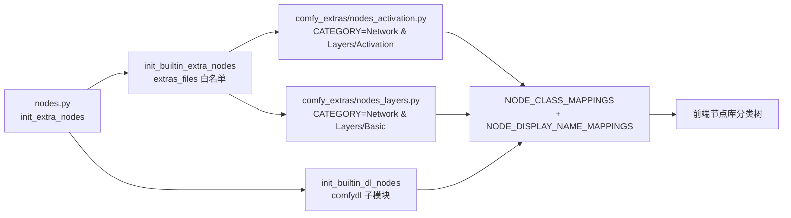

## 用户需求

在现有 ComfyUI 精简宿主（`ComfyDL_UI`）中完成 reform 第二步：**把基础神经网络层做成核心节点，并重构节点库分类树**。

### 现状（用户描述）

节点库中 `Comfy节点` 下已有 `Activation`（14 个激活节点），以及 `Network & Layers`、`ComfyDL EX` 两个占位分类；`扩展` 下为 `d2l`。

### 目标结构

`Comfy节点` 下收敛为：

- `Network & Layers`
- `Activation`：Sigmoid / Tanh / ReLU / Leaky ReLU / ELU / SELU / GELU / SiLU / Mish / Softplus / ReLU6 / Hard Swish / Identity / Softmax（14 个，功能不变，仅换分类位置）
- `Basic`：Linear / Embedding / Flatten / Reshape / Broadcast / Concat / Add / Multiply
- `图像` / `模型` / `实用工具` / `文本` / `utilities` 保持不变；`扩展` 下 `d2l` 保持不变。

### 澄清后确定的补充约束

1. **删除空分类**：`ComfyDL EX` 从规划中彻底移除；`Network & Layers` 由"空分类"升级为真实父分类。经全仓检索，这两个字符串从未存在于代码中（前端也不渲染空分类），因此代码侧无删除动作，仅需同步文档与记忆中的分类树描述。
2. **去重（按"等价的只留一个"原则）**：`Dense` ≡ `Linear`，只保留 `Linear`（`Dense` 可用 `Linear + 激活节点` 组合替代）；`Residual`、`Skip Connection` 在张量层面 ≡ `Add`（逐元素相加 + 广播），只保留 `Add`。最终 `Basic` 为 **8 个节点**。
3. **参数走 slot**：`Linear` 的 `weight`/`bias`、`Embedding` 的 `weight` 均为张量，通过输入 slot 传入，不做内部随机初始化。
4. **与 d2l 重叠节点并存**：`CdlBroadcast`、`CdlReshape`（`d2l/Tensor Basic`）保持原样不动，新增核心节点与之语义对齐、各自独立。
5. **冒烟测试**：新建一个**轻量**冒烟测试器，对全部已注册节点做注册表 + 逐节点执行检查，**不启动 ComfyUI 服务**。

### 视觉/使用效果

打开节点库可在 `Comfy节点 → Network & Layers → Activation / Basic` 看到两组合计 22 个节点；`Basic` 组内节点全部使用张量插槽（通用张量类型）互联，可与 `d2l` 张量节点直接接线；`ComfyDL EX` 不再出现。任意节点保持默认参数即可产出有效输出。

## 技术栈

- 语言/运行时：Python（仓库自带 `ComfyDL_UI\penv\` 虚拟环境，torch 2.13 / torchvision 已装）。
- 节点框架：ComfyUI 宿主自带的 **V3 schema IO API**（`from comfy_api.latest import ComfyExtension, io`），与 `comfy_extras/nodes_activation.py` 现有写法完全一致。
- 类型系统：复用既有核心 slot 类型 `TENSOR`（`comfy/comfy_types/node_typing.py` + `comfy_api/latest/_io.py`），不新增类型。
- 计算：`torch` / `torch.nn.functional` 原生算子，不引入新依赖。

## 实现方案

### 总体策略

本次改动是"**一个常量重命名 + 一个新节点文件 + 一处白名单接线 + 一套轻量测试 + 文档同步**"，属于宿主侧的窄改动，不触碰 `comfy/` 核心包、不改执行引擎，符合仓库 `AGENTS.md` 的最小改动面要求。

### 关键决策与理由

1. **分类用斜杠嵌套**：`CATEGORY = "Network & Layers/Activation"` / `"Network & Layers/Basic"`，前端节点库按 `/` 自动分层，无需任何前端代码或 JS 扩展（已确认仓库内无 `web/`、无自定义 JS）。
2. **新文件 `comfy_extras/nodes_layers.py`**，沿用 `nodes_activation.py` 的 V3 风格（模块级 `CATEGORY` 常量 + 共享 `_basic_schema()` 构造函数），保证两个文件同构、易维护。文件名已确认未被占用。
3. **必须改 `nodes.py` 白名单**：`init_builtin_extra_nodes()` 用的是硬编码 `extras_files` 列表而非目录扫描，漏加文件名等于节点不注册。
4. **节点 id 前缀沿用"叶子分类名"约定**：`Activation*` → `Basic*`（`BasicLinear` 等），display_name 为简洁名（已全仓确认 `Linear/Add/Multiply/Concat/Embedding/Flatten/Reshape/Broadcast` 无显示名冲突）。
5. **`weight`/`bias` 走 slot**：`F.linear(tensor, weight, bias)` / `F.embedding(indices, weight)`，符合用户"参数是张量就走 slot"的要求；节点保持无状态、无跨执行缓存。
6. **`dim`/`target_shape` 稳健性对齐现有先例**：`dim` 按 `ActivationSoftmax` 的做法钳制到 `[-rank, rank-1]`；`target_shape` 解析/广播失败时回退返回原张量（沿用 `CdlReshape`/`CdlBroadcast` 的容错约定），保证"不改参数也能产出有效输出"。
7. **冒烟测试器不走 HTTP**：直接 `asyncio.run(nodes.init_extra_nodes(init_custom_nodes=False, init_api_nodes=False))` 进程内装载 `comfy_extras` + `comfydl` 全量节点，再逐节点合成输入并调用，秒级完成，避免每次起服务。

### 性能与可靠性

- 每个节点只做 1 次 torch 算子调用（`F.linear`/`F.embedding`/`flatten`/`reshape`/`broadcast_to`/`cat`/`add`/`mul`），无 Python 循环、无 `.cpu()`/`.numpy()` 往返、无 dtype 提升（保持入参 dtype/device），复杂度与内存均为单算子量级。
- 形状/dim 计算全部在 Python 侧用 int 完成，不构造元数据张量。
- 输入非法时回退为原张量（可解释、不中断工作流），错误信息走 `print` 短提示，不打印大张量。

## Implementation Notes

- 先改分类常量（1 行，风险最低、可独立验证），再新增节点文件，最后接线并测试，便于定位失败点。
- `nodes_activation.py` 的 `CATEGORY` 是模块级常量、被 14 个节点共享，改一处即全部生效；改完需确认全仓无其他引用该字符串的位置（文档除外）。
- 新文件不要引入 `try/except` 包裹整段逻辑；仅在 `target_shape` 解析处按现有 `CdlReshape` 风格做窄捕获（`ValueError`/`RuntimeError`）。
- 冒烟测试器必须能同时处理两类节点：V3（`GET_SCHEMA`/`define_schema` + 类方法 `execute`）与 legacy（`INPUT_TYPES` + 实例方法 `FUNCTION`）。
- 需要外部资源/落盘的节点（下载、数据集、保存图像等）记为 `SKIP(原因)` 而非 `FAIL`；被测节点产生的临时文件统一落到临时沙箱并在结束时删除（遵守"临时文件及时清理"）。
- 全程使用 `P:\Dev\ComfyUI_Refs\ComfyDL_UI\penv\Scripts\python.exe`；若 venv 不可用则把命令交给用户手动执行。
- 文档改动只改与节点数量/分类树相关的行，不重写整份文档；`ComfyDL/` 独立 checkout 与子模块同源，用 `git pull` 同步而非手工改两份。

## 架构设计

节点注册链保持不变，仅在宿主侧新增一个 extra 模块：



## 目录结构

```
ComfyDL_UI/                                  # 主仓根（Git 操作根，分支 master）
├── comfy_extras/
│   ├── nodes_activation.py                  # [MODIFY] 模块级 CATEGORY 常量由 "Activation" 改为 "Network & Layers/Activation"。
│   │                                        #   14 个节点定义、widget、执行逻辑一律不动。
│   └── nodes_layers.py                      # [NEW] Basic 基础层节点（8 个），V3 io API，模块级 CATEGORY = "Network & Layers/Basic"。
│                                            #   共享 _basic_schema() 构造 io.Schema；全部单/双输入、TENSOR 入出、保持 dtype/device。
│                                            #   BasicLinear(tensor,weight,bias?) / BasicEmbedding(tensor,weight) / BasicFlatten(tensor,start_dim,end_dim)
│                                            #   BasicReshape(tensor,target_shape) / BasicBroadcast(tensor,target_shape) / BasicConcat(a,b,dim)
│                                            #   BasicAdd(a,b) / BasicMultiply(a,b)。每个节点必须写详细 docstring（做什么/入什么/出什么）。
├── nodes.py                                 # [MODIFY] init_builtin_extra_nodes() 的 extras_files 白名单加入 "nodes_layers.py"。
│                                            #   不改 init_builtin_dl_nodes / init_extra_nodes 的调用顺序。
├── cdl_smoke_tests/
│   └── run_smoke_test.py                    # [NEW] 轻量冒烟测试器：不启动服务，进程内装载全部节点并逐节点执行。
│                                            #   支持 V3 与 legacy 两类节点、按类型合成输入、SKIP 白名单、PASS/SKIP/FAIL 汇总表、非 0 退出码。
│                                            #   支持 --filter 过滤、落盘节点写入临时沙箱并在结束时清理。
├── comfydl/                                 # ComfyDL 子模块（分支 main，远端 Cynthia-lxx/ComfyDL）
│   ├── FUNCTIONS.md                         # [MODIFY] TENSOR 说明中的 Activation 措辞、"## 17. ComfyUI / Activation" 章节改为
│   │                                        #   Network & Layers 父章节（Activation 14 + Basic 8）、Total Node Count 表。
│   ├── FUNCTIONS_zh.md                      # [MODIFY] 中文版同步同样的章节与数字。
│   ├── README.md                            # [MODIFY] "ships **116 nodes** across 17 categories" 及分类表行。
│   └── README_zh.md                         # [MODIFY] 中文版同步。
├── docs/
│   └── reform-step2-network-layers.md       # [NEW] 本步设计记录，格式对齐 reform-step1-activation-tensor.md。
└── .codebuddy/memory/                       # [MODIFY] MEMORY.md 分类树与"下一步"条目；新增当日进度记录。
```

`P:\Dev\ComfyUI_Refs\ComfyDL\`（同源独立 checkout，落后 1 个提交）：通过 `git pull` 同步 4 个说明文件，不单独手改。

## 关键结构

Basic 节点的控件契约（默认值均"开箱可用"，INT 的 default 落在 [min, max] 内）：

| 节点 id | display_name | 输入 | 输出 | 算子 |
| --- | --- | --- | --- | --- |
| `BasicLinear` | Linear | `tensor` TENSOR；`weight` TENSOR；`bias` TENSOR(optional) | `output` TENSOR | `F.linear` |
| `BasicEmbedding` | Embedding | `tensor` TENSOR(整数索引，内部 `.long()`)；`weight` TENSOR | `output` TENSOR | `F.embedding` |
| `BasicFlatten` | Flatten | `tensor` TENSOR；`start_dim` INT 1 (0~4)；`end_dim` INT -1 (-4~4) | `output` TENSOR | `torch.flatten` |
| `BasicReshape` | Reshape | `tensor` TENSOR；`target_shape` STRING `"1,-1"` | `output` TENSOR | `torch.reshape` |
| `BasicBroadcast` | Broadcast | `tensor` TENSOR；`target_shape` STRING `"2,3"` | `output` TENSOR | `torch.broadcast_to` |
| `BasicConcat` | Concat | `a` TENSOR；`b` TENSOR；`dim` INT -1 (-4~4) | `output` TENSOR | `torch.cat` |
| `BasicAdd` | Add | `a` TENSOR；`b` TENSOR | `output` TENSOR | `a + b` |
| `BasicMultiply` | Multiply | `a` TENSOR；`b` TENSOR | `output` TENSOR | `a * b` |


共享 schema 构造函数形态（与 `nodes_activation.py` 同构）：

```python
CATEGORY = "Network & Layers/Basic"

def _basic_schema(node_id, display_name, description, inputs, search_aliases=None) -> io.Schema:
    return io.Schema(
        node_id=node_id, display_name=display_name, category=CATEGORY,
        description=description, search_aliases=search_aliases,
        inputs=list(inputs), outputs=[io.Tensor.Output(display_name="output")],
    )
```

## 验收标准

1. 进程内注册检查：`IMPORT_FAILED []`；`NODE_CLASS_MAPPINGS` 中新增 8 个 `Basic*` 节点，14 个 `Activation*` 节点分类字符串为 `Network & Layers/Activation`，8 个 `Basic*` 为 `Network & Layers/Basic`，全部输入输出为 `TENSOR`。
2. 冒烟测试：`penv\Scripts\python.exe cdl_smoke_tests\run_smoke_test.py` 输出 **0 FAIL**，`Network & Layers` 下 22 个节点全部 PASS（SKIP 项必须带原因且逐条列出）。
3. 端到端（仅一次）：`--cpu` 起服务后 `GET /object_info` 确认树结构为 `Comfy节点 → Network & Layers → {Activation 14, Basic 8}`、`ComfyDL EX` 不存在，随后关闭服务。
4. 4 个说明文件的节点总数与分类数与实际注册结果一致（102 ComfyDL + 14 + 8 = 124，18 个分类）。

## Agent Extensions

### Skill

- **lsp-code-analysis**
- Purpose: 在分类常量重命名前做引用面与符号影响分析，确认 `CATEGORY` 常量及 `ActivationSigmoid` 等节点符号的全仓引用点，避免漏改或误伤。
- Expected outcome: 得到一份精确的符号引用清单（代码 vs 文档），据此确认分类迁移只需改 `nodes_activation.py` 一处常量。

### SubAgent

- **code-explorer**
- Purpose: 为冒烟测试器盘点全部已注册节点的输入形态（legacy `INPUT_TYPES` 与 V3 `GET_SCHEMA` 两类、隐藏输入 `prompt`/`unique_id`、需要外部资源或落盘的节点清单）。
- Expected outcome: 产出"节点 → 输入类型/默认值/是否可执行/需 SKIP 原因"清单，使 `run_smoke_test.py` 的类型合成与 SKIP 白名单有据可依。