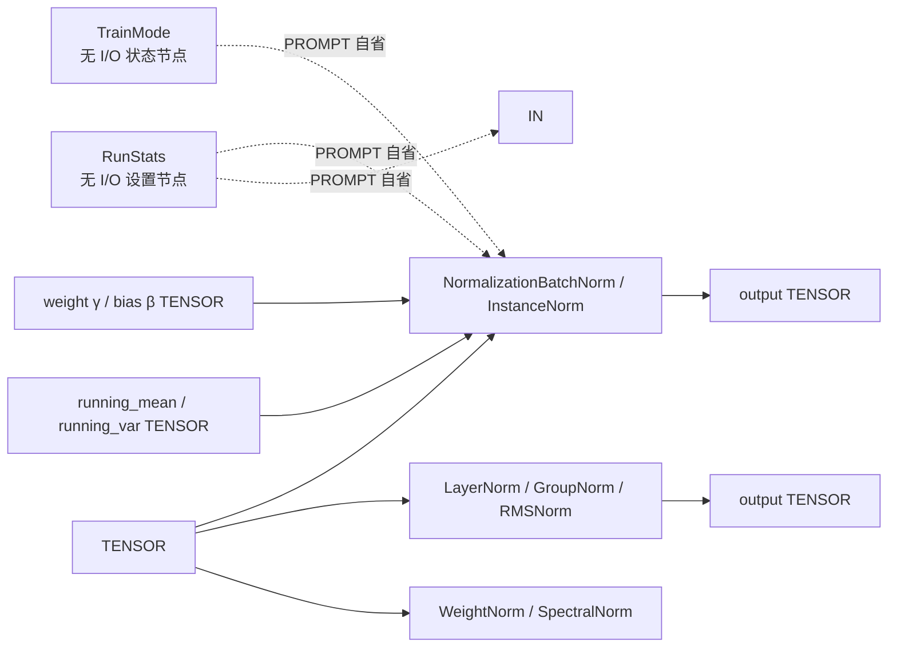

> ⚠ **本计划部分章节已过时（2026-09-11 落地时变更）**：§3「hidden PROMPT 自省 + 实例消歧」与
> §4「`fingerprint_inputs` 补偿缓存」的方案**在实现中整体弃用**，最终改为**连线通道**——
> `TrainingMode` 的 `mode` STRING 输出连到 BatchNorm / InstanceNorm 的 `mode` 插槽。
> 原因：缓存签名（`comfy_execution/caching.py`）只覆盖已连线的输入及其祖先，且 `IS_CHANGED` /
> 校验流程调用 `get_input_data` 时 `dynprompt=None`，隐藏 `prompt` 在那里是空字典。
> 实现中 `fingerprint_inputs` / `state_source` / `instance_name` / `resolve_training_state`
> 均为 **0 处**；`TrainingMode` / `TrainingRunStats` 也没有 `instance_name` 控件。
> 请以 `ComfyDL_UI/docs/reform-step3-normalization.md` 与 `comfy_extras/nodes_normalization.py` 为准；
> 其余章节（节点清单、控件默认值、秩自适应、无状态约定）仍与实现一致。

## 产品概述

在 ComfyUI 的 `Network & Layers` 分类树下，与 `Basic`、`Activation` 同级新增 `Normalization` 分组，一次性补齐 7 类主流归一化节点；同时引入"训练/推理态"的最小基础设施，让归一化节点能在训练语义与推理语义之间切换。本次不实现可学习参数对象与优化器（下一轮），但结构上不挡路。

## 核心功能

- **批归一化 BatchNorm**：单节点按秩自适应，输入 rank2→1d、rank3→(N,C,L)、rank4→2d、rank5→3d，行为等价 `F.batch_norm`，无需用户选择 1d/2d/3d。
- **实例归一化 InstanceNorm**：同样秩自适应（rank4 即 2d 语义），等价 `F.instance_norm`。
- **层归一化 LayerNorm**：按可配置的尾部维度做归一化，支持 γ/β。
- **组归一化 GroupNorm**：按可选分组数分组后归一化，支持 γ/β。
- **RMSNorm**：LLaMA 类大模型常用，均方根归一化，支持缩放权重。
- **权重归一化 WeightNorm**：对权重做重参数化 `g·v/‖v‖`，可只做方向归一化也可乘缩放系数。
- **谱归一化 SpectralNorm**：用确定性幂迭代估计权重谱范数，输出除以谱范数的权重。
- **训练/推理态开关**：一个无输入无输出的状态节点，可选 `train`/`eval`；归一化节点在后台读取它，无需连线。
- **持久化运行统计量**：一个无输入无输出的设置节点，用可编辑数值承载 `running_mean`/`running_var`，随工作流保存而跨运行保留；推理态下批归一化/实例归一化优先使用它。
- **实例消歧**：同类状态节点可存在多个，通过实例名与消费节点上的来源控件精确选择，无法匹配时按确定性规则回退并给出提示，绝不中断工作流。
- **可视化效果**：7 个归一化节点出现在节点库 `Network & Layers/Normalization` 下，控件精简（归一化维度/分组数/eps 等）；状态与设置节点位于 `Network & Layers/Training` 下，仅有两三个可编辑控件，拖入画布即可用，无需连线。

## 技术栈

- 语言/运行时：Python 3.14，虚拟环境 `ComfyDL_UI/penv`（内含 `torch 2.13.0`、`numpy 2.5.2`）。
- 节点 API：ComfyUI **v3** 节点体系 —— `from comfy_api.latest import ComfyExtension, io`，类继承 `io.ComfyNode`，通过 `@classmethod define_schema() -> io.Schema` 声明、`@classmethod execute() -> io.NodeOutput` 实现，与现有 `comfy_extras/nodes_activation.py`、`comfy_extras/nodes_layers.py` 完全一致。
- 数值算子：优先使用 native torch 函数式接口（`F.batch_norm` / `F.instance_norm` / `F.layer_norm` / `F.group_norm` / `F.rms_norm`，torch 2.13 均有），不写自定义 kernel、不做 fp32 上转兜底。

## 实现方案

### 1. 秩自适应归一化（用户明确要求"单节点按秩自适应"）

`F.batch_norm` 与 `F.instance_norm` 在 PyTorch 中本就接受任意 `(N, C, ...)` 形状，因此**不存在 rank 分支**：一个节点天然覆盖 1d/2d/3d，1d/2d/3d 的差异只是"沿哪些维度求统计量"，由张量形状本身决定。节点 `description` 与 docstring 中显式说明 `rank2=(N,C)`、`rank3=(N,C,L)`、`rank4=(N,C,H,W)`、`rank5=(N,C,D,H,W)` 的对应关系，用户无需选型。这比写三套分支更少代码、更少出错点，也与 `nodes_activation.py` "shape-agnostic" 的既有设计一致。

### 2. 无状态纯函数（延续 Basic/Activation 的既有约定）

γ/β 不存放在节点内部，而是作为 `optional=True` 的 `TENSOR` 输入槽（与 `nodes_layers.py` 的 `Linear.weight/bias` 完全同构），因此节点可驱动任意 checkpoint、不在两次执行间缓存任何张量，符合 `AGENTS.md` "禁止模块级/类级持久张量存储"与"节点只暴露它真正读取的输入"。

### 3. 训练/推理态：PROMPT 自省 + 实例消歧（用户 Q2 方案落地）

- 依据（已核实）：`execution.py:192-207` —— 节点在 schema 里声明 `hidden=[io.Hidden.prompt]` 时，`cls.hidden.prompt` 就是**整个 prompt 字典**（每节点含 `class_type`、`inputs` 内的 widget 值）。这是**静态读图**，与执行顺序无关，因此"无输入无输出的状态节点"不需要被调度、也不需要全局变量即可生效。
- 用户提出的"实例名与节点名是两回事、要给每个实例独立标识"落实为：**prompt 字典的 key（字符串数字 id）作为机器唯一标识**（与 `io.Hidden.unique_id` 同一命名空间），状态节点再用一个 `instance_name` widget 提供人类可读别名。
- 解析优先级（确定性、绝不抛异常）：

1. 消费节点的 `state_source` 非空 → 在所有同类状态节点中按 `instance_name` 精确匹配；命中多个时取 prompt id 最小者并告警。
2. `state_source` 为空 → 图上恰有 1 个同类状态节点则用它；有多个则优先 `instance_name == "default"`，否则取 prompt id 最小者并告警。
3. 匹配不到 / 图上无同类节点 / `prompt` 为空 → 回退内置默认（模式 `train`；统计量缺失则继续下一优先级），仅提示不报错。**冒烟测试会注入 `prompt={}`，必须走这条路径且不 FAIL。**
4. 状态节点被静音/绕过时前端不会把它写进 prompt，等价于"不存在"，自动回退默认值。

### 4. 缓存正确性（本次最关键的隐藏坑，已核实）

`comfy_execution/caching.py:109-126` 的节点签名只取 `class_type` + `node["inputs"]`，**hidden 输入不参与签名** → 用户只改状态节点 widget 时，消费节点会命中旧缓存而不重算。补偿手段：`execution.py:60-101` 的 `IsChangedCache` 会用**含 hidden** 的输入调用 `fingerprint_inputs`（`_io.py:1955-1960`，等价 v1 的 `IS_CHANGED`）并把它并入签名。因此 BatchNorm / InstanceNorm **必须实现 `fingerprint_inputs(cls, **kwargs)`**，返回解析后的模式、统计量来源内容与相关 widget 值；`cls.hidden` 在 `execute` 与 `fingerprint_inputs` 中均可用（`_io.py:2041-2047` 的 `PREPARE_CLASS_CLONE` 在调用前注入）。

### 5. 推理态运行统计量的三级取值（用户 Q3 方案落地）

widget 只能承载 `str/int/float/bool/combo`，**无法承载张量**，因此持久化设置节点用逗号分隔的数字字符串承载 `running_mean`/`running_var`，随工作流 JSON 保存而持久化（正是用户描述的"靠保存工作流实现持久化"），大张量场景仍可用节点上的 `TENSOR` 槽。取值优先级：
① `running_mean`/`running_var` TENSOR 槽（已连线）→ ② `RunStats` 节点的字符串值（长度 1 视为标量广播、长度等于 C 逐通道、其它长度告警后跳过）→ ③ 回退当前批统计量并告警（工作流不中断，与 `Reshape`/`Broadcast` 的回退风格一致）。

### 6. 权重重参数化节点（WeightNorm / SpectralNorm）

二者本质是"对权重做重参数化"，不是对激活张量归一化，将在 docstring 与说明文件中显式标注：

- `WeightNorm`：输入 `weight`，可选 `g`；`v / clamp(‖v‖₂(dim, keepdim), eps)`，`g` 存在时按其形状广播相乘。
- `SpectralNorm`：无状态近似（不等价于 torch 有状态的 `spectral_norm`）。用**确定性**初值（由权重自身的均值方向单位化得到，**禁止随机数**，否则破坏缓存与复现）做 `n_power_iterations` 次幂迭代估计 σ，输出 `weight / clamp(σ, eps)`。是否额外输出 σ 由实现时按"只输出节点自己拥有的值"原则决定（倾向输出，便于用户接 `g`）。

### 7. 性能与复杂度

所有节点都是单次调用 native 算子，无 host 往返、无额外拷贝、不改变 dtype/device。PROMPT 自省每个被求值节点做一次 O(N_nodes) 字典扫描（prompt 规模通常几十个节点，可忽略）；不在模块级缓存解析结果，避免跨执行残留状态。

## 架构设计



虚线为"后台数据通信"（读 prompt 字典，非连线）；实线为正常 TENSOR 数据流。现有 Basic/Activation 节点与 ComfyDL 张量节点可直接与新增节点互连，无需任何适配。

## 目录结构

```
ComfyDL_UI/
├── comfy_extras/
│   └── nodes_normalization.py   # [NEW] 归一化节点族 + 训练态基础设施。单文件承载 7 个归一化节点
│                                #   （CATEGORY="Network & Layers/Normalization"）与 2 个无 I/O 状态/设置
│                                #   节点（CATEGORY="Network & Layers/Training"）。原因：comfy_extras 无
│                                #   __init__.py，跨文件 import 会在"独立加载 + 包导入"下产生双模块副本，
│                                #   因此共享的解析器与辅助函数必须与消费者同文件。
│                                #   内容：(1) 模块 docstring（职责/入出/无状态说明）；
│                                #   (2) 共享辅助：_warn()（沿用 nodes_layers.py 的
│                                #       print("[Network & Layers] ...") 风格）、_parse_dims()（复用
│                                #       nodes_layers.py:66-91 的容错解析，含中文全角分隔符）、
│                                #       _parse_float_list()（逗号分隔浮点，失败回退默认）；
│                                #   (3) 状态解析器 resolve_training_state()；
│                                #   (4) 7 个归一化节点，每个含 What/In/Out docstring；
│                                #   (5) NORMALIZATION_NODES 列表 + NormalizationExtension(ComfyExtension)
│                                #       + async comfy_entrypoint()（对齐 nodes_layers.py:477-496）。
├── nodes.py                     # [MODIFY] init_builtin_extra_nodes() 的 extras_files 列表
│                                #   （第 679-699 行）追加 "nodes_normalization.py"，否则不会被加载。
└── cdl_smoke_tests/
    └── run_smoke_test.py        # [MODIFY，仅按需] 冒烟测试自动遍历 NODE_CLASS_MAPPINGS，通常无需改动；
                                 #   若零输出节点或 STRING 控件在 dummy 输入合成下暴露问题，才做最小适配。
```

说明文件（每次改动必更）：

```
ComfyDL_UI/comfydl/FUNCTIONS.md      # [MODIFY] 新增第 18/19 章节点表 + 总数统计
ComfyDL_UI/comfydl/FUNCTIONS_zh.md   # [MODIFY] 同上（中文）
ComfyDL_UI/comfydl/README.md         # [MODIFY] 分类表与计数
ComfyDL_UI/comfydl/README_zh.md      # [MODIFY] 同上
```

计数基线（需核对后更新）：总节点 124 → **133**，`Network & Layers` 22 → **31**，分类数 18 → **20**（新增 `Normalization`、`Training`）；优先用仓库自带 `comfydl/_update_nodes.py`、`comfydl/_update_readme.py` 生成，若数量无法统计则移除数量统计。

## 关键代码结构

状态解析的接口契约（消费者与状态节点共用，签名级定义）：

```python
@dataclass(frozen=True)
class TrainingState:
    """本次求值解析出的全局训练态；prompt 为空或匹配失败时给出内置默认值。"""
    mode: str                 # "train" | "eval"
    running_mean: str | None  # RunStats 节点的原始 widget 字符串，缺省为 None
    running_var: str | None
    mode_source: str          # 命中的 TrainMode 实例标识（prompt key），回退默认时为 ""
    stats_source: str         # 命中的 RunStats 实例标识，缺省为 ""

def resolve_training_state(cls, *, mode_source: str = "", stats_source: str = "") -> TrainingState:
    """从 cls.hidden.prompt 自省解析训练/推理态与持久化统计量，绝不抛异常。"""
```

## 实现要点

- **节点清单（9 个）**：`NormalizationBatchNorm`、`NormalizationInstanceNorm`、`NormalizationLayerNorm`、`NormalizationGroupNorm`、`NormalizationRMSNorm`、`NormalizationWeightNorm`、`NormalizationSpectralNorm`、`TrainingMode`、`TrainingRunStats`。
- **控件设计（默认值必须开箱可用）**：
- BatchNorm/InstanceNorm：`eps` FLOAT 默认 `1e-5`（min 0，max 1e-2，step 1e-6）；新增 `state_source` STRING 默认 `""`（自动）。
- LayerNorm/RMSNorm：`normalized_shape` STRING 默认 `"last"`（语义=只归一化最后一维；同时支持 `"-1,-2"`、`"8,16"`；解析失败回退 `"last"` 并告警，绝不留空串）；`eps` 默认 LayerNorm `1e-5`、RMSNorm `1e-6`（LLaMA 惯例）。
- GroupNorm：`num_groups` INT 默认 `1`（min 1，max 64）、`eps` 默认 `1e-5`；**当 `num_groups` 不能整除通道数时回退为 1 并告警**（与 Reshape/Broadcast 的回退风格一致，避免默认之外的取值直接报错）。
- WeightNorm：`dim` INT 默认 `0`（min -8，max 7）、`eps` FLOAT 默认 `1e-12`。
- SpectralNorm：`n_power_iterations` INT 默认 `1`（min 0，max 20）、`dim` INT 默认 `0`、`eps` 默认 `1e-12`。
- TrainingMode：`mode` Combo 默认 `"train"`（与 PyTorch `training=True` 一致，且无统计量输入时也有无告警结果）；`instance_name` STRING 默认 `"default"`。
- TrainingRunStats：`instance_name` STRING 默认 `"default"`、`running_mean` STRING 默认 `"0.0"`、`running_var` STRING 默认 `"1.0"`。
- **不得给 LayerNorm/GroupNorm/RMSNorm/WeightNorm/SpectralNorm 添加 mode/stats 相关控件**：它们的数学与 train/eval 无关，多挂控件违反"只暴露真正读取的输入"。
- **不做防御式 dtype 上转**：batch_norm 等在 CPU+半精度下会明确报错，按 `AGENTS.md` 让错误清晰暴露，不写 upcast 兜底分支。
- **告警用 stdout**：沿用 `nodes_layers.py:107-109` 的 `print("[Network & Layers] ...")`，信息短且可执行，不打印大 payload。
- **冒烟测试**：用 `ComfyDL_UI/penv` 运行 `python cdl_smoke_tests/run_smoke_test.py`，必须无 FAIL；它会自动遍历 `NODE_CLASS_MAPPINGS` 合成 dummy 输入，并注入 `HiddenHolder(prompt={})`，因此解析器与字符串解析必须在"空图 + 异常控件值"下返回默认值而非抛异常。若 penv 不可用，输出命令让用户手动执行并回传结果。
- **临时验证脚本用后即删**（双模语义验证脚本不要留在仓库）。
- **提交**：在仓库根 `P:\Dev\ComfyUI_Refs\ComfyDL_UI\` 按 `feat(comfy_extras): ...` 格式提交，节点实现、冒烟测试、文档同步可各自独立提交。
- **不实现但预留**：下一轮的 `cdlParam` 自定义类型只需让现有 `weight`/`bias` 可选槽同时接受该类型，本次无需为其写任何代码或分支。

## Agent Extensions

### SubAgent

- **code-explorer**
- Purpose: 在实现前核对 `nodes.py` 注册表、`nodes_activation.py`/`nodes_layers.py` 的风格细节与冒烟测试的节点发现机制；在文档同步阶段穷尽定位四份说明文件中所有"节点数量/分类计数"的出现位置，避免漏改。
- Expected outcome: 输出一份准确的"注册点 + 文档计数出现点"清单，作为实现与文档同步步骤的核对依据，保证 9 个新节点被加载且四份说明文件的计数全部一致。