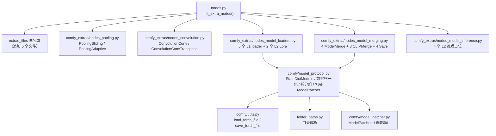

## Product Overview

在 ComfyDL 的节点体系中新增 `Network & Layers` 下的两个分类（Pooling、Convolution），并把脱水阶段移除的 MODEL 数据类型及其配套基础节点重新实装，让"权重"重新成为可在节点图中流转的一等数据。

## Core Features

### 一、Pooling 分类（Network & Layers/Pooling）

覆盖从滑动窗口池化到自适应/全局池化的完整功能，但按"输入输出格式一致即合并"的原则收敛为少量节点，通过节点上的模式下拉切换语义：

- 滑动窗口池化：可选 max / avg 两种模式，可选 1d / 2d / 3d 三个秩；窗口、步长、填充、膨胀、向上取整、填充计入分母等均为可调控件。
- 自适应池化：可选 max / avg 两种模式，可选 1d / 2d / 3d 三个秩，输出尺寸可调；输出尺寸设为 1 时即为全局池化（Global Average/Max Pooling），因此不再单列全局池化节点。

### 二、Convolution 分类（Network & Layers/Convolution）

- 卷积节点：覆盖 1d / 2d / 3d 三个秩；权重与偏置通过连线输入（与 Basic 分类的 Linear 保持同一约定），节点自身无状态、不做初始化。
- 支持参数共享概念的直观呈现：权重形状随秩变化，体现同一组权重在空间所有位置复用。
- 支持分组卷积（groups）与膨胀卷积（dilation），二者为控件。
- 支持四种填充模式：zeros / reflect / replicate / circular。
- 转置卷积节点：覆盖 1d / 2d / 3d，支持步长、填充、输出补充填充、膨胀、分组；权重与偏置同样走连线。

### 三、MODEL 数据类型与配套基础节点复装

- 恢复 MODEL 数据类型在节点图中的地位，并恢复与之配套的加载 / 合并 / 保存类基础节点（Load Checkpoint、Model Save、Model Merge 族、UNET Loader、Lora Loader、VAE 与 CLIP 加载链等），节点名与输入输出契约沿用既有习惯。
- 本阶段为"权重协议层"：加载节点按权重键前缀把权重拆分为模型 / 文本编码器 / VAE 三组并各自成包输出；合并节点按权重键对齐做张量运算；保存节点把权重落盘。不进行模型结构识别，暂不承担扩散模型推理。
- 加载、合并、保存节点在本阶段即可实际产出结果；少数依赖真实编解码/结构识别的节点（LoRA 加载、VAE 编解码、文本编码）本期以正确契约占位，执行时给出明确、可操作的说明而不是底层模块报错。

## Visual Effect

新增分类与节点出现在节点库的核心区，按分类分组展示；节点输入区左侧为权重/张量连线槽，右侧为模式与超参数控件；控件默认值开箱即用，不改任何参数即可跑出有效输出。

## 一、技术栈

- 语言 / 运行时：Python 3.14（`ComfyDL_UI\penv\Scripts\python.exe`），PyTorch（`torch.nn.functional`）。
- 节点形态：ComfyUI V3 节点 API（`from comfy_api.latest import ComfyExtension, io`），`@classmethod define_schema()` + `@classmethod execute()` + 模块级 `comfy_entrypoint()`。
- 落位：新增文件放在 `ComfyDL_UI/comfy_extras/`，由 `nodes.py` 的 `extras_files` 白名单注册（该白名单是硬编码，漏加即不注册）。`comfy_extras` 的 `python_module` 首段属 Comfy Core，前端节点库会归入核心区。
- 复用既有基础设施，不引入新依赖：`folder_paths.py`（`checkpoints`/`loras`/`vae`/`text_encoders`+`clip`/`diffusion_models`+`unet` 目录解析）、`comfy/utils.py`（`load_torch_file` 158-203、`save_torch_file` 205-209、`state_dict_prefix_replace` 237）、`comfy/comfy_types/node_typing.py`（`IO.MODEL`/`CLIP`/`VAE`/`LORA_MODEL` 已就绪）、`comfy/model_patcher.py::ModelPatcher`、`comfy/model_management.py`。

## 二、实现方案

### 2.1 Pooling：2 个节点覆盖全族

用户要求"功能全面但节点数量不要做太多，输入输出格式一致者合并"。

- `PoolingSliding`（显示名 `Pool`）：`mode`(max/avg) × `dims`(1/2/3) → 分派到 `F.max_pool{1,2,3}d` / `F.avg_pool{1,2,3}d`。
- `PoolingAdaptive`（显示名 `Adaptive Pool`）：`mode`(max/avg) × `dims`(1/2/3) × `output_size`(int) → 分派到 `F.adaptive_max_pool{1,2,3}d`（取返回元组的第 0 项）/ `F.adaptive_avg_pool{1,2,3}d`。`output_size=1` 即 Global Avg/Max Pool，因此**不单列全局池化节点**，在 docstring 与 `search_aliases` 中显式标注 `global average pooling` / `GAP` / `global max pooling`。

语义覆盖：MaxPool1/2/3d、AvgPool1/2/3d、AdaptiveAvgPool1/2/3d、AdaptiveMaxPool1/2/3d、GlobalAvg/MaxPool1/2/3d —— 原清单 4 个加 1d/3d 与 max 对称项，共 12 种语义，2 个节点。

模式无关参数必须在 docstring 中写明会被忽略：`dilation` 仅 `max` 有效（`F.avg_pool*d` 无该参数）、`count_include_pad` 仅 `avg` 有效（`F.max_pool*d` 无该参数）。`dims` 决定窗口/步长/填充/膨胀的元组长度（单值 → 各空间维同值）。

### 2.2 Convolution：2 个节点覆盖 6 种语义

- `ConvolutionConv`（显示名 `Conv`）：`dims`(1/2/3) → `F.conv{1,2,3}d`。
- `ConvolutionConvTranspose`（显示名 `ConvTranspose`）：`dims`(1/2/3) → `F.conv_transpose{1,2,3}d`。

关键决定：

1. **权重/偏置走 slot，无状态**，与 `BasicLinear` 完全对齐：`weight` 必填 `io.Tensor.Input`，`bias` 用 `optional=True`。**不设 `in_channels` / `out_channels` / `bias(bool)` 控件** —— `in_channels = weight.shape[1] * groups` 可由权重推断，偏置有无由 optional slot 决定。`groups` 无法从权重推断，且用户点名要求，故必须为控件。
2. **`padding_mode` 必须手工实现**：`F.conv{1,2,3}d` **没有** `padding_mode` 参数（只有 `nn.Conv*d` 模块有）。当 `padding_mode != "zeros"` 时，先 `F.pad(x, pad, mode=...)`（`zeros→constant` / `reflect` / `replicate` / `circular`，正好覆盖用户要求的四种），再把 `F.conv*d` 的 `padding` 传 0，避免重复填充。`F.pad` 的 `circular` 需输入秩 ≥ 3 且填充量小于对应维度尺寸，需捕获并给出可读提示而非裸栈。
3. **转置卷积不放 `padding_mode` 控件**：`nn.ConvTranspose*d` 与 `F.conv_transpose*d` 都没有该参数。
4. **教学点写进 docstring**：Conv 权重形状 `(out_channels, in_channels/groups, kH, kW)`，ConvTranspose 权重形状 `(in_channels, out_channels/groups, kH, kW)`（与 Conv 相反）；同一组权重在所有空间位置复用即"参数共享"。
5. **dtype 策略对齐 `BasicLinear`**：当 `tensor` 与 `weight` 同为浮点且 dtype 不同时，先 `torch.promote_types` 统一（fp16 激活 + fp32 权重在 fp32 下运行），而不是抛 dtype 不匹配错误。

### 2.3 MODEL 协议层：不照搬原生实现，改为 state_dict 级

子代理已用行号确认：在"不回捞 ldm"约束下照搬原生实现是行不通的 —— 所有"产生 MODEL/CLIP/VAE"的入口在 `execute` 时必然抛 `ModuleNotFoundError`：

- `comfy/sd.py:2097` `model_detection.unet_prefix_from_state_dict`（CheckpointLoaderSimple / UNETLoader 首爆点）
- `comfy/sd.py:425` `diffusers_convert` 与 `ldm.models.autoencoder`（VAELoader）
- `comfy/sd.py:40/42/44` `comfy.lora` / `lora_convert`（LoraLoader）
- `comfy_extras/nodes_model_merging.py:179` `comfy.model_base.SDXL`、`:204-216` `comfy.model_sampling` / `ModelType.EPS`（ModelSave / CheckpointSave 首爆点）

同时又确认了两条**可以安全依赖**的事实：

- `ModelPatcher.__init__`（`model_patcher.py:345`，函数体 346-404）只做属性赋值，不 import 生成模块；`clone`(434-599)、`add_patches`(846-868)、`get_key_patches`(870-891)、`model_state_dict`(893-901) **全部不含 `comfy.lora` 引用**（`comfy.lora` 的 11 处调用点 188/194/206/921/1027/1034/1224/1231/1313/1665/1932 全在 `LowVramPatch` / `patch_weight_to_device` / `patch_model` / `calculate_weight` / `patch_hook_weight_to_device`，即"**应用**补丁"的路径）。
- `comfy/utils.py` 的 `load_torch_file` / `save_torch_file` / `state_dict_prefix_replace` 与 `folder_paths.py` 的目录解析全部完好，**纯 IO，零 ldm 依赖**。

由此得到本方案的核心策略：**只走"权重搬运"，彻底避开"补丁应用"路径**。

1. **新增权重容器 `StateDictModule(nn.Module)`**：内部持有一个**扁平** `dict[str, Tensor]`，覆写 `state_dict()` / `load_state_dict()` / `_save_to_state_dict()` 使键集**原样往返**；张量按引用持有，不做拷贝、不注册为 `Parameter`。它同时提供 `get_sd()` 别名（对齐 `VAE.get_sd` / `CLIP.get_sd` 的调用习惯）。

- 为什么不用"由点号键重建嵌套子模块"：需处理键既是前缀又是叶子的冲突，且注册为 `Parameter` 会把 `requires_grad` / `nn.Module` 语义混进来。扁平字典覆写更简单、更可靠，且 `ModelPatcher` 只通过 `self.model.state_dict()` 读权重，兼容性已核实。

2. **不改 `comfy/model_patcher.py`**：原生 `state_dict_for_saving`（1745-1747）要求 `self.model.diffusion_model` 与 `model.state_dict_for_saving`（普通 `nn.Module` 没有），本方案**根本不用它**，改用 `ModelPatcher.model_state_dict()`（893-901，已核实无 lora）直接取权重。这样 `comfy/` 框架层零改动，回滚风险最小。
3. **前缀归一化（不是结构识别，只是键字符串处理）**：加载时自动探测并剥离最外层容器前缀（`model.` / `state_dict.` / `module.`，判据为"绝大多数键共享此前缀"），把 SD1.5/SDXL 的 `model.diffusion_model.*` → `diffusion_model.*`。剥离掉的前缀记录在容器上，保存时**原样回加**，保证"载入→保存"键集逐字往返。

- 归一化后天然得到三个分组：`diffusion_model.*` → MODEL、`first_stage_model.*` → VAE、`cond_stage_model.*` / `conditioner.*` / `text_encoders.*` → CLIP。未匹配任何分组的键全部归入 MODEL，保证不丢权重。
- 归一化是 `ModelMerge*` 能生效的**硬前提**：`ModelMergeSimple` 按 `diffusion_model.` 前缀取键、`add_patches` 要求键在 `state_dict()` 中逐字存在。
- 另给一个 `prefix_strip` 字符串控件（默认 `"auto"`，可填具体前缀或 `"raw"` 关闭）应对自动探测失灵的场景。

4. **合并节点按键对齐做张量运算，不构造 ModelPatcher 补丁**：原生 `ModelMergeSimple` 走 `clone()` + `add_patches()`，补丁真正生效发生在 `patch_weight_to_device` → `comfy.lora.calculate_weight`（921 行），**该路径会抛 ModuleNotFoundError**。因此合并实现为：对齐两个容器的键 → 逐键 `a*(1-w) + b*w` → 包成新的 `StateDictModule` + `ModelPatcher`。语义与原生一致（`ModelMergeAdd` 权重 (1,1)、`ModelMergeSubtract` 为 `(-1,1)`、`ModelMergeBlocks` 按键前缀分段给不同权重），且保存结果确定、可测。
5. **保存节点绕开 `save_checkpoint`**：直接用 `model.model_state_dict()` / `container.state_dict()` → `state_dict_prefix_replace` 回加前缀 → `comfy.utils.save_torch_file`（safetensors）。全部 CPU、零 GPU 依赖。

### 2.4 三层边界表（本任务最大的范围风险，须在用户确认时可见）

| 层 | 行为 | 节点 |
| --- | --- | --- |
| L1 真执行（state_dict 级，本次必须真正可用） | 读文件 / 拆分组 / 合并 / 落盘 | `CheckpointLoaderSimple`、`UNETLoader`、`VAELoader`、`CLIPLoader`、`DualCLIPLoader`、`ModelSave`、`VAESave`、`CLIPSave`、`CheckpointSave`、`ModelMergeSimple`、`ModelMergeBlocks`、`ModelMergeAdd`、`ModelMergeSubtract`、`CLIPMergeSimple`、`CLIPMergeAdd`、`CLIPMergeSubtract` |
| L2 注册 + 契约正确 + 明确报错 | 出现在节点库、可连线、IO 契约与原生一致；执行时抛可操作的 `RuntimeError`（说明"脱水模式未内置 X，回捞方式…"），**不得**是裸 `ModuleNotFoundError` | `LoraLoader`、`LoraLoaderModelOnly`（LoRA 键映射本质上是模型结构识别，与所选路线冲突）、`VAEDecode`、`VAEEncode`、`CLIPTextEncode`、`CLIPSetLastLayer`（需真实编解码/文本编码器） |


L2 的存在意义是"类型与 IO 打通、工作流可搭"（用户所选路线的原话），并在未来回捞 ldm 后原地转正。

## 三、实施要点

1. **命名与落位**：分类名沿用仓库既有拼写 `Network & Layers/Pooling`、`Network & Layers/Convolution`（用户书写的 "Layers & Network" 为顺序笔误）。Model 侧沿用原生分类 `model/loaders`、`model/merging`、`model/latent`、`model/conditioning`，节点 id 沿用原生 id（`CheckpointLoaderSimple`、`ModelSave`、`ModelMergeSimple`…），便于未来与上游对齐。
2. **共享 schema 构造器**：仿 `nodes_layers.py:33-63` 的 `_basic_schema()`，在 `nodes_pooling.py` / `nodes_convolution.py` 各写一个 `_pooling_schema()` / `_conv_schema()`（统一 `outputs=[io.Tensor.Output(display_name="output")]`）；各文件内复制既有 `_warn()`（`nodes_layers.py:107-109` / `nodes_normalization.py:69-71`）的非致命告警惯例。
3. **widget 默认值必须开箱可用**（硬规则）：

- INT 默认取典型值且落在 `[min, max]`：`dims=2`、`kernel_size=2`、`stride=1`（Pooling 用 `0` 表示"跟随 kernel_size"，需在 docstring 注明）、`padding=1`（Conv，保持同尺寸）、`dilation=1`、`groups=1`、`output_size=1`、`output_padding=0`。
- combo 默认必须存在于选项列表：`mode=max`（PoolingSliding）/ `mode=avg`（PoolingAdaptive）、`padding_mode=zeros`。
- 文件下拉：`ckpt_name` 等用 `folder_paths.get_filename_list(...)` 的动态列表，默认取列表首项（列表为空时退化为空串，节点本身此时不可用，属预期）。`prefix_strip` 默认 `"auto"`，是可直接运行的示例值而非空串。
- 命名为 `filename_prefix` 的 STRING 控件默认 `"comfydl/model"`，保证不填也能落盘。

4. **冒烟器适配（保持 0 FAIL 的硬要求）**：

- 新增的 `optional=True` 且非 widget 的 `bias` TENSOR 形参必须给默认值 `None`（冒烟器会跳过这类输入）。
- L1 加载节点不能依赖真实权重文件：在沙箱里合成一个最小 `.safetensors` 假 checkpoint（含 `model.diffusion_model.*` / `first_stage_model.*` / `cond_stage_model.*` 三组键），并把 `folder_paths` 的对应目录临时指向沙箱，让加载节点**真执行拿到 PASS**而不是 SKIP。
- L2 六个节点加入 `_SKIPPED_NODES`（理由形如 "needs a real LoRA file / text encoder / VAE implementation"）。SKIP 不计入失败。
- 为 `ModelMergeSimple`（输出权重应为两输入的加权和）、`CheckpointLoaderSimple`（三组键不串组）、`ModelSave`（确实落盘）补 `_OUTPUT_CHECKS` 值级断言。
- 沙箱产物（假 checkpoint、落盘文件）随用例结束清理，遵守"临时文件及时清理"。

5. **性能与内存**：容器按引用持权重，内存占用 ≈ 文件大小，不额外拷贝；合并是逐键 O(总参数量) 的逐元素运算，fp16 大模型会有瞬时双倍内存，采用"逐键就地写入新字典、不保留中间张量"降低峰值；保存走 safetensors，全程 CPU，不触发 `model_management` 的显存分配。
6. **爆炸半径控制**：本次不改动 `comfy/sd.py`、`comfy/model_patcher.py` 与任何既有 `comfy/` 文件（只**新增** `comfy/model_protocol.py`）；不改动现有 11 个 image 节点；不改动 `comfydl/` submodule（本次工作全在 `ComfyDL_UI` 主仓）；复核 `nodes.py` 白名单为纯追加。
7. **文档与计数**：改动后按硬规则同步两份 `FUNCTIONS.md` 与两份 `README.md`，并新增 `docs/reform-step4-pooling-convolution.md`、`docs/reform-step5-model-protocol.md`。四份说明文件涉及三套计数口径（ComfyDL banner 109/20、宿主注册表 248/38、说明文件"内置节点库"141/26），**落笔前必须先实测各口径统计脚本的真实统计范围**（`comfydl\_update_readme.py` 重建类别表与 FUNCTIONS 计数，但它不管 README 的 "provides N nodes across M categories" 总句，需手改）；预期本次新增 2 个 Pooling 分类节点 + 2 个 Convolution 分类节点 + 22 个 model 节点。

## 四、架构设计

本次改动是**追加式**的：新增 1 个 `comfy/` 辅助模块 + 5 个 `comfy_extras/` 节点文件，全部通过既有注册链进入运行时，不改动任何既有控制流。



数据流：`权重文件 → load_torch_file → 前缀归一化 → 按前缀拆分为 MODEL/CLIP/VAE 三组 → 各包成 StateDictModule → MODEL 再包进 ModelPatcher →（ModelMerge* 按键对齐做张量运算）→（ModelSave 回加前缀）→ save_torch_file 落盘`。

## 五、目录结构

```
ComfyDL_UI/
├── comfy/
│   └── model_protocol.py                          # [NEW] MODEL 协议层基础设施
├── comfy_extras/
│   ├── nodes_pooling.py                           # [NEW] Pooling 分类 2 节点
│   ├── nodes_convolution.py                       # [NEW] Convolution 分类 2 节点
│   ├── nodes_model_loaders.py                     # [NEW] model/loaders 7 节点
│   ├── nodes_model_merging.py                     # [NEW] model/merging 11 节点
│   └── nodes_model_inference.py                   # [NEW] L2 占位 4 节点
├── nodes.py                                       # [MODIFY] extras_files 白名单追加 5 行
├── cdl_smoke_tests/
│   └── run_smoke_test.py                          # [MODIFY] 沙箱假 checkpoint + SKIP/断言条目
├── docs/
│   ├── reform-step4-pooling-convolution.md        # [NEW] 施工记录
│   └── reform-step5-model-protocol.md             # [NEW] 施工记录
└── comfydl/
    ├── FUNCTIONS.md / FUNCTIONS_zh.md             # [MODIFY] 类别表 + 计数
    └── README.md / README_zh.md                   # [MODIFY] 类别表 + 总句计数
```

各文件职责与实现要求：

- **`comfy/model_protocol.py`** [NEW]：MODEL 协议层共用设施。(1) `StateDictModule(nn.Module)` —— 扁平 state_dict 容器，覆写 `state_dict`/`load_state_dict`/`_save_to_state_dict` 实现键集原样往返，张量按引用持有，附 `get_sd()` 别名与 `outer_prefix` 属性；(2) `strip_outer_prefix(sd, mode="auto")` —— 探测并剥离最外层容器前缀，返回 `(归一化后的字典, 前缀)`；(3) `split_checkpoint(sd)` —— 按 `diffusion_model.` / `first_stage_model.` / `cond_stage_model.`·`conditioner.`·`text_encoders.` 拆成三组，未匹配键归入模型组；(4) `make_model_patcher(sd)` —— 用 `comfy.model_management` 的 load/offload device 把容器包成 `ModelPatcher`；(5) `merge_state_dicts(a, b, weights, blocks=None)` —— 按键对齐的加权合并；(6) `save_state_dict(sd, outer_prefix, filename_prefix, metadata=None)` —— 回加前缀后 `save_torch_file` 落盘。全部函数写详细 docstring（干什么/入什么/出什么），只用 `comfy.utils` / `folder_paths` / `model_management`，绝不触碰 `comfy.sd` 的 guess-config 链与 `comfy.lora`。

- **`comfy_extras/nodes_pooling.py`** [NEW]：`CATEGORY = "Network & Layers/Pooling"`。`PoolingSliding` 与 `PoolingAdaptive` 两节点，统一 `_pooling_schema()` 构造器 + `POOLING_NODES` 列表 + `PoolingExtension(ComfyExtension)` + `comfy_entrypoint()`。`dims` 决定窗口/步长/填充/膨胀元组长度；`mode` 分派到对应 `F.*_pool*d`。docstring 分 `What:`/`In:`/`Out:` 三段，写明：`dims=2, kernel=2` ≡ `nn.MaxPool2d(2)`；`output_size=1` ≡ 全局池化（≡ `nn.AdaptiveAvgPool2d(1)` ≡ Global Average Pooling）；`dilation` 仅 max 有效、`count_include_pad` 仅 avg 有效（模式无关参数被忽略）；`stride=0` 表示跟随 `kernel_size`。`search_aliases` 覆盖 `maxpool2d`/`avgpool2d`/`adaptiveavgpool2d`/`global average pooling`/`GAP`/`unpool` 等。

- **`comfy_extras/nodes_convolution.py`** [NEW]：`CATEGORY = "Network & Layers/Convolution"`。`ConvolutionConv` 与 `ConvolutionConvTranspose`，统一 `_conv_schema()` + `CONVOLUTION_NODES` + `ConvolutionExtension` + `comfy_entrypoint()`。两节点均为 `slots = [tensor(必填), weight(必填), bias(optional=True, 默认 None)]`。`ConvolutionConv` 控件：`dims`/`groups`/`stride`/`padding`/`padding_mode`/`dilation`；`padding_mode != "zeros"` 时先 `F.pad`（`zeros→constant`）再把 conv 的 padding 传 0。`ConvolutionConvTranspose` 控件：`dims`/`groups`/`stride`/`padding`/`output_padding`/`dilation`，**无 `padding_mode`**。两节点都要做 BasicLinear 式的浮点 dtype 提升，并用 `weight.shape` 推断通道数、对不匹配给出可读报错。docstring 必须写明权重形状（Conv `(out, in/groups, k...)`、ConvTranspose `(in, out/groups, k...)`）与"参数共享"含义。

- **`comfy_extras/nodes_model_loaders.py`** [NEW]：分类 `model/loaders`。L1：`CheckpointLoaderSimple`（`(MODEL, CLIP, VAE)`，`ckpt_name` 来自 `checkpoints` 目录，`prefix_strip` 控件）、`UNETLoader`（`(MODEL,)`，`diffusion_models` 目录）、`VAELoader`（`(VAE,)`，`vae` 目录）、`CLIPLoader`（`(CLIP,)`，`text_encoders` 目录）、`DualCLIPLoader`（`(CLIP,)`，两个文件合并为一个容器）。分组为空时输出**空容器而非 None**，避免下游连线断裂。L2：`LoraLoader`（`(MODEL, CLIP)`）与 `LoraLoaderModelOnly`（`(MODEL,)`），保留原生 IO 契约，`execute` 抛可操作的 `RuntimeError`，说明 LoRA 键映射属结构识别、需回捞 `comfy/lora.py`。忽略掉原生 `CLIPLoader.type` 等"仅为结构识别服务"的控件，避免出现无作用的死控件。

- **`comfy_extras/nodes_model_merging.py`** [NEW]：分类 `model/merging`。合并 7 节点：`ModelMergeSimple`(ratio)、`ModelMergeBlocks`(按 `diffusion_model.` 下的键分段给权重)、`ModelMergeAdd`、`ModelMergeSubtract`、`CLIPMergeSimple`、`CLIPMergeAdd`、`CLIPMergeSubtract` —— 全部经 `merge_state_dicts()` 做**键对齐的张量运算**并产出新容器，不构造 ModelPatcher 补丁（避开 `calculate_weight` 路径）。保存 4 节点：`ModelSave`、`VAESave`、`CLIPSave`、`CheckpointSave` —— 用 `model_state_dict()` / `state_dict()` 取权重，回加 `outer_prefix` 后 `save_torch_file`；`CheckpointSave` 把三组权重按各自前缀合并进同一文件。`filename_prefix` 控件默认 `"comfydl/model"`；`RETURN_TYPES` 与原生一致（`()` + `OUTPUT_NODE = True`），docstring 说明输出目标目录。

- **`comfy_extras/nodes_model_inference.py`** [NEW]：L2 占位 4 节点 —— `VAEDecode`、`VAEEncode`（`model/latent`）与 `CLIPTextEncode`、`CLIPSetLastLayer`（`model/conditioning`）。IO 契约与原生逐字一致，`execute` 抛可操作的 `RuntimeError`（指明需回捞哪个模块），docstring 顶部明确标注"协议层占位，本阶段不可执行"。

- **`nodes.py`** [MODIFY]：仅在第 679-703 行的 `extras_files` 列表**追加** 5 行（`nodes_pooling.py`、`nodes_convolution.py`、`nodes_model_loaders.py`、`nodes_model_merging.py`、`nodes_model_inference.py`），不改动既有条目、不改动第 455/470 行的映射表（新节点由 `comfy_entrypoint` 自行注册）。

- **`cdl_smoke_tests/run_smoke_test.py`** [MODIFY]：沙箱侧新增"合成最小假 checkpoint 并把 `folder_paths` 对应目录指向沙箱"的准备步骤；`_DUMMY_OVERRIDES`/`_OUTPUT_CHECKS` 为 L1 节点补输入与值级断言；`_SKIPPED_NODES` 为 6 个 L2 节点补条目与理由。目标是 L1 拿 PASS、L2 拿 SKIP、整体 0 FAIL。

## 六、关键代码结构

以下 2 个接口是本次的架构支点，其余按既有 `nodes_layers.py` 模式照写即可，不在此重复。

```python
# comfy/model_protocol.py
class StateDictModule(nn.Module):
    """Weight container: holds a flat state_dict and round-trips its keys verbatim.

    Backed by a plain dict of tensors held by reference (no copy, no Parameter
    registration), so memory cost equals the source file. ``state_dict()`` is
    overridden to return that flat dict, which is exactly what
    ``ModelPatcher.model_state_dict`` / ``get_key_patches`` / ``add_patches`` read.
    """

    def __init__(self, sd: dict[str, torch.Tensor], outer_prefix: str = "") -> None: ...

    @property
    def outer_prefix(self) -> str:
        """Container prefix stripped on load (e.g. ``"model."``); re-added on save."""

    def get_sd(self) -> dict[str, torch.Tensor]:
        """Alias of ``state_dict()``, matching the native VAE/CLIP ``get_sd`` habit."""
```

```python
# comfy/model_protocol.py
def split_checkpoint(
    sd: dict[str, torch.Tensor], prefix_strip: str = "auto"
) -> tuple[dict[str, torch.Tensor], dict[str, torch.Tensor], dict[str, torch.Tensor], str]:
    """Split a checkpoint into (model_sd, clip_sd, vae_sd, stripped_prefix).

    Groups by key prefix only - no architecture detection is performed:
    ``diffusion_model.*`` -> model, ``first_stage_model.*`` -> vae,
    ``cond_stage_model.*`` / ``conditioner.*`` / ``text_encoders.*`` -> clip.
    Keys matching no group are kept in ``model_sd`` so nothing is dropped.
    ``prefix_strip`` is ``"auto"`` (detect and strip a shared outer prefix such as
    ``model.``), ``"raw"`` (strip nothing) or an explicit prefix string.
    """
```

## 七、验证方案

1. **冒烟测试**（硬规则）：`penv\Scripts\python.exe cdl_smoke_tests\run_smoke_test.py`，基线 226 PASS / 22 SKIP / 0 FAIL；本次预期 PASS 显著增加（4 个新分类节点 + 16 个 L1 节点真执行）、SKIP 增加 6（L2）、**FAIL 必须为 0**。另跑 `--filter Pooling`、`--filter Convolution`、`--filter Model` 做定点复核。
2. **语义正确性抽查**（`_OUTPUT_CHECKS` 内固化）：`PoolingSliding(dims=2, kernel=2, mode=max)` 与 `F.max_pool2d` 结果逐元素一致；`PoolingAdaptive(output_size=1)` 与 `F.adaptive_avg_pool2d(x, 1)` 一致；`ConvolutionConv(padding_mode="reflect")` 与 `F.pad(mode="reflect") + F.conv2d` 组合一致；`CheckpointLoaderSimple` 三组键不串组；`ModelMergeSimple(ratio=0.5)` 输出满足 `0.5*a + 0.5*b`。
3. **往返一致性**：假 checkpoint 经 `CheckpointLoaderSimple` → `CheckpointSave` 后键集与原始文件逐字一致（含 `outer_prefix` 回加），以此证明归一化不丢信息。
4. **注册与环境**：`penv\Scripts\python.exe main.py --cpu --quick-test-for-home` 启动，启动日志无 `IMPORT FAILED`；确认新分类出现在节点库核心区（`python_module` 首段为 `comfy_extras`），注意前端节点库只在页面加载时取一次，需刷新页面。
5. **文档与全仓一致性**：四份说明文件计数与实测一致；用 code-explorer 子代理全仓复查残留的失效引用（原生节点 id、`extras_files` 条目、`_archived` 路径等）。

## Agent Extensions

### SubAgent

- **code-explorer**
- Purpose: 在实现完成后对全仓做一次一致性复查，覆盖"节点 id 是否全局唯一且与原生规范一致""`extras_files` 白名单是否与新增文件名逐一对应""四份说明文件的类别表与实测节点列表是否吻合""是否残留指向已归档示例工作流的失效引用"，以及核对新增节点在 `nodes.py` / `comfy_extras` 之间的 import 边界是否干净。
- Expected outcome: 输出一份带文件路径与行号的差异清单；清单为空或差异被逐条修复后，方可进入文档计数定稿与提交阶段。