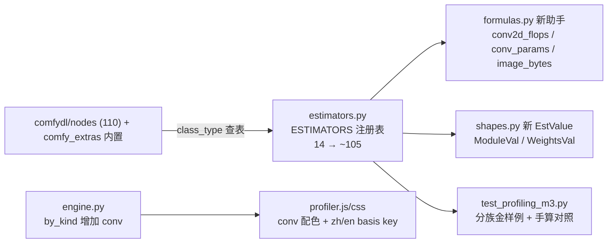

## 用户需求

扩展 ComfyUI Profiling 的两本账（M1 内存静态估算 + M2 FLOPs 计算量）的估算器规则库，使其适配大部分“可预测且需要预测”的节点：

1. **ComfyDL 自有节点**（`comfydl/nodes/` 下 110 个，覆盖张量运算、目标检测、语义分割、CV/注意力/RNN/seq2seq 模型构造、数据集、可视化等 18 个族）
2. **内置节点**：加载族（Load Checkpoint/VAE/CLIP/LoRA/UNET）+ 常用主干通路（VAE Encode/Decode、图像缩放、CLIPTextEncode 等，以本 build 实际存在的节点为准）

## 澄清结论（用户已拍板）

- **内置范围**：加载族 + 主干通路（约 15-25 个），不做全部 32 个 comfy_extras 文件
- **交付方式**：按族分批（张量 → CV/检测/分割 → NLP/seq2seq → 内置加载族），每批独立测试 + 验收 + 提交 + 双盘同步
- **精度口径**：维持诚实边界——形状可从输入推导的给 exact/approx；权重加载按文件大小 os.stat 实测（沿用 LanguageModelLoad 先例）；无法静态推断的照旧 unknown 并写明理由，宁缺毋假

## Product Overview

Profiling 面板从“只认识 14 个 LM 教学节点”升级为“认识全库绝大多数节点”：用户搭任意 ComfyDL/混合工作流时，按节点分解表中 unknown 大幅减少，内存账本与 FLOPs 账本能沿数据流跨节点传播（上游形状已知 → 下游即可推导），预算判定与瞬爆规模提示随之覆盖更广。

## Core Features

- **张量/形状代数估算**：reshape/cat/slice/conv2d/box 变换/图像归一化等约 30 个节点，输出形状静态推导，内存=张量字节、FLOPs=逐元素/卷积公式
- **模型构造器估算**：RNN/GRU/注意力/LeNet/ResNet18/Seq2Seq 等约 20 个节点按 widget 精确算参数量与权重内存（含 optimizer 态倍数），新增 conv FLOPs kind 并在面板构成条着色
- **内置加载族估算**：Checkpoint/VAE/CLIP/UNET/LoRA 按 `os.stat` 文件字节记权重常驻，VAE 编解码按 8× 下采样假设（假设集可配），Save 族记磁盘写
- **收尾降 unknown**：可视化/设备查询/misc 等约 15 个节点标记为直通/zero-FLOPs 的 estimated，面板不再误报 unknown；明确不可预测者（Nms、GAN 更新、pack/unpack）保持 unknown 并附理由
- **跨批共性**：新增 EstValue（ModuleVal/WeightsVal）、conv 公式助手、i18n basis key（zh/en）、每批金样例测试 + 第一性原理独立重推

## Tech Stack

全部沿用现有栈，零新依赖：纯 Python 估算引擎（`comfy/profiling/`，无 torch import、无节点 import、IO 仅限 os.stat）、原生 JS 面板（`app/profiling_assets/profiler.js` 小改：kind 配色 + i18n key）、脚本式冒烟测试（`cdl_smoke_tests/`）。Python ≤3.12 语法，P 盘开发 / F 盘（py3.12+cu130）复测。

## Implementation Approach

**复用既有注册表模式扩展，不引入新架构**：每个节点一个 `@register(class_type)` 估算函数，接收 `EstimationCtx`（链接已解析为上游 EstValue），返回 `NodeEstimate`（outputs 按槽序 + MemoryItem 列表 + FlopsItem 列表 + 双语 basis key）。引擎的未知传播机制（上游 Unknown → 下游 as_unknown 逐级降级）天然支持跨族数据流，无需改动。

**关键决策**：

1. **先补公式层再写估算器**（批 1 前置）：`formulas.py` 新增 `conv2d_flops`（2·Cout·Hout·Wout·Kh·Kw·Cin/groups）、`conv_param_count`、`image_bytes`（NHWC 语义助手）、`elementwise_item` 工厂；`engine.py` 的 by_kind 初始表与 `profiler.js` kindbar 同步增加 `"conv"` kind（引擎 `.get(kind,0)` 天然累加，前端配色需跟上）
2. **新增两个 EstValue**：`ModuleVal(param_count, kind_hint)`（cdlModel 模块构造器的输出，携带参数量而非 LM spec）与 `WeightsVal(file_bytes, source_path)`（内置 loader 的输出）——使 `CdlModelClone`（2× 模型）、`CdlSgdStep` 等下游节点可推导
3. **FLOPs kind 归类**：卷积/相关/池化 → `conv`；逐元素/形状操作 → `other` 且多为 zero；注意力/RNN 步进 → 沿用 attn/ffn 口径手推
4. **分批交付**（对应用户批次序，按代码耦合微调）：

- **批 1（张量/形状/CV/检测/分割，~30 个）**：tensor_basic/tensor_ops 全部、object_detection 纯张量代数 9 个（Nms 除外）、semantic_segmentation 4、image_tools 5、内置图像缩放 3、LoadImage 族 3。亮点：`CdlVocColormap2Label` 固定 16MB int64、`CdlMultiboxPrior` anchors 百万级 float32 是内存大头
- **批 2（模型构造器 NLP/seq2seq/注意力，~20 个）**：model_nlp 6、model_seq2seq 2、model_attention 8（含 DEPRECATED 仍可估）、model_utils 的 Clone/Save/Load/Info 等 7、nlp_utils 5（与现有 Text 族同构，近复制粘贴）。`CdlModelForward` 维持 unknown（模块黑盒）
- **批 3（内置加载族+主干，~20 个）**：7 个 loader 走 os.stat 文件字节（复用 `LanguageModelLoad` 的降级链：找不到文件 → approx + 假设集记一笔）、VAEDecode/VAEEncode（8× 下采样、latent 4ch 假设）、CLIPTextEncode（token 数假设）、CLIPSetLastLayer 直通、Save 族 4 个（磁盘写、flops zero）
- **批 4（收尾降 unknown，~15 个）**：可视化 12 + mesh3d 1 + device_utils 3 + misc 4 + 已知常量数据集 3（FashionMNIST 等近似）——统一 `flops_status="zero"` 或直通 estimated；Gan/GradClipping/SgdStep 等训练副作用节点尽量给保守内存（如 2× 模型）但 FLOPs unknown

5. **i18n 与面板零结构改动**：新增估算器自动改善面板（unknown → estimated 自动渲染），仅需在 profiler.js zh/en 字典补 basis key 与 conv kind 配色（css `.cdlp-k-conv`）
6. **测试范式照抄金样例**：每批在 `test_profiling_m3.py`（新文件，分族函数）用 prompt dict + 第一性原理独立重推（手算 conv FLOPs、参数量）+ unknown 口径断言；严禁只断言“不崩溃”

**性能**：估算在图变更时一次拓扑遍历，新增 ~90 个估算器均为 O(1) 算术 + 少量 os.stat（loader 已有缓存先例可循）；无热路径风险。

## Architecture

不新增架构层次，仅横向扩表：



## Directory Structure

```
ComfyDL_UI/
├── comfy/profiling/
│   ├── formulas.py         # [MODIFY] 新增 conv2d_flops、conv_param_count、image_bytes、
│   │                       #   elementwise_item 工厂；RNN/GRU/注意力参数量公式
│   ├── shapes.py           # [MODIFY] 新增 ModuleVal(param_count)、WeightsVal(file_bytes)
│   │                       #   两个 EstValue（字段对齐既有 dataclass 风格）
│   ├── estimators.py       # [MODIFY] 主体扩展：~90 个 @register 估算器，按族分区注释，
│   │                       #   每个带 docstring（入什么/出什么/置信级别）；预计增长至 ~1400 行，
│   │                       #   若超限则拆 estimators_cdl.py / estimators_builtin.py 子模块（注册表合并）
│   └── engine.py           # [MODIFY] by_kind 初始表加 "conv"；flops 聚合无其他改动
├── app/profiling_assets/
│   ├── profiler.js         # [MODIFY] i18n 字典补新 basis key（zh/en）；kindbar 增加 conv 分类
│   └── profiler.css        # [MODIFY] 新增 .cdlp-k-conv 配色（蓝紫系，与 attn 蓝区分）
├── cdl_smoke_tests/
│   └── test_profiling_m3.py # [NEW] 分族测试：每批一组函数（金样例 prompt、第一性原理重推、
│                           #   unknown 口径断言、loader os.stat 降级链、跨族传播）
└── docs/
    └── profiling-m3-estimator-families.md  # [NEW] 设计文档：批次划分、覆盖/不覆盖清单及理由、
                                            #   新公式与 EstValue、conv kind、验收清单
```

不改动任何节点文件（无 FUNCTIONS/README 四件套更新）；不动 `comfydl/nodes/` 与 `comfy_extras/` 的任何代码。

## Key Code Structures

```python
# shapes.py — 新 EstValue（接口级）
@dataclasses.dataclass(frozen=True)
class ModuleVal(EstValue):
    param_count: int          # 可静态推导的模块参数量
    kind_hint: str = ""       # "rnn"|"attention"|"conv"|"seq2seq"，供下游 FLOPs 估算参考

@dataclasses.dataclass(frozen=True)
class WeightsVal(EstValue):
    file_bytes: int           # os.stat 实测；找不到文件时 -1 + approx
    source_path: str = ""
```

```python
# formulas.py — 新助手（签名级）
def conv2d_flops(batch, out_h, out_w, out_c, in_c, kh, kw, groups=1) -> int: ...   # 2·乘加
def conv_param_count(in_c, out_c, kh, kw, bias=True, groups=1) -> int: ...
def image_bytes(batch, h, w, channels, itemsize=FLOAT32_BYTES) -> int: ...          # NHWC
def rnn_param_count(num_inputs, num_hiddens, gates=1, bias=True) -> int: ...        # GRU=3 门
```

## Agent Extensions

### SubAgent

- **code-explorer**
- Purpose: 每批动工前（medium 强度，只读）精确提取该批目标节点的 INPUT_TYPES/RETURN_TYPES/widget 默认值与实现细节（如 conv 的 stride/padding 语义、VAE 通道数、LeNet 的 Lazy 输入通道假设点），并核对估算器写入的形状公式与节点实现逐行一致
- Expected outcome: 每批产出节点签名清单与形状公式核对表，确保估算器一次写对，不靠猜