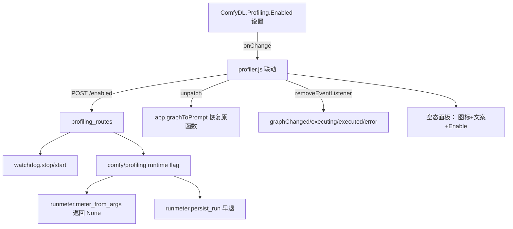

## Product Overview

Profiling 总开关：让用户能把 profiling 功能完全停用（停止对工作流解析与执行流程的劫持、停止后台采样），以及对称的一键恢复。

## Core Features

- **Settings 总开关**：`ComfyDL.Profiling.Enabled`（boolean，默认 on，user 设置持久化），前后端联动热切换，无需重启。
- **停用语义（退出全部 Run 路径）**：
- 前端：恢复被劫持的 `app.graphToPrompt`（保守恢复，防其他扩展再包层）、移除 graphChanged/executing/executed/execution_error 四个监听、清 scheduleEstimate 定时器、隐藏顶栏徽章与 watchdog 胶囊；
- 后端：watchdog 采样线程 stop()（250ms psutil 恒采样是后端恒定开销主源）、runtime flag 短路 `meter_from_args`/`persist_run`（executor 零改动）。
- **空态面板**：停用后侧栏 tab 与 Expand/overlay 切换保留，两面板内容区渲染居中空态——图标 + "Profiling currently disabled" 大字 + Enable 按钮（点击走同一 Settings onChange 联动）；样式参考 ComfyUI 宿主 Assets 面板空资产视图（大图标+主副文字居中、淡色、大间距）；en/zh 双语。
- **硬关启动参数** `--cdl-profiling-disable`：不启动 watchdog、runtime flag 恒 off 不可被端点/设置改回，前端空态下 Enable 按钮替换为“需去除启动参数重启”说明。
- **后端新端点**：`GET/POST /comfydl/profiling/enabled`（POST `{enabled}`；硬关时 POST 拒绝，GET 返回 hard_disabled 标志）；停用后手动路由（estimate/opgraph/history）保留，但空态不发请求。

## Tech Stack

- 前端：项目既有原生 JS/CSS 补丁层资产（profiler.js/profiler.css），零新依赖、零构建（宿主补丁层惯例，Monospace 永远最后兜底）。
- 后端：aiohttp 路由 + 现有 watchdog 幂等 start()/stop() 接口；runtime flag 落 comfy/profiling/ 侧（分层铁律：comfy 层不得 import app 层）。
- 测试：cdl_smoke_tests check 范式（TestServer 路由集成 + JS 括号配平静态断言）+ 真启动验证（坑 25）。

## Implementation Approach

### 系统架构



### 关键实现决策

1. **前端热切换**：新增 `applyEnabled(enabled)` 可重入函数——on：patchGraphToPrompt + 挂四监听（handler 提为命名引用存 state）+ 自动 estimate；off：保守恢复 graphToPrompt（仅当当前引用是自家 patched 函数）、removeEventListener、清 timer、隐藏徽章/胶囊（保存元素引用）、两面板渲染空态。init 顺序改为先 GET /enabled 再决定是否挂载（硬关/已停用直接空态，恢复时才 patch）。
2. **runtime flag**：`comfy/profiling/` 新小模块（如 master.py 或并入 proflog.py，按内聚定）——`is_enabled()/set_enabled()`；app 层 set；`meter_from_args` 优先查 flag 返回 None；`persist_run` flag-off 早退；executor（execution.py:751-763/883-886）零改动。
3. **硬关**：`--cdl-profiling-disable` 进 cli_args.py；server.py:283-287 条件 start；flag 初始化为 disabled 且 set_enabled 拒绝改回；GET /enabled 返回 `hard_disabled: true` 供前端区分空态按钮形态。

## Directory Structure

```
ComfyDL_UI/
├── app/profiling_assets/profiler.js   # [MODIFY] applyEnabled 热切换、命名 handler、空态渲染、i18n、init 顺序
├── app/profiling_assets/profiler.css  # [MODIFY] 空态样式（居中图标/文案/按钮，参考 Assets 空态）
├── app/profiling_routes.py            # [MODIFY] enabled 端点 + watchdog 联动 + flag set
├── comfy/profiling/                   # [MODIFY] runtime flag（proflog.py 或新 master.py）
├── comfy/profiling/runmeter.py        # [MODIFY] meter_from_args/persist_run 读 flag
├── comfy/cli_args.py                  # [MODIFY] --cdl-profiling-disable
├── server.py                          # [MODIFY] watchdog 条件启动（283-287）
├── cdl_smoke_tests/test_profiling_log.py  # [MODIFY] T4 静态断言 + enabled 端点/flag/硬关专项
└── docs/profiling-logging.md          # [MODIFY] 总开关文档章节
```

## 空态面板设计

参考 ComfyUI 宿主 Assets 面板空资产视图范式：内容区正中央垂直居中一列——顶部大号内联 SVG 图标（仪表/波形隐喻，线条风格与面板既有视觉一致，淡描边色 var(--border-color) 系）、下方 "Profiling currently disabled" 主文案（13-14px 600 字重）、副文案一行（en/zh：说明可在设置或此按钮恢复；硬关时副文案替换为“启动参数 --cdl-profiling-disable 生效中，重启后可恢复”且无按钮）、底部 Enable 按钮（沿用 .cdlp-button 主样式、醒目尺寸）。背景延续面板底色，无卡片边框；侧栏与 overlay（三列布局下中列）同一空态组件复用。侧拉/叠加切换与标题栏不受影响。字体 sans-first + tabular-nums，配色全部取宿主 CSS 变量。

## Agent Extensions

### SubAgent

- **code-explorer**
- Purpose：前置阅读阶段调研 ComfyUI 宿主前端 Assets 面板空资产态的样式范式（图标+主副文字居中、淡色、间距的具体 CSS 结构）供空态面板复刻；并复核 runmeter/profiling_routes/profiler.js 相关行号现状。
- Expected outcome：Assets 空态样式要点清单（选择器/布局/间距/配色取值）+ 前端改动点行号核对表。