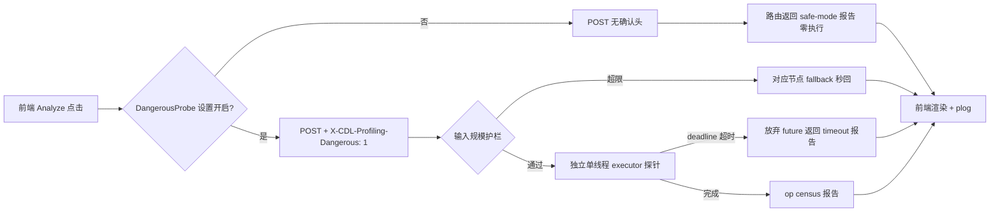

## P0 计划：Profiling v2 止血——opgraph Analyze 安全化

消除"大输入 Analyze 真实执行节点代码卡死整个 profiling 后端"的资源炸弹（用户实测：1MB tiny shakespeare 填入 LM 模板后 CPU/内存吃满、estimate 一并卡死、Ctrl+C 无效只能 taskkill）。

### 核心需求

1. **输入规模护栏**：STRING 类输入超阈值（初值 64KB/节点，可调常量）的节点直接 fallback，绝不进入探针执行；全图字符串总量超 2MB 时提前返回错误报告；
2. **危险模式门控**（ADR-1）：在线真实探针退役为显式 opt-in——前端注册 `ComfyDL.Profiling.DangerousProbe` boolean 设置（默认关，开启时轻量确认），仅在设置开启时请求附加 `X-CDL-Profiling-Dangerous: 1` 头；未附带头的 Analyze 返回 safe-mode 报告（全部节点 fallback + 可读提示），绝不执行任何节点代码；
3. **执行器隔离与超时**：探针从默认 executor 移入独立单线程 executor（thread_name_prefix 隔离日志），总体 deadline（60s 初值）+ `wait_for` 超时放弃 future；`probe_workflow` 在节点间检查 deadline，超时后剩余节点标记 "deadline exceeded"（接受已启动线程跑完才释放，文档明示此边界）；
4. **验收**：1MB corpus 场景 Analyze 秒回（fallback 或 safe-mode），estimate/refresh 全程不受影响，服务可正常 Ctrl+C；
5. **计划结构要求（用户指定）**：任务清单以"前置阅读（Comfy Docs/CustomNode Docs/memory/必要代码）"开头、以"记忆文件写入"结尾；执行守则——context 过大时先 compact 并写 memory 再继续。

### 边界

- 本 Phase 只动父仓库（`comfy/` + `app/` + `docs/` + `cdl_smoke_tests/`），不涉及 comfydl 子模块；
- 规则库（P1）、FLOPs 实测回流（P2）不在本 Phase 范围；safe-mode 报告仅是 P1 上线前的占位提示。

## 技术方案

### 现状（前置调研已核实）

- `app/profiling_routes.py:124-169`：opgraph 路由用 `loop.run_in_executor(None, opgraph.analyse_workflow, prompt)`——默认线程池 + 无超时 + 无护栏，是事故入口；
- `comfy/profiling/opgraph.py`：`_probe_one:196` 真实执行节点代码（`FakeTensorMode:53` 只 import 未使用，docstring 失实需修正）；`OPS_LIMIT:69` 已有单节点 op 上限先例；`probe_workflow:263` 拓扑循环逐节点调 `_probe_one`，上游未探出会级联 fallback（护栏可搭此便车）；
- 前端 `profiler.js`：`requestOpgraph` 已是 try/finally + plog 结构；settings 注册区已有 `ComfyDL.Profiling.LogLevel` combo 先例（`javascript_settings.md` 范式：id/category/type/defaultValue/onChange）；
- 测试先例：`test_profiling_opgraph.py`（aiohttp TestServer 路由测试、harness bootstrap）、`test_profiling_log.py`（T4 系列 JS 静态断言）；现有路由测试只断言 200 + totals/nodes/version 存在，safe-mode 报告同样满足，不会破坏既有断言。

### 实现要点

1. **护栏常量**（opgraph.py 顶部，注明可调）：`MAX_NODE_INPUT_BYTES = 64*1024`、`MAX_TOTAL_INPUT_BYTES = 2*1024*1024`、`PROBE_DEADLINE_SECONDS = 60.0`；探针前扫描 prompt 各节点 inputs 的字符串值字节数，超限节点直接构造 fallback entry（error="input too large for probe (N KB > limit)"）并跳过 `_probe_one`；全图超限直接提前返回带 error 的报告。下游节点因 "upstream not probed" 自然级联，无需额外处理；
2. **危险模式门控**（profiling_routes.opgraph）：无确认头 → 返回 version 1 的 safe-mode 报告（`"mode": "safe"`，各节点 fallback，error="probe disabled (dangerous mode off)"）+ proflog low 一条；有头 → 走探针。头由前端仅在 DangerousProbe=true 时附加；
3. **执行器隔离**：profiling_routes 模块级 `ThreadPoolExecutor(max_workers=1, thread_name_prefix="cdl-probe")`；`asyncio.wait_for(loop.run_in_executor(probe_pool, ...), timeout=PROBE_DEADLINE_SECONDS)`，超时返回带 "probe timeout" error 的报告（放弃 future，线程不可杀——文档明示）；deadline 同时传入 `probe_workflow` 在节点间协作检查；
4. **前端**：DangerousProbe boolean 设置（开启时 `window.confirm` 轻确认）→ `requestOpgraph` 按 `state.dangerousProbe` 附加头；响应含 `"mode": "safe"` 时渲染 i18n 提示卡（en/zh），plog 记录门控状态；
5. **文档**：`docs/profiling-m3-opgraph.md` 增"Safety model (P0)"章节（护栏/危险模式/超时边界/线程不可杀声明）；`opgraph.py` docstring 修正 FakeTensor 失实描述为"真实执行 + P0 安全护栏"；
6. **测试**：test_profiling_opgraph 增项（超限字符串 fallback 且未执行、全图超限提前返回、safe-mode 报告形态、带头才探针）；test_profiling_log T4 静态增项（确认头名、safe-mode i18n 键存在）；1MB corpus 场景路由级防回归；最后双盘全量冒烟（P: penv / F: penv_new）。

### 数据流

### 守则

- context 过大时先 compact 并写 memory（进度入 2026-10-06.md）再继续；
- 提交推送前 `git pull origin master --rebase`（项目惯例）；F 盘同步用 `git fetch + reset --hard origin/master + submodule update` 并复跑专项。