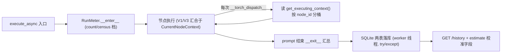

## Profiling v2 P2：实测回流（FLOPs 成为 run 的附属产物）

用户真实运行工作流时，以低开销记录每次运行 per-node 的实测 FLOPs，写入 user database 供两类用途：①纠正 estimate（measured vs formula 滚动校准比例）；②为用户提供历史记录参考。同时明确报告口径边界（fwd+bwd 合计、optimizer 漏计、复合算子双计）。

## 核心功能

- **run 期计数器**：进程级轻量 TorchDispatchMode（默认 count-only 档，census 档 opt-in），每次算子调用按 CurrentNodeContext contextvar 归属到当前执行节点；单节点 op 上限保护；DB/计数失败绝不打断执行。
- **执行路径挂载**：`execute_async` 入口挂载、出口卸载并汇总；CLI 开关 `--cdl-profiling-record {off,count,census}` 默认 count。
- **持久化**：`profiling_runs` + `profiling_node_stats` 两表（SQLAlchemy model + Alembic 0007 迁移），run 结束同步落库。
- **查询与校准**：`GET /comfydl/profiling/history`（最近 runs + per-node 明细）；estimate 报告为有历史实测的节点附 `measured_flops` 与 `ratio` 字段。
- **前端**：实测历史卡（最近 runs 列表 + 展开 per-node 明细）+ per-node "实测 vs 公式"行（en/zh）。
- **质量关**：开销基准 <5%（LM 模板与大训练负载）、训练节点（inference_mode(False)+backward+optimizer.step）兼容性实测、真启动 + 实际 Queue 落库验证、口径文档。

## Tech Stack

- 后端：Python 3.12 兼容语法（双盘规则）、torch TorchDispatchMode（TLS 语义）、SQLAlchemy 2.0 + Alembic（项目既有栈）、aiohttp 路由。
- 前端：profiler.js 原生 JS（cdlp- 前缀 + 宿主 CSS 变量，P0/P1 既有范式），无新增依赖。
- 测试：cdl_smoke_tests 既有 check() 范式 + aiohttp TestServer + 临时 sqlite；真启动 + Queue 落库验证。

## Architecture

### 挂载与归属（ADR-4）

### Module Division

- `comfy/profiling/runmeter.py`：RunMeter（计数模式：per-node {flops_total, op_count}；census 模式：另存 per-op 计数，超 OPS_LIMIT 降级为 count-only）；`snapshot()` 返回 {node_id: {...}}；contextvar 缺失的算子计入 "unattributed" 桶。
- `execution.py`：execute_async try/finally 挂/卸（courtesy 规则：任何异常吞掉 + proflog）。
- `app/database/models.py` + `alembic 0007`：两表。
- `app/profiling_routes.py`：/history 端点 + estimate 报告合并 measured 字段。
- `profiler.js`：历史卡 + 校准行 + i18n。

### Data Flow

Queue 运行 → dispatch 记账按 contextvar 分桶 → prompt 结束汇总 → create_session 同步写两表 → 前端历史卡/校准显示。

## Agent Extensions

### SubAgent

- **code-explorer**
- Purpose: p2-preread 中复核 CurrentNodeContext contextvar 在异步 task 交错下的传播语义、alembic 0006 迁移文件范式、app/database/models.py 表定义范式与 estimate 路由合并点
- Expected outcome: 精确的挂载点行号、迁移文件模板、表定义模板与 estimate 合并接口清单