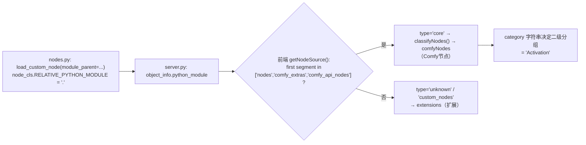
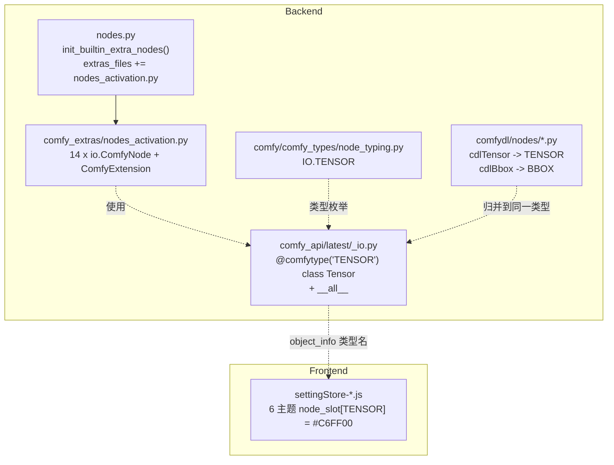

## 产品概述

把 ComfyDL_UI 从"教学演示节点集合"向"深度学习生产工具"迈出 reform 第一步：在宿主运行时里建立一套**真正属于 Comfy 核心的、语义单一、开箱可用**的激活函数节点，并为其引入一个通用的**张量数据类型**与专属配色，同时把 ComfyDL 自创的数据类型向 Comfy 官方类型归并，消除"同一语义两套类型"的分裂。

## 核心功能

- **Activation 分类（Comfy节点 之下）**：新增 14 个激活函数节点 —— Sigmoid、Tanh、ReLU、Leaky ReLU、ELU、SELU、GELU、SiLU、Mish、Softplus、ReLU6、Hard Swish、Identity、Softmax。
- **节点形态统一**：每个激活节点**恰好 1 个输入槽 + 1 个输出槽**，槽类型为通用张量；**无可学习参数**；少量超参（负斜率、alpha、dim、GELU 近似方式）一律通过节点上的 widgets 控制，并给出合理范围与开箱即用的默认值。
- **张量数据类型**：新增通用张量类型，并在连线、菜单、搜索中作为一个独立数据类型被识别；为其分配**柠檬绿 `#C6FF00`** 的专属颜色，在所有界面主题下一致生效。
- **数据类型合并**：把 ComfyDL 自创的通用张量类型、边界框类型统一归并到 Comfy 侧的同义类型上，使 ComfyDL 节点与新激活节点可以**直接互连**；无 Comfy 同义实现的类型（模型/词表/数据加载器）保持原样并明确登记为 Legacy 专用。
- **分类树保持原状**：本次只有 Activation 出现节点，`Network & Layers`、`ComfyDL EX` 不预留空分类；`d2l` 仍位于"扩展"分组下。
- **视觉结果**：打开节点库即可在「Comfy节点 → Activation」看到 14 个节点；把任意节点的张量输出连到激活节点时，连线与插槽呈柠檬绿色。

## 技术栈

- 宿主：ComfyUI v0.34.0 脱水改装版（本仓 `ComfyDL_UI/`），Python 3.14，解释器 `ComfyDL_UI\penv\Scripts\python.exe`。
- 后端节点 API：**ComfyUI V3 `io` API**（`comfy_api.latest.io`，参照 `comfy_extras/nodes_math.py` 模板）。
- 类型系统：V1 `comfy/comfy_types/node_typing.py` 的 `IO` 枚举 + V3 `comfy_api/latest/_io.py` 的 `@comfytype` 注册表。
- 前端：PyPI 包 `comfyui-frontend-package==1.51.9`，静态资源为 Vite 打包 minify 产物（**无本地 `web/` 源码**）。
- 数据计算：`torch.nn.functional` 逐元素算子，保持输入的 dtype / device。

## 实现方案

### 核心结论（修正记忆 §7 的错误诊断）

前端「Comfy节点 / 扩展」的分组**不是**按"代码是否在 `comfy/` 文件夹内"判断的，而是按 `python_module` 的**首段模块名白名单**：



因此只要节点放在 `comfy_extras/` 并以 `module_parent="comfy_extras"` 加载，就**自动成为「Comfy节点」**，无需篡改 `comfy/` 包——这正是本次选择 `comfy_extras/nodes_activation.py` 的依据。

### 关键决策

1. **Activation 节点用 V3 API 写在 `comfy_extras/nodes_activation.py`**，`CATEGORY = "Activation"`。

- 理由：V3 是官方推荐写法，`load_custom_node` 的原生分支自动处理 `RELATIVE_PYTHON_MODULE` 与显示名注册；`comfy_extras` 首段命中白名单 → 「Comfy节点」；`CATEGORY="Activation"` → 二级目录 "Activation"（前端无 `nodeCategories.Activation` 译文时回退显示原文，与目标树一致）。
- 不设 `ESSENTIALS_CATEGORY`（会落入 Essentials 区），不设 `EXPERIMENTAL`/`DEV_ONLY`（会被隐藏或降级）。

2. **张量类型 = 新建 `TENSOR`，而不是复用 `IMAGE`/`MASK`/`LATENT`**。

- 理由：内置三者语义是"专用载荷"，通用任意形状张量在内置类型中确实空缺；ComfyDL 的 `cdlTensor` 正好对应该空缺，因此 `TENSOR` 同时承担"新类型"与"归并目标"两个角色，一步到位。
- 双端注册：V1 `IO` 枚举补一项（供 V1 节点/类型提示使用），V3 `_io.py` 新增 `@comfytype(io_type="TENSOR")` 类并加入显式 `__all__`（`_io_public.py` 是 `from ._io import *`，漏加 `__all__` 会导致 `io.Tensor` 不可见）。
- 安全：`execution.py` 的类型校验只对 INT/FLOAT/STRING/BOOLEAN 做值转换、只对 combo 校验选项，对新类型字符串**无感**，无中心化白名单，新增类型不会触发校验失败。

3. **配色照 ComfyUI 官方原样做法**：在 6 套主题的 `colors.node_slot` 映射表中各加一项 `TENSOR:'#C6FF00'`。

- 已实测 6 处主题表偏移：`arc`(430430)、`dark`(432594)、`github`(434551)、`light`(438770)、`solarized`(441587)、`nord`(442935)；另有 5 处非主题 `node_slot` 命中（447535/447558/447580/947015/947170）**执行时先核查其语义**，属主题调色板/设置 schema 的需一并补齐 key 以免设置页缺项。
- `#C6FF00` 已核对与全部非空内置色（`#eacb8b #A8DADC #ad7452 #cf876f #00d78d #80a1c0 #b38ead #a3bd8d #8978a7 #C2FFAE #DCC274 #be616b`）不冲突。
- 该文件位于 site-packages，**不入版本控制**，前端包升级（文件名 hash 变化）后会丢失 → 在文档中记录"升级后需重新应用"及精确操作说明。

4. **数据类型合并 = 有 Comfy 同义实现的改名归并；无同义实现的保留原名**。

- `cdlTensor` → `TENSOR`（归并到本次新建的 Comfy 类型，含算法常量表与文档类型表）。
- `cdlBbox` → `BBOX`（内置已有同义类型 `IO.BBOX`，且该类型当前零引用，改名零风险）。
- `cdlModel` / `cdlVocab` / `cdlDataloader`：内置无同义实现（内置 `MODEL` 指扩散模型，语义不同）→ **保留原名**，在常量表与文档中明确登记为 Legacy 专用。
- 复用项目自带的改名工具 `comfydl/_update_nodes.py` 的映射表风格记录本次改名（该文件本来就是干这个的，不新造轮子）。

### 性能与可靠性

- 激活计算为逐元素 O(n)、访存受限；实现上只做一次分配，不引入中间张量副本，不做 `.cpu()`/`.numpy()` 往返，`Identity` 直接透传输入对象（零拷贝）。
- `Softmax` 为归约型 O(n)；`dim` 越界时按张量实际维度归一化（钳制），避免抛异常破坏工作流。
- 保持输入 dtype/device 不变（fp32/fp16/bf16 均可），不做隐式升/降精度。
- 类型改名是**纯字符串常量替换**，运行期无额外开销；后端链路类型仅作文档/前端连线校验用途，不参与运行期数据搬运。

### 避免技术债

- 复用现有模式：V3 节点模板照抄 `nodes_math.py` 结构；配色沿用官方 `node_slot` 机制；改名沿用 `_update_nodes.py` 映射约定；文档沿用项目双语规范。
- 不新增前端扩展、不改 `comfy/` 包的注册链、不动 `init_builtin_dl_nodes()` —— 均无必要。

## 实施要点（执行注意）

- **注册名单是硬编码**：`nodes.py:679-697` 的 `extras_files` 列表必须手动追加 `"nodes_activation.py"`，否则节点不会被加载（该列表不含 glob）。
- **`__all__` 是显式的**：`comfy_api/latest/_io.py:2385-2497` 需追加 `"Tensor"`，否则 `io.Tensor` 在 `define_schema` 中不可用。
- **widgets 默认值必须开箱可用**（项目规则）：INT/FLOAT default 必须在 `[min,max]` 内且为典型值；combo default 必须在选项列表内。
- **每个节点必须写详细 docstring**（做什么/入什么/出什么），并保证不改参数即可产出有效输出。
- **命名不得与内置冲突**：14 个节点 id 统一加 `Activation` 前缀（如 `ActivationSigmoid`），显示名为短名（如 `Sigmoid`）。
- **前端文件为 minify 单行**：修改时按 `node_slot:{...}` 的整段锚点做精确插入，插在 `STRING` 项后以保持字母序；改完必须实测加载一次页面，避免破坏 JS 语法导致白屏。
- **改动范围控制**：本次不做 `CdlActivation` 的删除/弃用（与 14 个新节点功能重叠），仅在文档中标注关系，交由后续决定；不改其余 102 个 ComfyDL 节点的行为，仅改类型名字面量。
- **submodule 提交链**：`comfydl/**` 的改动需在 submodule 内提交并 push，再回主仓 `git add comfydl` 更新 gitlink 并提交。
- **git 约定**：命令在 `P:\Dev\ComfyUI_Refs\ComfyDL_UI\` 执行，带 `-c safe.directory=P:/Dev/ComfyUI_Refs/ComfyDL_UI`；cmd 下 `&&` 会被转义，命令分条写；推送前 `git pull origin master --rebase`；提交信息 `<type>(<scope>): <subject>`。
- **临时文件**：验证期间产生的日志/JSON 必须清理，不留垃圾。

## 架构设计

本次改动是"在既有注册链上新增一个核心节点文件 + 扩一条类型定义"，不引入新架构模式：



## 目录结构

```
ComfyDL_UI/
├── comfy_extras/
│   ├── nodes_activation.py                         # [NEW] 14 个 Activation 节点（V3 io API）。职责：定义单输入单输出、无可学习参数的激活函数节点。实现要求：每节点 1 个 io.Tensor.Input + 1 个 io.Tensor.Output；CATEGORY="Activation"；node_id 统一 Activation 前缀、显示名用短名；LeakyReLU 暴露 negative_slope(FLOAT,0.01,0..1,0.01)，ELU 暴露 alpha(FLOAT,1.0,0..100,0.01)，Softmax 暴露 dim(INT,-1,-4..4,1) 且越界时钳制，GELU 暴露 approximate(COMBO ['none','tanh'],默认 'none')；SELU/ReLU6/HardSwish/Mish/SiLU/Softplus/ReLU/Sigmoid/Tanh/Identity 无参；全部按输入 dtype/device 计算，Identity 零拷贝透传；每个类写详细 docstring；文件末尾提供 ComfyExtension 与 comfy_entrypoint()（async）。
│   └── nodes_math.py                               # [参考] V3 节点写法模板（不改）
├── nodes.py                                        # [MODIFY] init_builtin_extra_nodes() 的 extras_files 列表追加 "nodes_activation.py"（硬编码名单，必须手动加）。
├── comfy/comfy_types/
│   └── node_typing.py                              # [MODIFY] IO 枚举新增 TENSOR = "TENSOR"（放在 VIDEO 之后），使 V1 类型清单与 V3 一致。
├── comfy_api/latest/
│   └── _io.py                                      # [MODIFY] 新增 @comfytype(io_type="TENSOR") class Tensor(ComfyTypeIO): Type = torch.Tensor，附 docstring 说明"任意形状通用张量，非 IMAGE/MASK/LATENT"；并在显式 __all__（:2385-2497）中追加 "Tensor"。
├── docs/
│   ├── comfydl-builtin.md                          # [MODIFY] 更新冒烟基线（CORE_AFTER 由 113 → 新增 14 个后实测值）、分类数（16 → 17）、新增"reform 第一步"章节：Activation 分类来源、TENSOR 类型、前端配色操作位置与"前端包升级后需重新应用"的提示、类型归并表。
│   └── reform-step1-activation-tensor.md           # [NEW] 双语说明：设计动机、14 节点清单与参数表、TENSOR 类型与 `#C6FF00` 配色、ComfyDL 类型归并表（含 cdlModel/cdlVocab/cdlDataloader 保留说明）、CdlActivation 关系备注、验证记录、回退方式。
├── penv/Lib/site-packages/comfyui_frontend_package/static/assets/
│   └── settingStore-KkBYyEnh.js                    # [MODIFY-外部，不入版本控制] 在 6 处主题 colors.node_slot 映射中各插入 TENSOR:'#C6FF00'；并核查另 5 处非主题 node_slot 命中是否也需补 key。
└── comfydl/                                        # [submodule] 需在子模块提交后再回主仓更新 gitlink
    ├── nodes/__init__.py                           # [MODIFY] :18-30 类型常量表改为"指向 Comfy 实现的别名"：TENSOR = "TENSOR"（canonical）、cdlTensor = TENSOR（legacy alias）、BBOX/cdlBbox 同理；cdlModel/cdlVocab/cdlDataloader 保留原名并注明为 Legacy 专用。
    ├── nodes/*.py                                  # [MODIFY] 机械替换字面量 "cdlTensor" → "TENSOR"、"cdlBbox" → "BBOX"（tensor_basic/tensor_ops/model_*/object_detection/semantic_segmentation/datasets/nlp_utils/gan/misc/visualization/image_tools 等）。
    ├── _update_nodes.py                            # [MODIFY] 在旧名映射表中登记本次改名（cdlTensor→TENSOR、cdlBbox→BBOX），供后续批量迁移复用。
    ├── FUNCTIONS.md / FUNCTIONS_zh.md              # [MODIFY] 更新自定义类型表（cdlTensor→TENSOR、cdlBbox→BBOX 归并说明）与节点说明。
    └── README.md / README_zh.md                    # [MODIFY] 同步类型/节点数量相关表述（不可统计时移除统计）。
```

## 关键代码结构

V3 新类型定义（`comfy_api/latest/_io.py`，与既有 `Image`/`Mask` 同构，是本次多处依赖的契约）：

```python
@comfytype(io_type="TENSOR")
class Tensor(ComfyTypeIO):
    '''Generic N-D tensor of arbitrary shape.

    Unlike IMAGE / MASK / LATENT (which carry specific semantics), TENSOR is a
    shape-agnostic torch.Tensor slot used by the Activation and ComfyDL nodes.
    '''
    Type = torch.Tensor
```

Activation 节点骨架（`comfy_extras/nodes_activation.py`，其余 13 个同构）：

```python
class ActivationSoftmax(io.ComfyNode):
    """Element-wise activation node (Softmax).

    What: normalizes the input tensor along the selected dimension.
    In:   tensor (TENSOR) - any shaped tensor.
    Out:  output (TENSOR) - same shape, values normalized along `dim`.
    """

    @classmethod
    def define_schema(cls) -> io.Schema:
        return io.Schema(
            node_id="ActivationSoftmax",
            display_name="Softmax",
            category="Activation",
            inputs=[
                io.Tensor.Input("tensor"),
                io.Int.Input("dim", default=-1, min=-4, max=4, step=1,
                             tooltip="Dimension to normalize over (clamped to the tensor rank)."),
            ],
            outputs=[io.Tensor.Output(display_name="output")],
        )

    @classmethod
    def execute(cls, tensor, dim: int) -> io.NodeOutput:
        ...
        return io.NodeOutput(out)
```

14 个节点的 widget 规范（未列出的均为无参）：

| 节点 (node_id) | 显示名 | 额外 widget |
| --- | --- | --- |
| ActivationSigmoid | Sigmoid | - |
| ActivationTanh | Tanh | - |
| ActivationReLU | ReLU | - |
| ActivationLeakyReLU | Leaky ReLU | `negative_slope` FLOAT default 0.01, min 0.0, max 1.0, step 0.01 |
| ActivationELU | ELU | `alpha` FLOAT default 1.0, min 0.0, max 100.0, step 0.01 |
| ActivationSELU | SELU | - |
| ActivationGELU | GELU | `approximate` COMBO ["none","tanh"] default "none" |
| ActivationSiLU | SiLU | - |
| ActivationMish | Mish | - |
| ActivationSoftplus | Softplus | -（torch 默认 beta=1, threshold=20） |
| ActivationReLU6 | ReLU6 | - |
| ActivationHardSwish | Hard Swish | - |
| ActivationIdentity | Identity | -（透传） |
| ActivationSoftmax | Softmax | `dim` INT default -1, min -4, max 4, step 1 |


## 使用的扩展

### Skill

- **lsp-code-analysis**
- Purpose: 在把 ComfyDL 的 `cdlTensor`/`cdlBbox` 归并为 Comfy 类型之前，做一次语义化的引用影响面分析（查找定义、查找引用、调用层级），确保没有遗漏的字面量使用点或跨文件引用。
- Expected outcome: 得到一份"待改文件 + 精确位置"的完整清单，并确认改名后无残留引用；同时验证新增的 `io.Tensor` 定义能被正确解析引用。

### SubAgent

- **code-explorer**
- Purpose: 批量梳理并核对与"节点数量/类型清单"相关的文档表述与注册名单（`comfydl/FUNCTIONS*.md`、`README*.md`、`docs/comfydl-builtin.md`、`nodes.py` 的 `extras_files`），避免数量口径不一致或漏改。
- Expected outcome: 输出一份可直接照着改的文档位置清单（文件:行号 + 现状文本），改完后能验证 4 个说明文件与 2 个 docs 的数量/类型表述全部自洽。