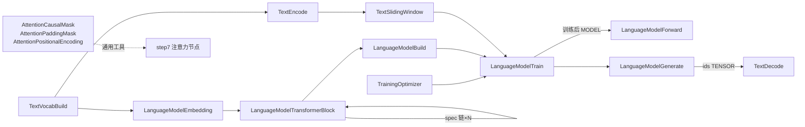

## 产品概述

以「给定一批语料词汇，训练一个语言模型并与它对话」为需求导向，为 ComfyDL_UI 内置节点库新增一批**教学级语言模型（LM）流水线节点**，覆盖完整闭环：文本语料 → 分词/词表 → 滑窗数据集 → 模型结构声明 → 单节点内训练 → 前向推理 → 自回归生成文本。同时补齐核心注意力族缺失的配套工具（因果掩码、填充掩码、位置编码）。

## 设计原则

- **实用性优先**：默认参数开箱可用——不改任何控件即可用示例语料跑通「训练 + 生成」全链路。
- **泛用性优先**：掩码/位置编码是通用张量工具（服务所有注意力节点，不限于 LM）；生成节点输出 token 索引 TENSOR（文本无关）；trainer 复用现有 `OPTIMIZER` 槽（吃任何 `TrainingOptimizer` 输出）。
- **结构走连线、超参走 widget、参数由 trainer 拥有**（与 step6/step7 哲学一致）。
- 参考草稿清单但去粗取精：合并冗余项（LM Head 并入模型 spec 的输出投影）、剔除低价值项（RNN/LSTM spec、chat 交互节点、legacy 训练器）。

## 核心功能（13 个新节点，3 个分类）

1. **Attention 扩充（+3，`Network & Layers/Attention`）**：`AttentionCausalMask`（下三角 bool 掩码，SDPA 语义 True=可注意）、`AttentionPaddingMask`（按有效长度生成填充掩码）、`AttentionPositionalEncoding`（sinusoidal 位置编码，可加性注入）。
2. **Text 新分类（+4，`Network & Layers/Text`）**：`TextVocabBuild`（语料→词表+词表大小）、`TextEncode`（文本→token 索引 TENSOR）、`TextDecode`（token 索引 TENSOR→文本）、`TextSlidingWindow`（token 流→ (x,y) 下一词预测数据集）。
3. **模型与训练（+6，`Network & Layers/Training`）**：`LanguageModelEmbedding`（嵌入层 spec，可选内置位置编码）、`LanguageModelTransformerBlock`（Transformer 块 spec，spec 链式堆叠任意深度）、`LanguageModelBuild`（spec 链→物化模型，seeded 确定性初始化）、`LanguageModelTrain`（单节点内完整训练闭环，接 OPTIMIZER 槽）、`LanguageModelForward`（模型+索引→logits TENSOR）、`LanguageModelGenerate`（prefix 自回归生成，温度/seed 可控，输出文本+索引）。

视觉上无新 UI 组件，仅为节点库新增 13 个节点与 1 个新分类分组。

## 技术栈

- 沿用项目现有栈：Python 3.14（venv `ComfyDL_UI\penv\`）+ PyTorch + ComfyUI V3 节点 API（`comfy_api/latest/_io.py `的 `@comfytype`/`io.ComfyNode`）+ `comfy_extras` 硬编码白名单注册。
- 协议层零新依赖：`comfy/model_protocol.py` 只 import torch（对齐 `training_protocol.py` 的脱水可导入约束）。

## 实现方案（关键决策与理由）

### 1. 架构路线：模型对象 + spec 链，而非纯 TENSOR 拼装

`execution.py:751` 用 `torch.inference_mode()` 包住整轮 prompt，**梯度无法跨节点存活**——纯 TENSOR 数据流拼出的“模型”到 trainer 节点时计算图已断。因此 trainer 必须接收**可物化的模型对象**（同 step6 `TrainingLoop`、legacy `cdlModel` 先例）。

结构声明采用 **spec 链**：每个 spec 节点有 optional `spec` 输入接前一节、输出累积后的链表。用普通槽位即可表达任意深度，无需前端变长输入支持。`LanguageModelBuild` 将 spec 链物化为 `nn.Module`（seeded 确定性初始化），`LanguageModelTrain` 在单节点体内完成 `inference_mode(False)` + detach/clone + forward/backward/step，输出**训练后的新模型对象 + loss 历史**（不污染缓存：输出是不可变新值）。

### 2. 复用与互操作

- trainer 直接消费现有 `OPTIMIZER` 槽（`tp.build_optimizer(config, parameters)`），与 step6 训练族无缝互通。
- 掩码节点输出直接接 step7 `AttentionSelf`/`AttentionMultihead` 的 `mask` 槽（SDPA 语义已在 docstring 声明）。
- `LanguageModelGenerate` 输出 token 索引 TENSOR + STRING 双输出；`TextDecode` 独立存在 → 生成节点不被文本编码绑死（可喂任意 VOCAB）。
- 位置编码：`PositionalEncoding` 为纯函数节点（无参）；模型 spec 的 `include_position` 控件默认自带 PE（对齐 d2l `TransformerEncoder`），两条路径都可用。

### 3. 新类型注册

在 `comfy_api/latest/_io.py` 照 `Params`（:692）模式添加 3 个 `@comfytype`：`VOCAB`、`MODELSPEC`、`NNMODEL`。**⚠ 实现前必须先核对 `_io.py` 全量 io_type 列表避免命名冲突**（ComfyUI 核心已有 `MODEL`，故模型类型不可叫 `MODEL`；同理确认 `VOCAB` 未被占用，冲突则改名 `CDLVOCAB`）。

### 4. 类型契约

- `VOCAB`：冻结的词表对象（token↔idx 双向映射 + `<unk>` 策略），可安全缓存。
- `MODELSPEC`：spec 链（tuple of frozen dataclass），无设备状态。
- `NNMODEL`：物化 `nn.Module`（同 legacy `cdlModel` 先例，ComfyUI 按 Python 对象缓存，无序列化问题）。

### 5. 性能与可靠性

- 训练循环为 Python 级（教学定位），steps 控件加 `STEPS_WARN_THRESHOLD` 式上限告警（复用 step6 模式）；默认 steps 取小网络典型收敛值。
- 生成循环 greedy/temperature 采样用局部 `torch.Generator(seed)`，不碰全局 RNG（缓存正确性）。
- 全屏蔽行 NaN 防护：掩码节点复用 step7 `finfo.min` 约定。
- 语料超大时 `TextVocabBuild` 只 warn 不截断（教学场景自担），词表输出 INT 大小供 spec 联动。

### 6. 计数影响（三套口径，按记忆约定分别更新）

- 宿主注册表：287/45 → **300/46**（+13 节点、+1 分类 Text）。
- 四份说明文件：181/33 → **194/34**（core 72→85；N&L 49→62 = Attention 4→7、Training 11→17、新 Text 4）。
- ComfyDL banner 109/20 不变（本批全为 core 节点）。

## 架构图



## 目录结构

```
ComfyDL_UI/
├── comfy/
│   └── model_protocol.py            # [NEW] LM 协议层：Vocab 类、encode/decode、EmbeddingSpec/TransformerBlockSpec
│                                    #   冻结 dataclass、build_module(spec链)→nn.Module（seeded init）、
│                                    #   自回归解码循环。只 import torch，模式对齐 training_protocol.py。
├── comfy_api/latest/
│   └── _io.py                       # [MODIFY] 照 Params(:692) 模式新增 VOCAB/MODELSPEC/NNMODEL 三个
│                                    #   @comfytype（注册前先核对 :2472+ 类型列表防重名）。
├── comfy_extras/
│   ├── nodes_attention.py           # [MODIFY] 追加 3 节点：AttentionCausalMask / AttentionPaddingMask /
│                                    #   AttentionPositionalEncoding（纯函数，bool 掩码 SDPA 语义，
│                                    #   输出直接可接 step7 mask 槽；跨模块导入一律绝对导入）。
│   ├── nodes_text.py                # [NEW] 4 节点：TextVocabBuild / TextEncode / TextDecode /
│                                    #   TextSlidingWindow。分类 Network & Layers/Text。
│                                    #   TextVocabBuild 默认语料给可运行示例（开箱可用铁律）。
│   └── nodes_lm.py                  # [NEW] 6 节点：LanguageModelEmbedding / LanguageModelTransformerBlock /
│                                    #   LanguageModelBuild / LanguageModelTrain / LanguageModelForward /
│                                    #   LanguageModelGenerate。分类 Network & Layers/Training。
│                                    #   Train 复用 tp.build_optimizer + OPTIMIZER 槽 + inference_mode(False) 闭环。
├── nodes.py                         # [MODIFY] extras_files 白名单加 nodes_text.py、nodes_lm.py（漏加即不注册）。
├── cdl_smoke_tests/
│   └── run_smoke_test.py            # [MODIFY] 新节点全覆盖：_VALUE_FACTORIES（VOCAB 经节点构造、
│                                    #   spec 经节点构造）+ _INPUT_OVERRIDES（配套形状）+ _OUTPUT_CHECKS
│                                    #   （掩码形状/三角性、词表 roundtrip、loss 单调下降、生成非空、
│                                    #   parity 对照 nn.TransformerEncoderBlock）。
├── docs/
│   └── reform-step8-language-model.md  # [NEW] step8 设计文档：spec 协议、类型契约、约束与验证记录。
├── docs/comfydl-builtin.md          # [MODIFY] 追加 step8 段（+13 节点说明与计数）。
└── comfydl/
    ├── FUNCTIONS.md / FUNCTIONS_zh.md  # [MODIFY] 新增 13 节点条目 + Text 分类（计数 194/34）。
    ├── README.md / README_zh.md        # [MODIFY] 库总计句另起一段手写（防脚本改写）。
    ├── _update_readme.py               # [MODIFY] _CAT_DESC 增 Network & Layers/Text 描述。
    └── locales/zh/nodeDefs.json        # [REGEN] gen_locales.py 自动重建（13 条新中文描述）。
```

## 关键代码结构

```python
# comfy/model_protocol.py — spec 链契约（冻结、无设备状态、可缓存）
@dataclasses.dataclass(frozen=True)
class EmbeddingSpec:
    vocab_size: int
    d_model: int
    include_position: bool = True

@dataclasses.dataclass(frozen=True)
class TransformerBlockSpec:
    d_model: int
    num_heads: int
    d_ffn: int
    activation: str = "relu"
    dropout: float = 0.0

def build_module(spec_chain: tuple, *, seed: int) -> nn.Module:
    """Materialize a spec chain into an nn.Module (deterministic seeded init)."""

def generate_tokens(model, vocab, prefix_ids, num_tokens, *, temperature, seed) -> torch.Tensor:
    """Autoregressive next-token loop on a local torch.Generator."""
```

## 实施注意（防回归要点）

- **分支基线**：step7 在实验分支 `reform-step7-attention`（master 未合入）。本批以当前工作区分支为基继续；实现开始时与用户确认分支策略（默认：直接在当前实验分支续作，交付后随 step7 一并合入）。
- **跨模块导入必须绝对导入**（`from comfy_extras.nodes_attention import …`），相对导入在该分支 `load_custom_node` 下必炸。
- **widgets 默认值开箱可用**：`TextVocabBuild.corpus` 给示例语料；d_model=32/num_heads=4（整除）；steps=300、lr 走 OPTIMIZER 默认 0.01；temperature=1.0。
- **`_rerun_v3` 未显式传入的张量输入会重新随机**——冒烟断言依赖输入一致性时必须全量传入。
- 训练节点输出**新模型对象**而非原地改（缓存正确性）；docstring 按「干什么/入什么/出什么」三段式逐节点写全。
- 冒烟基线 264/23/0 → 本批后 300 节点零 FAIL 方可交付；临时脚本用完即删。