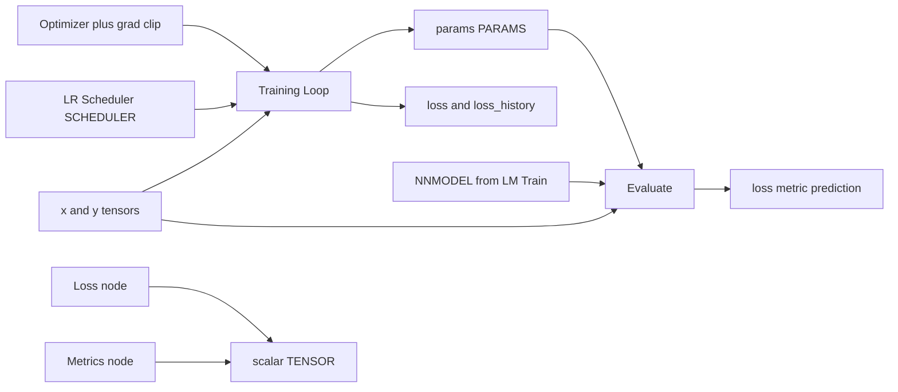

## 产品概述

为 ComfyDL_UI 的 Network &amp; Layers/Training 分组补齐"训练闭环"：把学习率调度、损失、指标、评估从训练节点内部拆成可连线的图节点，并给两个训练节点（Training Loop / Language Model Train）补上调速器连线、梯度裁剪与早停。

## 核心功能

- 新增 LR Scheduler 节点：StepLR / CosineAnnealingLR / ExponentialLR / OneCycleLR / ReduceLROnPlateau，输出可连线的调度器配置；配套新增连线类型 SCHEDULER。总步数与最大学习率自动取自训练节点与 Optimizer 配置，用户无需手填。
- 新增 Loss 节点：mse / l1 / smooth_l1 / cross_entropy / bce_with_logits / kl_div，输入 prediction + target，输出标量 loss，用于评估或自定义训练目标。
- 新增 Metrics 节点：mae / rmse / accuracy / top_3 / top_5 / perplexity，输入 prediction + target，输出标量指标。
- 新增 Evaluate 节点：只评估不训练。收 NNMODEL 或 PARAMS（配 activation 控件）加 x/y，可选用 loss/metric 控件，输出 loss、metric、prediction。
- 改造 Optimizer 节点：新增 grad_clip_norm / grad_clip_value 两个控件（默认 0 表示关闭），随 OPTIMIZER 连线传给训练节点，不新增节点与类型。
- 改造 Training Loop 与 Language Model Train：可选的 SCHEDULER 输入；按步推进调度器（plateau 类型用当步平滑 loss 驱动）；按配置做梯度裁剪；新增早停控件（patience 默认 0 表示关闭、min_delta 默认 1e-4）。早停触发时回滚到监控指标最佳点的参数、把 loss_history 截断到该点，并打印停止步与最佳 loss。
- 交互与视觉效果：新节点以既有卡片样式出现在 Training 分类下，控件默认值开箱可用；不接调度器、不填裁剪与早停时，输出与行为跟现在完全一致（老工作流不受影响）。

## 技术栈与约束

- 语言/运行时：Python 3.14（仓库虚拟环境 `ComfyDL_UI\penv`），PyTorch 既有版本；不新增任何第三方依赖（`torch.optim.lr_scheduler`、`torch.nn.utils.clip_grad_norm_/clip_grad_value_` 均为 torch 自带）。
- 节点框架：ComfyUI V3 节点 API（`from comfy_api.latest import ComfyExtension, io`，`io.Schema` + `@classmethod execute`），沿用 `comfy_extras/nodes_training.py`、`comfy_extras/nodes_lm.py` 既有写法。
- 新连线类型：用 `comfy_api/latest/_io.py` 里既有的 `@comfytype(io_type=...)` 装饰器注册，与 `PARAMS` / `OPTIMIZER` / `VOCAB` / `NNMODEL` 完全同构。
- 协议层不变式：`comfy/training_protocol.py` 类模块只依赖 torch / safetensors，可在脱水构建中导入；新逻辑必须继续满足这条边界。

## 实现方案（总体策略）

1. **协议先行、纯函数承载数学**：调度器、裁剪、早停判定、损失与指标全部先落成不可变配置或纯函数，节点只做"widget 到配置"和"配置到 torch 调用"的搬运。损失/指标数学同时被 Loss 节点、Metrics 节点、Evaluate 节点与两个训练节点复用，避免同一公式出现多份实现。
2. **配置走连线、超参走控件**：SCHEDULER 是与 OPTIMIZER 平行的新连线类型（配置对象，不含 device 状态，可被 ComfyUI 安全缓存）；梯度裁剪进入既有 OPTIMIZER 载荷，早停进入训练节点的控件。这不引入新类型，且连线天然参与缓存签名——改一行调度配置会让下游训练节点重算。
3. **默认路径零开销**：调度器未连线、`grad_clip_norm=grad_clip_value=0`、`early_stop_patience=0` 时，循环体与当前实现逐字相同，不产生任何额外张量操作；启用后才每步增加一次 O(P) 的裁剪或一次 O(1) 的调度器步进。
4. **早停的确定性**：监控量取每步 loss 的滑动平均（模块级常量窗口），`patience` / `min_delta` 做纯函数判定，仅在指标改善时对 `state_dict` 做一次 O(P) 快照；触发时回滚参数、截断 history。判定只依赖 loss 序列，因此同 seed 同配置恢复结果完全可复现。
5. **plateau 型调度器需要 metric**：`ReduceLROnPlateau` 由训练节点用滑动平均 loss 调 `scheduler.step(metric)`，其余调度器按迭代步进；`build_scheduler` 通过第二个返回值告知调用方走哪条路径。
6. **总步数自动解析**：`t_max=0` 表示"跟随训练节点的步数"，`OneCycleLR` 的 `total_steps` 同样取训练节点的 iterations、`max_lr` 取 OPTIMIZER 的 lr。用户不必额外填"总步数"，点击即用。
7. **Evaluate 双入口**：先看 NNMODEL（有 `forward` 直接前向，识别 `vocab_size` 则走 token 级交叉熵）；只给 PARAMS 时用 `layer{i}.weight/bias` 的形状重建 MLP（宽度来自各 weight 的 in/out，activation 由控件给出），复用 `tp.MLP` + `tp.load_into_module`，与 Training Loop 的命名约定严格一致。

## 实现要点（执行细节）

- **向后兼容**：`OptimizerConfig` 新增字段一律带 0.0 默认值，`optimizer_config()` 在边界处归一化，因此老工作流、老 API 调用缺字段时按"关闭"处理；`TrainingLoop` 的 `loss` 下拉只做增量扩项（默认仍是 mse，老值仍合法）；两个训练节点的新 `scheduler` 输入为 `optional=True`，未连线时行为与现在完全一致。冒烟 harness 明确"可选槽默认不接"（`run_smoke_test.py` 中 `_WIDGET_TYPES` 上方注释），因此不会自动给训练节点塞一个调度器。
- **不污染输入、不泄漏图**：两个训练节点现有实现已用 `torch.inference_mode(False)` + `copy.deepcopy` + 输入 `clone()`；裁剪、调度、快照与回滚必须全部作用在副本上，且任何输出都不得携带 autograd 图或 grad（沿用现有 `detach()` / `parameter.grad = None` 收尾）。
- **回滚顺序**：先回滚参数，再重算 prediction（现有代码本就在循环结束后算 prediction，保持该顺序即可），`loss` 输出取回滚点对应的最佳监控值。
- **进度与中断**：沿用 `comfy.utils.ProgressBar(iterations)` 的每步 `update(1)`（它同时是中断检查点）；早停提前退出时不得再推进进度条。
- **日志**：沿用 `[Network &amp; Layers]` 前缀的 `print` 与 `LOGGER.warning` 风格；新增信息（调度器描述、裁剪设置、早停停止步与最佳 loss）只并入既有的单行摘要，绝不打印张量内容。
- **影响面控制**：只改 `nodes_training.py` / `nodes_lm.py` / `training_protocol.py` / `_io.py` 与测试、文档；不动脱水清单（`nodes.py` 的 `extras_files` 已包含这两个节点文件，新节点自动注册）。
- **文档计数**：四份说明文件里的节点数必须用注册表实际统计结果改写（跑冒烟或统计脚本），不要用算术推断；`gen_locales.py` 只覆盖 comfydl 自身的 109 个节点，本批不新增语言条目，但仍跑一次 `--check` 确认无差异。
- **冒烟断言要对齐 torch 真值**：调度器逐 step 比对 `torch.optim.lr_scheduler` 同名实现的 `get_last_lr()`；损失/指标比对 `torch.nn.functional` 或手算值；另外覆盖"训练输入不被污染""同 seed 可复现""早停触发后 history 截断且返回最佳参数""裁剪确实改变参数更新"四类回归。

## 架构设计

新增的都是"Training 分组内的普通节点 + 一个协议模块内的纯函数层"，不改动注册与执行架构。数据流如下：



- 协议层 `comfy/training_protocol.py`：训练侧配置与辅助（OptimizerConfig、SchedulerConfig、seeded_rng、build_optimizer、build_scheduler、裁剪、快照、早停判定）。
- 数学层 `comfy/training_metrics.py`（新）：损失与指标的纯 torch 实现，供四个新节点与两个训练节点共用。
- 节点层：`comfy_extras/nodes_training.py`（4 个新节点 + 2 个改造节点）、`comfy_extras/nodes_lm.py`（1 个改造节点）。
- 类型层：`comfy_api/latest/_io.py` 注册 SCHEDULER。
- 验证层：`cdl_smoke_tests/run_smoke_test.py` 的工厂表、输入覆盖表与输出断言表。

## 目录结构

```
ComfyDL_UI/
├── comfy/
│   ├── training_protocol.py     # [MODIFY] OptimizerConfig 加 grad_clip_norm / grad_clip_value（默认 0 = 关闭）并在 describe() 与归一化中体现；新增 clip_gradients()；新增 SCHEDULER_OPTIONS、SchedulerConfig（frozen dataclass）、scheduler_config()（边界校验/回退）、build_scheduler(config, optimizer, total_steps) 返回 (scheduler, steps_with_metric)；新增早停辅助 EarlyStopTracker（patience/min_delta/滑动平均窗口/最佳步）与 snapshot_state()/restore_state()；同步 __all__。
│   └── training_metrics.py      # [NEW] 损失与指标纯函数层：LOSS_OPTIONS（mse/l1/smooth_l1/cross_entropy/bce_with_logits/kl_div）、METRIC_OPTIONS（mae/rmse/accuracy/top_3/top_5/perplexity）、compute_loss()、compute_metric()、resolve_loss()/resolve_metric()（auto：整数/索引目标走分类，浮点目标走回归）、形状校验与可读报错；只依赖 torch。
├── comfy_api/latest/_io.py      # [MODIFY] 注册 @comfytype(io_type="SCHEDULER") class Scheduler(ComfyTypeIO)（TYPE_CHECKING 下 Type = SchedulerConfig，带说明与 Tutorial 链接），并加入 __all__。
├── comfy_extras/nodes_training.py # [MODIFY] TrainingOptimizer 增 grad_clip_norm / grad_clip_value 控件并传入 optimizer_config；TrainingLoop 增 scheduler 可选输入 + early_stop_patience / early_stop_min_delta 控件，循环内插入裁剪、调度器步进、平滑 loss 监控与最佳点回滚/history 截断，摘要日志补调度器与早停信息；新增 TrainingLRScheduler（display_name "LR Scheduler"，SCHEDULER 输出）、TrainingLoss、TrainingMetrics、TrainingEvaluate 四个节点类（各配详细英文 docstring：做什么、入什么、出什么、形状约定）；_loss_value 委托 training_metrics.compute_loss，LOSS_OPTIONS 改为从新模块取。
├── comfy_extras/nodes_lm.py     # [MODIFY] LanguageModelTrain 增 scheduler 可选输入与早停控件，循环内插入裁剪、调度器步进（plateau 用平滑 loss）、对 deepcopy 副本的 state_dict 快照/回滚与 history 截断，docstring 与摘要日志同步；保持输入 clone 与 eval 收尾不变。
├── cdl_smoke_tests/run_smoke_test.py # [MODIFY] 新增 _f_scheduler 工厂并注册 "SCHEDULER"；为 4 个新节点补 _INPUT_OVERRIDES（Evaluate 需匹配的 x/y 与 PARAMS，必要时用两种配置分别跑 NNMODEL 与 PARAMS 路径）；新增 _OUTPUT_CHECKS：调度器 lr 序列对齐 torch、损失与指标对齐 F.*、训练输入不被污染、同 seed 可复现、早停回滚与 history 截断、裁剪生效；用既有 _rerun_v3 覆盖各调度器/损失/指标分支。
├── docs/reform-step9-training-loop-completion.md # [NEW] 本批设计动机、节点与类型清单、默认值表、验证结论与已知边界。
└── comfydl/                     # [MODIFY] FUNCTIONS.md、FUNCTIONS_zh.md、README.md、README_zh.md：补 4 个新节点条目并同步所有节点计数（Training 分组、Network &amp; Layers 合计、宿主核心、总计，按注册表实测改写）。
```

## 关键代码结构（接口级）

```python
# comfy/training_protocol.py
SCHEDULER_OPTIONS = ("StepLR", "CosineAnnealingLR", "ExponentialLR", "OneCycleLR", "ReduceLROnPlateau")

@dataclasses.dataclass(frozen=True)
class SchedulerConfig:
    name: str = "CosineAnnealingLR"   # 常见且只需 T_max，开箱即可产生有效衰减
    step_size: int = 30               # StepLR
    gamma: float = 0.1                # StepLR / ExponentialLR
    t_max: int = 0                    # 0 = 跟随训练节点的步数
    eta_min: float = 0.0              # CosineAnnealingLR / ReduceLROnPlateau 的下限
    pct_start: float = 0.3            # OneCycleLR 预热比例
    patience: int = 10                # ReduceLROnPlateau
    factor: float = 0.1               # ReduceLROnPlateau

def scheduler_config(...) -> SchedulerConfig: ...
def build_scheduler(config: SchedulerConfig, optimizer: torch.optim.Optimizer,
                    total_steps: int) -> tuple[object, bool]:
    """返回 (scheduler, needs_metric)；needs_metric 为 True 时调用方用平滑 loss 步进。"""
```

```python
# comfy/training_metrics.py
LOSS_OPTIONS = ("mse", "l1", "smooth_l1", "cross_entropy", "bce_with_logits", "kl_div")
METRIC_OPTIONS = ("mae", "rmse", "accuracy", "top_3", "top_5", "perplexity")

def compute_loss(name: str, prediction: torch.Tensor, target: torch.Tensor) -> torch.Tensor: ...
def compute_metric(name: str, prediction: torch.Tensor, target: torch.Tensor) -> torch.Tensor: ...
```

新增控件的默认值（均满足"开箱可用"）：`grad_clip_norm=0.0`（0 = 关闭，范围 0..1000）、`grad_clip_value=0.0`（范围 0..1000）、`early_stop_patience=0`（0 = 关闭，范围 0..100000）、`early_stop_min_delta=1e-4`（范围 0..1）；TrainingLoss 的 loss 默认 `mse`，TrainingMetrics 的 metric 默认 `mae`（对任意浮点 (N, C) 形状都成立，冒烟通用张量可直接跑通）。

## Agent Extensions

### SubAgent

- **code-explorer**
- Purpose: 在收尾阶段做一次全仓交叉复核——确认新类型 `SCHEDULER` 的注册/导出/消费点齐全，4 个新节点在两个训练节点、冒烟工厂表、输入覆盖表、输出断言表与四份说明文件中都有对应条目，且四份文档里的节点计数与注册表实测值一致。
- Expected outcome: 输出一份"漏改清单"（若为空即确认无遗漏），据此补齐文档与测试，避免出现节点已注册但文档计数或冒烟覆盖不一致的残留。