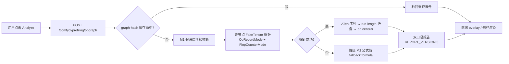

## 产品概述
为 ComfyDL_UI 的 Profiling 面板新增“等效基础算子计算图”分析能力（Profiling M3 第一批）：把当前工作流的每个节点在 FakeTensor 探针下实际会执行的 ATen 算子序列捕获出来，聚合成逐节点算子普查表（算子名/次数/单次FLOPs/总FLOPs/算术强度），并与 M2 公式账本形成双口径交叉验证。

## 核心需求（用户已确认的决策）
1. **可用性优先**：op-graph 探针**仅由手动 Analyze 按钮触发**，异步执行、绝不阻塞 Queue/Run；M1 内存估算与 M2 FLOPs 公式账本保持 500ms 防抖自动重估（纯公式、零成本，现状不动）；W2 watchdog 照旧随 Run 采样。
2. **双显示模式**：侧拉侧栏 = 速览（判定卡 + FLOPs 总量 + Analyze 按钮 + op 汇总行 + stale 提示）；新增**全屏叠加 overlay** = 完整 dashboard（内存判定 + 耗时 Top-N + 算子分解探索器），解决“侧栏越来越长、上下翻找”的问题；模式切换记忆到 localStorage。
3. **算子粒度 = ATen**：档A 节点（attention/recurrent/LM）分解到 matmul/softmax/linear 级；档B 节点（conv/pool/norm）在 ATen 层即单算子（诚实边界：不下探 cuDNN 内核）。
4. **健壮性**：训练循环按 run-length 折叠（steps=300 → 算子块 ×300，报告注明口径）；副作用节点（save_path 等）逐节点 try/except，探不动降级 M2 公式值并标 `fallback:"formula"`；任何失败不阻塞启动与运行。
5. **双口径交叉验证**：公式账本 vs 探针算子图并排呈现，偏差即 bug 信号（项目 6ND 式自检惯例）；`REPORT_VERSION` 2→3。
6. **范围边界**：v1 只做 op census 表（算子 DAG 可视化、F4 roofline 接入、W3 优化建议库、F5 时间预警后置）；不改执行器；预计无新增 ComfyDL 节点（FUNCTIONS 计数不动）。

## 价值
- 覆盖面从 M2 的“按族枚举公式”升级为“结构自证”——任何能跑的节点（含未来 RL 节点）出生即被覆盖；
- 每算子算术强度直接喂 F4 roofline；显式 softmax+matmul 相邻等模式是 W3 建议库的第一批素材；
- 教学可视化：展开任意节点即可见“你的 Attention = 4×linear + 2×matmul + softmax + …"。


## 技术栈
- 后端：Python 3.14 embedded（禁用 3.12+ 语法保 GPU 兼容）、torch 2.13+cpu（P）/ 2.11+cu130（F）、aiohttp 路由（沿用 `web.RouteTableDef` + server.py 逐条并入的 `/api` 孪生惯例）；
- 探针核心：**`FakeTensorMode` + 自定义 `TorchDispatchMode`**——已实证 `torch/utils/flop_counter.py` 在 P 盘 torch 2.13 存在（公开类 `FlopCounterMode`，内部 `_FlopCounterMode(TorchDispatchMode)`，含 mm/bmm/conv/sdpa 等成熟 FLOPs 公式），计划**继承其内部模式类**或并列一个记录型 mode：一次探针同时捕获 ATen 调用序列（op/shape）与 FLOPs；F 盘 2.11 验证步骤列入计划（该模块自 torch 2.1 起存在，预期可用，若缺失则降级为纯记录型 mode + 自带公式表）；
- 前端：`app/profiling_assets/profiler.js/css` 仓库自有资产（`/comfydl/profiling/` 静态路由直发，无 site-packages 补丁漂移风险），vanilla JS + 现有设计语言（Gmarket Sans 数值字体子集约束、逐字 CJK 回退——沿用 M2 字体规范：仅数值/状态语义位置施加展示字体）。

## 实现思路
1. **探针**：对 graphToPrompt 输出逐节点取 M1 假设层推断的形状 → 构造 FakeTensor 输入 → 在 `torch.inference_mode(False)` + FakeTensorMode + 记录型 dispatch mode 下调用节点 `execute` → 捕获 ATen 序列（op/shape/flops）→ run-length 折叠重复块（训练循环 ×steps）→ 聚合 op census；
2. **降级**：逐节点 try/except，探不动（副作用如 save_path、comfy host 依赖）→ 回退 M2 公式值并标 `fallback:"formula"`；探针失败绝不阻塞启动/运行；
3. **缓存**：按 graph-hash（节点类型+widget 值摘要）进程内缓存，图变更自动 stale；
4. **API**：`POST /comfydl/profiling/opgraph`（body 与 estimate 一致的 prompt/budget/assumptions），并入 routes 自动获得 `/api` 孪生；
5. **前端**：profiler.js 新增 analyze 状态机（idle/loading/stale/done）、双模式容器（侧栏抽屉 vs 全屏 overlay，共享 report state）、算子分解探索器（节点列表按 FLOPs 排序 → 展开 op census 表 + 强度条）；profiler.css 新增 overlay 样式。

## 架构（数据流）


## 目录结构（本批改动）
```
ComfyDL_UI/
├── comfy/profiling/
│   └── opgraph.py                    # [NEW] 探针器：OpRecordMode（继承/并列 FlopCounterMode 的
│                                     #   TorchDispatchMode）+ FakeTensor 驱动 + run-length 折叠 +
│                                     #   op census 聚合 + 对 estimate_workflow 的 F2 降级引用
├── app/
│   ├── profiling_routes.py           # [MODIFY] POST /comfydl/profiling/opgraph（graph-hash 进程缓存；
│   │                                 #   沿用现有 estimate 端点的 body 约定与错误处理）
│   └── profiling_assets/
│       ├── profiler.js               # [MODIFY] analyze 状态机（idle/loading/stale/done）、
│       │                             #   侧拉/叠加双模式切换、op census 探索器（排序/展开/强度条）
│       └── profiler.css              # [MODIFY] overlay 全屏浮层样式（沿用 Gmarket Sans 字体约束）
├── docs/profiling-m3-opgraph.md      # [NEW] 设计文档：ATen 粒度口径、探针通道分析、诚实边界、分期
├── docs/profiling-m1-memory-estimation.md   # [MODIFY] §10 勾选关联项
├── docs/profiling-m2-compute-and-watchdog.md # [MODIFY] §10 勾选关联项
└── cdl_smoke_tests/
    └── test_profiling_opgraph.py     # [NEW] 专项测试（金样例/折叠/降级/路由集成）
```
不改动：execution.py、server.py 路由表结构（仅 routes 列表新增条目自动获得 /api 孪生）、前端 site-packages、五份 FUNCTIONS/README 计数。

## 关键接口约定
```python
# comfy/profiling/opgraph.py
def analyse_opgraph(prompt: dict, assumptions: dict | None = None) -> dict:
    """返回 REPORT_VERSION 3 的 opgraph 报告：
    {"report_version": 3,
     "nodes": {"<node_id>": {
         "node_type": str,
         "probed": bool,                  # False = 降级公式口径
         "fallback": "formula" | None,
         "total_flops": int,              # 探针口径
         "formula_flops": int | None,     # M2 口径（交叉验证）
         "folded": {"block_ops": int, "repeat": int} | None,  # 训练循环折叠口径
         "ops": [{"op": "aten::mm", "count": int,
                  "flops_each": int, "flops_total": int,
                  "intensity": float} | {"op": ..., "fallback": True, "flops_total": int}]
     }},
     "total_flops": {"opgraph": int, "formula": int | None, "ratio": float | None}}
```
op census 表与该 schema 一一对应；`intensity = flops_each / M1 激活字节`（同节点内复用 M1 结果）。

## 性能与风险
- 探针开销：FakeTensor 无真实内存/GPU 占用，单节点毫秒~秒级（训练节点受 steps 影响，折叠后仍需真实跑首块）；全程异步 + 可中断，Run 路径零侵入；
- 兼容风险：节点 execute 内部对 comfy host 的依赖（ProgressBar 已优雅降级；torch.save 副作用会抛错→走降级路径）；
- 双盘差异：torch 2.11 与 2.13 的 flop_counter 覆盖算子集可能不同（如 flex_attention）——报告带 torch 版本号，测试双盘各跑。
	

## 设计风格
沿用 Profiling 面板既有设计语言（app/profiling_assets/profiler.css 账本风格）：深浅两套主题跟随 ComfyUI；数字/状态语义位置使用 Gmarket Sans Bold 子集字体（仅数字与必然出现的 ASCII 状态符，CJK 逐字回退系统栈——沿用 M2 二次收窄规则：卡片标题/表格节点行/顶栏徽章只用字重不加字体）。

## 新增 UI 块
1. **Analyze 按钮**：侧栏 FLOPs 卡片头部 + overlay 顶栏各一个；三态（idle → loading 转圈 → stale 黄点提示 re-analyze）；
2. **双模式切换**：侧栏 header 右侧 maximize-2 图标 → 进入全屏 overlay（fixed 浮层覆盖画布，Esc/收起按钮退出）；模式选择写 localStorage；
3. **Overlay 布局**：左列 240px 总览卡（内存判定/FLOPs 双口径/耗时 Top-N——与侧栏同源数据），右侧弹性区域为算子分解探索器：上半节点列表（node_id/type/total_flops/fallback 标记，可按 FLOPs 排序），点击行展开 op census 子表（算子名/次数/单次FLOPs/总FLOPs/强度条形），折叠口径以“块 ×N”标注；
4. **响应式**：overlay 内部两栏在窄屏折叠为上下堆叠；算子表横向滚动。

## Agent Extensions
### SubAgent
- **code-explorer**
  - Purpose：计划第一步（用户明确要求）——精读 ComfyUI_Docs_Work（custom-nodes/backend 执行模型、http 路由、前端扩展篇目）、Comfy_CustomNode_Docs_md 对应篇目、.codebuddy/memory 与 rules 全量，产出与本批相关的契约清单；并深挖 comfy/profiling/engine.py 的形状推断接口、profiler.js 的 report state 结构，为探针与 UI 扩展提供精确落点
  - Expected outcome：一份"契约清单 + 代码落点"报告（执行器 inference_mode 包裹确认、路由注册方式、TestServer 大载荷要求、profiler.js 状态管理现状），作为后续编码的输入
