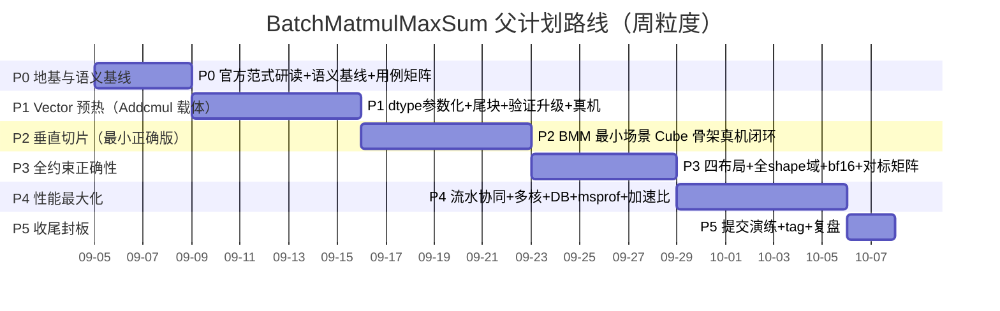

# PARENT PLAN · BatchMatmulMaxSum 父计划（长期战略路线）

> **定位**：比 PLANS.md / 各实施计划高一级的**长期战略文档**，统领 `2026/09/05 → 2026/10/07（内部期限）` 期间 **BatchMatmulMaxSum 赛题攻关**与 **CANN_OpHelper 支撑能力扩展**的全部下层工作。
>
> - **上级**：无（本文件为当前最高级路线）
> - **下级**：各次实施计划（OpHelper 能力扩展轮次 plan、赛题专项 plan、未来 PLANS.md、每日迭代清单）——下层计划实施完成后**回填本文件对应阶段状态**；本文件只在阶段门禁通过、重大决策或路线更动时修订。
> - **创建**：2026-09-05（定靶同日）；建档后进度快照维护在 `MEMORY.md` 与每日日志（双份同步）。
> - **存放**：`.codebuddy/plans/PARENT_PLAN_batchmatmulmaxsum.md`（该目录已有 5 个 OpHelper 迭代 plan 文件，本文件与它们并存，为更高一级统领文档）。

---

## 1. 北极星与验收定义

### 1.1 北极星目标

在 **2026/10/07（内部期限）前**，以 **CANN_OpHelper 工具链（保留既有 expr/verify 功能）逐步扩展为支撑手段**，在昇腾 NPU 上**高质量实现 BatchMatmulMaxSum 融合算子**：全用例正确（与 PyTorch 语义对齐）+ 性能相对「拆分三算子」基线**尽量高**（正确性优先，性能最大化）。可复现提交版本须在官方截止前封板。

### 1.2 终态验收定义（阶段终点）

1. **正确性（先保）**
   - 与 PyTorch `torch.bmm(x1.fp32,x2.fp32) → amax(dim=-1) → sum(dim=-1,dtype=fp32)` 语义对齐；golden 以 **FP64 计算后转 FP32** 为基准。
   - 精度判据：输出恒 FP32 → 相对/绝对误差双 1e-4（fp32 域）或双 1e-3（fp16/bf16 输入域，题目判据）。
   - 覆盖：dtype×（B/M/N/K 维度域）×transposeX1/X2 四组合×非对齐尾块×全负行/边界值 的用例矩阵**全绿**；多次执行结果一致；输出无 NaN/±Inf；不修改输入。
2. **性能（后冲）**
   - 融合实现总耗时 ≤/显著低于「BatchMatMul + ReduceMax + ReduceSum」拆分实现基线（**加速比评分**），性能报告入档、加速比单调改进有据。
   - 关键机制达标项：Cube/Vector 协同流水、GM/L1/L0/UB 复用、沿 B/M 多核分配 + 尾块负载均衡、Double Buffer/Ping-Pong；msprof 采 Task Duration / Cube / Vector / MTE 利用率。
3. **工程（收口）**
   - 可复现提交版本（含工程快照与 build/verify 脚本）已演练并通过在线评测提交；版本 tag 齐全；复盘结论与回填落档。

### 1.3 官方日程锚点（不可动摇）

- 在线答题：`2026/09/05 00:00 – 10/16`；作品提交：`10/17 17:30 封榜、18:00 截止`；取**最后一次**提交成绩。
- 每日最大提交 **50 次**（调试演练与正式提交共用额度，本地验证充分后批量提交）。
- 在线训练阶段提交仅作调试参考、**不计入评奖**；正式比赛以最优成绩排名。
- 赛事状态参考：题面发布时通过率 40%、通过 2 人/尝试 5 人。

---

## 2. 事实源与题目硬约束（摘要；以 stage_goal 全文为唯一权威）

> **唯一事实源**：`p:\Dev\CANN_Learning_Refs\.codebuddy\memory\stage_goal_batchmatmul_maxsum.md`（用户一字不差存档）。路线任何推导不得超出该文件语义。以下为约束速查，冲突时以全文为准。

- **语义**：`y[b] = Σ_{m=0}^{M-1} max_{n=0}^{N-1} Σ_{k=0}^{K-1} x1[b,m,k]·x2[b,k,n]`；顺序固定 BatchMatMul → MaxSim(N) → Sum(M)，**Max 与 Sum 不可交换**；第 b 组 x1 仅配第 b 组 x2（无 batch broadcast）。
- **布局**：`transposeX1/transposeX2`（bool，默认 false）**只声明 storage shape**（x1: (B,M,K)/(B,K,M)；x2: (B,K,N)/(B,N,K)），逻辑 shape 不变、无真实转置执行；**四种组合均须正确支持**。
- **dtype**：x1/x2 同为 FP16 或 BF16（不混用）；输出 y 恒 **FP32**；K 维点积与两级归约 **FP32 累加或等效精度**。
- **维度**：1≤B≤64；1≤M≤8192；1≤N≤8192；32≤K≤8192 且 **K 为 8 的整数倍**；B×M×K ≤ 2²⁸、B×N×K ≤ 2²⁸。
- **尾块**：M/N 建议 16 倍但**非对齐必须正确处理尾块**。
- **数值**：无空 tensor / NaN / ±Inf / mask；元素可为负；**MaxSim 初值 = -∞ 或行首元素（禁 0，全负行返回最大负数）**；K 大累加防低精度长归约误差；不 modify 输入；连续 ND。
- **精度判据**：fp16/bf16 双 1e-3；fp32 双 1e-4。
- **性能基线**：BatchMatMul+ReduceMax+ReduceSum **拆分实现总耗时**；融合实现按相对加速比评分；msprof 采集（Task Duration/Cube/Vector/MTE）。

---

## 3. 现状盘点（诚实基线，2026-09-05 已核实）

### 3.1 CANN_OpHelper 能力现状与缺口

**已有（保留，不得回归破坏）**：
- expr 表达式链路：`A + 2/sigmoid(B) = C` → 解析 → fillgen 三文件（`op_kernel/{entry}.cpp`、`op_kernel/{entry}_tiling.h`、`op_host/{entry}.cpp`）→ fill-op 写盘 → verify 资产 → 云端一键 `bash verify/run_verify.sh` 数值比对 `TEST PASSED`（已真机背书）。
- 模块平铺于 `src/cann_ophelper/`：cli / model / yamlio / msopgen / proto / wizard / apply / fillgen / verifygen + `expr/`、`template/` 子包；docs（`expr-rules.md`、`official-patterns.md`）；tests 17 文件 229 用例全绿。
- 关键工程修复沉淀：`TPipe pipe` 成员、soc 目录别名（`ascend910b → ascend910_93`）已内置 verify 资产，云端 161001 环境坑有 workaround。

**v1 能力边界（诚实缺口，路线扩展对象）**：
- 仅**单输出单 dtype float32、ND、等形状、可整除**（无余数/尾块）；`InferShape` 直拷 input0 shape。
- kernel 为 **Vector 元素级**教学式（每核连续均分、tileNum=1、block_dim=8）；无归约/广播/尾块/多核负载。
- **无 Cube/MatMul、无归约模板、无 dtype 参数化、无 storage 布局/transpose 语义、无流水（DB/Ping-Pong）框架**——BatchMatmulMaxSum 属于全新 kernel 骨架族（Cube 系 + Vector 两级归约），无法由现有表达式驱动表达。
- verify 资产硬编码 `ACL_FLOAT`/固定 tensorShape；golden 解释器为 float32 逐元素。

### 3.2 可复用资源（路径已核实存在）

- **官方教程三镜像（同构）**，写代码前必先查阅：
  - `p:\Dev\CANN_Learning_Refs\Documentation_for_Developers\ascendc_operator_development\`（本地只读文档副本，**文档优先源**）
  - `p:\Dev\CANN_Learning_Hub_(for_dev)\tutorials\ascendc_operator_development\`（示例优先源）
  - `p:\Dev\CANN_Learning_Workspace\Reference_And_Documentation\tutorials\ascendc_operator_development\`
  - 相关章节：`02_AscendC_basic`（范式）、`03_intermediate_vector_operator_development`（tiling/规约/工程化）、**`04_matmul_basic`**（Cube/MatMul 主课，含 `answer/04.03~04.04` 源码）、**`05_fused_operator_development`**（融合算子，`answer/05.04_answer/op_kernel/matmul_abs.cpp` 与题目融合语义最相关）、`08_performance_optimization`（双缓冲/优化）；另有轻量版 `ascendc_operator_development_light\`（03 章含高阶 Matmul）。
- **实测工程区（可建/可用的测试载体）**：
  - `p:\Dev\CANN_Learning_Workspace\Projects\batchmatmulmaxsum_problem_1746_template\`（目标题空壳：`kernel.asc`/`main.asc` + run.sh + scripts）
  - `p:\Dev\CANN_Learning_Workspace\Projects\addcmulkernel_problem_332_template\`（姊妹题 Addcmul，P1 预热载体，可清空覆写）
- **知识底座（本区+相邻区，相邻只读引用）**：`ascendc_01~07_*.md` + `ascendc_knowledge_index.md`（本区 `.codebuddy\memory\` 与相邻区各有一份副本；相邻区另有「核心课程通读与AscendC知识沉淀」学习计划 `CANN_Learning_Workspace\.codebuddy\plans\核心课程通读与AscendC知识沉淀_8339da86.md` 可衔接）。
- **skills**：`CANN_Learning_Hub_(for_dev)\skills\ascendc-ops-project`（host/kernel/tiling 模板）、`skills\cannjudge-submit`（评测提交相关）。
- **姊妹题差距评估**：Addcmul 三层差距（L0 退化版≈现有 / M1=dtype+尾块+标量 / M2=广播+int+空张量）详见 `2026-09-05.md`，是 P1 范围的输入。

### 3.3 路线主干推论

- 本题目**两条腿并行**：① AscendC 官方范式/知识沉淀（MatMul/Cube/融合/归约）；② CANN_OpHelper 能力扩展（工具化支撑，非手工裸写），云端真机闭环为**事实仲裁**。
- 现有 expr/fillgen（Vector 逐元素）不能直接表达归约/布局/形状语义 → 路线的关键架构决策门在 P2 末尾：**「预设算子骨架/策略层 vs 继续扩展表达式驱动」**的选择须记录依据。
- **先 Vector 后 Cube 的爬坡路线**（用户定夺）：以 Addcmul 类元素算子的多 dtype + 非对齐尾块 + 验证框架升级为 P1 前导，与题目归约侧的尾块/多核基础共享。

---

## 4. 路线总图

| 阶段 | 主题 | 日历（内部） | 产出类型 | Exit Criteria（门禁） |
|---|---|---|---|---|
| P0 | 地基与语义基线 | 09/05–09/09 | 语义基线文档 + 用例矩阵 + 资源图 | 矩阵就绪、Cube 数据流理解有记录 |
| P1 | Vector 预热（Addcmul 载体） | 09/09–09/16 | fillgen/verifygen dtype 参数化 + 尾块 + tiling 能力 | 既有 229 测试全绿 + 新能力真机闭环 + 无回归破坏 |
| P2 | 垂直切片（最小正确版） | 09/16–09/23 | BMM 最小场景 host/tiling/kernel/verify 真机闭环 + 架构决策记录 | 最小场景 TEST PASSED 且与 PyTorch 数值一致 |
| P3 | 全约束正确性 | 09/23–09/29 | 四 transpose 布局、全维度域、bf16、尾块、MaxSim 语义 | 用例矩阵全绿 + 云端提交演练零环境坑 |
| P4 | 性能最大化 | 09/29–10/06 | 流水/多核/DB/msprof + 拆分基线性能库 | 性能报告入档、加速比单调改进有据 |
| P5 | 收尾封板 | 10/06–10/08 | 提交演练、版本 tag、复盘、父计划回填 | 可复现提交版本 + 复盘落档（此后至 10/16 为缓冲窗口） |

---

## 5. 阶段详案

### P0 地基与语义基线（09/05–09/09）

**目标**：把「题目语义」「PyTorch 对标基准」「硬件执行范式」三者钉死，作为后续所有阶段的事实地基。

**关键动作**：
- 研读官方 `04_matmul_basic`（主课 + `answer/04.03/04.04` 源码）与 `05_fused_operator_development`（重点 `matmul_abs.cpp`），记录 Cube 数据流（GM→L1→L0A/L0B→L0C→UB）与高阶 Matmul API、Vector 归约范式；对照 `ascendc_01~07` 索引补漏。
- 用 PyTorch 固化对标实现与 **FP64 golden** 生成脚本（语义 = `bmm→amax(dim=-1)→sum(dim=-1,dtype=fp32)`）。
- 建立**用例矩阵**：覆盖 dtype（fp16/bf16）× transpose 四组合 × 维度域（B∈{1,2,16,64}、M/N∈{1,16,17,8192}、K∈{8,32,1000,8192} 边界与 8 倍规则）× 非对齐尾块 × 全负行/边界值；附 FP32/FP64 参照输出与精度判据脚本。
- 盘点可复用资源（§3.2），衔接相邻学习计划，产出本文件 §7 的资源引用索引落地版。

**产出**：`docs/` 或记忆区语义基线文档（题目语义+判据复述）、用例矩阵文件（形状/dtype/存储组合/参照 golden 生成器）、资源地图。

**Exit Criteria（门禁）**：语义基线 + 用例矩阵就绪；Cube 数据流（GM/L1/L0/UB）理解有记录可查。

**决策点**：无重大架构决策；若矩阵暴露题目语义歧义 → 以 stage_goal 全文为准并记录。

---

### P1 Vector 预热（Addcmul 为载体，09/09–09/16）

**目标**：在**较小的、与题目共享基础**的 Addcmul 姊妹题上，把工具链从「单 dtype float32、可整除」推向「**多 dtype 参数化 + 非对齐尾块 + 验证框架 dtype 化 + tiling 多字段**」，为 P3 归约侧的尾块/多核和 P4 性能打地基；控制 blast-radius，保留功能零破坏。

**关键动作**：
- fillgen/model：dtype 从硬编码 `{"float"}` 参数化（fp16/fp32/int8/int32 按需）；kernel 循环与搬运用尾块处理（非 32 整倍数余量）；InferShape/TilingData 多字段扩展。
- verifygen：`input_*.bin`/`golden.bin`/`run_verify.sh`/runner 的 dtype 化（`ACL_FLOAT16/INT32` 等 + 解释器按 dtype 舍入）；soc 别名 workaround 保持。
- tiling 能力：多字段传递（非对齐的 tail 长度、块切分参数等）。
- 真机试金石：以 Addcmul（先**共享子集**：dtype+尾块+验证升级；广播等 Addcmul 特有能力**由门禁决定是否后置**）在 `addcmulkernel_problem_332_template` 跑通 `TEST PASSED`；再对既有 `expr` 冒烟回归。
- 全程既有 229 测试不得回归（新增能力独立开关，旧路径字节级稳定）。

**产出**：fillgen/verifygen 扩展实现 + 防回归测试 + 文档（official-patterns/expr-rules 增补）+ Addcmul 真机验证结果记录。

**Exit Criteria（门禁）**：既有全量测试绿 + 新能力（多 dtype 与尾块）在 Addcmul 或等载体真机闭环 `TEST PASSED` + 无回归破坏（blast-radius 受控可证）。

**决策点**：Addcmul 广播是否在本阶段全做（P1 只保 dtype+尾块+验证，广播可后置）；范围蔓延时以「先共享子集」收敛。

---

### P2 垂直切片：BatchMatmulMaxSum 最小正确版（09/16–09/23）

**目标**：以**最小可验证场景**打通题目自身的 Cube 工程骨架闭环——`fp16、B=1（或小 B）、M/N/K 对齐、transpose 均 false、K 点积 fp32 累加`——一次跑对，与 PyTorch 数值一致。

**关键动作**：
- 在 `batchmatmulmaxsum_problem_1746_template` 建立工程；研读官方 Matmul 高阶 API 或 04.03 源码，选定实现范式（AIV 高接口 Matmul vs 手工 Cube，记录取舍）。
- 搭 host（InferShape/InferDataType/Attr 透传 transposeX1/X2/TilingData）+ kernel（MatMul → UB 内 MaxSim(N) → Sum(M) 两级归约，MaxSim 初值 = -∞/行首，禁 0）+ tiling。
- 建立题目自己的 verify/评测 runner 语义基线（PyTorch fp64 golden + fp32 输出判据）。
- **架构决策门**：记录「预设算子骨架/策略层（BMM 专属生成） vs 扩展表达式驱动」的依据与方向——直接影响后续工具轮范围。

**产出**：BMM 最小场景可编译真机工程 + 云端 `TEST PASSED` 记录 + 架构决策记录。

**Exit Criteria（门禁）**：最小场景真机 `TEST PASSED` 且输出与 PyTorch golden 数值一致（判据达标）；环境坑（161001 等）在题目工程复现并走通 workaround。

**回退**：若 Cube API 路径不通 → 降级方案=先用 Vector 逐元素伪 MatMul 验证 host/tiling/归约链语义，Cube 替换单列为独立子任务（在 P3 内完成，不阻塞语义闭环）。

---

### P3 全约束正确性（09/23–09/29）

**目标**：把 P2 切片扩展到题目**全部语义与形状域**，对用例矩阵全绿。

**关键动作**：
- **四 transpose 存储布局**：storage shape 与逻辑 shape 解耦的访存/读取逻辑（跨 stride 读取或等价），示例 2（x1 按 (B,K,M)、x2 按 (B,N,K) 物理布局）为回归基准。
- **全维度域与尾块**：B∈1..64、M/N∈1..8192 非对齐尾块、K∈32..8192 与 8 倍规则下的长 K 累加；较大 shape 与 2²⁸ 规模上限用例。
- **bf16**：输入 bf16 路径 + 精度（双 1e-3）与 K 累加策略。
- **MaxSim 语义**：初值禁 0（全负行返回最大负数，示例 3 回归）；输出有限性；多次执行一致性（数值一致性规则）；不修改输入（副本或只读访问验证）。
- **云端提交演练**：题目的 build/run/提交链在云端完整演练，161001 类环境坑在真实评测形态下归零。

**产出**：覆盖用例矩阵的对标测试集（PyTorch golden 驱动）+ 提交演练记录。

> **P3 首切（2026-09-06 已达成）**：垂直切片 = 全 shape 域 + 尾块 + 多 case 数据链（transpose/bf16 留后续子切片）。方案演进：`__mix__` 融合（VECIN+GetTensorC，官方 03.05 范式）三轮云验 507015 未愈 → **用户裁决 route③ = bounded-C 双核**（复用 P2b 已证 cube+vector，host 按 64-row M 块循环，C 中间量收缩为单块 64×N×4B；融合性能优化延后 P4），落点 `Projects\bmm_p2_slice`。**云验 6/6 PASSED（anchor64/B8/K40/M1000/N1000，case0/4 diff=0.0，case2/3/5=6.1e-05），commit `32b0253` 已 fast-forward 合入实测仓库 master 并 push。** 已知边界：N%8!=0（非单点）诚实拒绝待下一切片；case0/4 vs 2/3/5 的 diff=0.0/2^-14 并存待多 seed 复核；域边缘最大 shape 未真机。逐 case 结果与隐藏问题判读见 MEMORY.md/2026-09-06.md。

**Exit Criteria（门禁）**：用例矩阵全绿（fp16/bf16 × 四布局 × 全 shape 域 × 尾块 × 边界值，PyTorch 对标判据达标）；云端提交演练零 161001 类环境坑。

---

### P4 性能最大化（09/29–10/06）

**目标**：在正确性保持全绿前提下，相对「拆分三算子」基线**最大化加速比**并逐项留档。

**关键动作**：
- **协同流水**：MatMul（Cube）产出与 UB 内 MaxSim→Sum 两级归约（Vector）重叠；减少中间全量 A∈R^{B×M×N} 的 GM 往返（融合卖点：省中间搬运与 kernel launch）。
- **多核分配**：沿 B 维和/或 M 维切核，兼顾小 B（B<核数时的 M 切）、大 M/N/K 与**尾块负载均衡**。
- **搬运与缓冲**：GM/L1/L0/UB 复用；Double Buffer / Ping-Pong 重叠搬运与计算。
- **基线性能库**：实现并记录「BatchMatMul+ReduceMax+ReduceSum 拆分实现」耗时基线；每轮优化后记录融合实现耗时与加速比，**单调改进有据**。
- **msprof**：采集 Task Duration、Cube/Vector 利用率、MTE 带宽，作为瓶颈定位与改进依据；性能报告入档。

**产出**：优化轮次记录（每轮：改动/效果/加速比）、拆分基线性能库、msprof 报告。

**Exit Criteria（门禁）**：全用例仍绿 + 性能报告入档 + 加速比相对拆分基线单调改进且记录完整。

---

### P5 收尾封板与复盘（10/06–10/08，缓冲至官方截止）

**目标**：形成**可复现的最优提交版本**并按赛事节奏提交；版本与文档收口；复盘并回填父计划。

**关键动作**：
- 提交演练：在线评测（正式）分批提交（**50 次/日额度**内、先验证后提交）；记录各提交点成绩，锁定最优版本。
- 版本收口：最终工程快照 + git tag（规范见 §6）；verify/run 脚本、README、依赖清单齐备。
- 文档收口与复盘：正确性/性能/工具扩展三线复盘；把实际路线与门禁执行情况**回填本父计划**；沉淀到 `MEMORY.md`/日志。

**Exit Criteria（门禁）**：可复现最优提交版本已提交且记录成绩；版本 tag 齐全；复盘结论落档且父计划状态回填。

---

## 6. 横切实践（全程纪律）

1. **官方范式优先**：任何 CANN 代码先查本地官方文档/示例（§3.2 三镜像 + skills），不臆造 API/范式；依据链记录在案。
2. **唯一事实源**：stage_goal 文件为题目语义唯一权威；用例矩阵/判据脚本从它派生并版本化。
3. **版本管理**：每里程碑 git tag；提交 `type(scope): subject`（既有规范）；push 前 `pull --rebase`；仓库 `CANN_OpHelper\` 命令需 `-C` + safe.directory。
4. **验证矩阵入库**：用例矩阵与性能基线随仓库演进，回归全绿（当前 229 基线只增不减语义）。
5. **每日双写记忆**：每日日志记录过程与决策；`MEMORY.md` 维护父计划指针 + 阶段状态快照；父计划在门禁/重大决策时更新。
6. **小步可验证**：避免超大重构；每步可独立验证（本地单测 + 云端真机）；blast-radius 受控。
7. **云端额度纪律**：本地充分验证后再批量提交；soc 别名等 workaround 随工程资产走（如 run_verify.sh 内置）。
8. **范围纪律**：Addcmul/广播等**非共享**能力不蔓延进主线；按门禁与「先共享子集」收敛。

---

## 7. 风险与缓解

| # | 风险 | 影响 | 缓解 |
|---|---|---|---|
| R1 | 工具抽象扩展过度（表达式驱动 vs 骨架层拉扯） | 主线停滞 | P2 架构决策门先记录取舍；范围以门禁收敛；先共享子集（P1）再垂直切片（P2） |
| R2 | Cube/MatMul 官方范式学习曲线 + API 差异 | P2/P3 延期 | P0 把 04/05 章研读纳入地基；P2 先小 B/对齐最小切片；不通则 Vector 伪 MatMul 降级保语义（回退路径） |
| R3 | 云端队列/提交额度（50 次/日） | 调试/提交卡顿 | 本地充分验证 + 批量提交；提交演练前置到 P3；紧急预留 P5 后缓冲窗口 |
| R4 | 评测环境差异（soc 161001/别名等） | 真机跑通但评测失败 | P3 提交演练前置零环境坑；workaround 内置工程资产 |
| R5 | 与课程学习计划时间争抢 | 知识跟不上 | P0 将学习与地基合并排程；衔接相邻学习计划与 ascendc 索引，避免重复通读 |
| R6 | 性能优化破坏正确性 | 用例回归 | P4 每轮优化后跑全矩阵；性能报告与回归记录并立 |
| R7 | 非对齐/大 K/小 B 边界性能与正确性难点 | P3/P4 质量 | 用例矩阵显式覆盖边界与尾块；负载均衡作为 P4 独立子项 |

---

## 8. 引用文件索引（已核实存在，随阶段动态增补）

### 记忆与规划（本工作区 `.codebuddy\memory\`、`.codebuddy\plans\`）
- `p:\Dev\CANN_Learning_Refs\.codebuddy\memory\stage_goal_batchmatmul_maxsum.md` — 题目全文一字不差存档（唯一事实源）
- `p:\Dev\CANN_Learning_Refs\.codebuddy\memory\MEMORY.md` — 长期记忆（父计划指针/进度快照挂载于此）
- `p:\Dev\CANN_Learning_Refs\.codebuddy\memory\2026-09-05.md` — Addcmul 差距评估、BMM 定靶、本轮建档记录
- `p:\Dev\CANN_Learning_Refs\.codebuddy\memory\ascendc_01_programming_paradigm.md` ~ `ascendc_07_custom_op_project_practice.md` + `ascendc_knowledge_index.md` — AscendC 知识底座（07 含 161001/soc 完整案例）
- `p:\Dev\CANN_Learning_Refs\.codebuddy\plans\`（既有 5 份 OpHelper 迭代计划，本父计划统领并存）

### 相邻工作区（只读引用，勿写）
- `p:\Dev\CANN_Learning_Workspace\.codebuddy\plans\核心课程通读与AscendC知识沉淀_8339da86.md` — 可衔接的学习计划
- `p:\Dev\CANN_Learning_Workspace\.codebuddy\memory\ascendc_*.md` + `MEMORY.md` — 实测经验（只读）
- `p:\Dev\CANN_Learning_Workspace\Projects\batchmatmulmaxsum_problem_1746_template\` — 目标题实测工程（含 `kernel.asc`/`main.asc` 空壳 + run.sh + scripts）
- `p:\Dev\CANN_Learning_Workspace\Projects\addcmulkernel_problem_332_template\` — 姊妹题 Addcmul 实测工程（P1 载体）

### 官方教程 / 文档 / skills（写代码前必查）
- `p:\Dev\CANN_Learning_Refs\Documentation_for_Developers\ascendc_operator_development\02_AscendC_basic\`、`03_intermediate_vector_operator_development\`、`04_matmul_basic\`、`05_fused_operator_development\`、`08_performance_optimization\`（本地只读文档副本）
- `p:\Dev\CANN_Learning_Hub_(for_dev)\tutorials\ascendc_operator_development\`（同构示例源）及 `CANN_Learning_Hub_(for_dev)\skills\ascendc-ops-project`、`skills\cannjudge-submit`
- `p:\Dev\CANN_Learning_Workspace\Reference_And_Documentation\tutorials\ascendc_operator_development\`（第三镜像）

### CANN_OpHelper 仓库（`p:\Dev\CANN_Learning_Refs\CANN_OpHelper\`）
- `docs\expr-rules.md`、`docs\official-patterns.md` — 表达式规则与官方模式基准
- `src\cann_ophelper\{model,yamlio,msopgen,proto,wizard,cli,fillgen,verifygen,apply}.py`、`src\cann_ophelper\expr\`、`src\cann_ophelper\template\` — 能力扩展作用点
- `tests\`（17 文件，229 用例基线）、`examples\add.yaml`

---

> 状态占位：**P0 已完成（2026-09-05）** · P0 产物 `p:\Dev\CANN_Learning_Workspace\Projects\bmm_maxsum_assets\`（README 见其自身；docs/ 含语义基线、Cube 数据流笔记、资源索引；cases/ 用例矩阵 23 例；golden/ stdlib+torch 双实现）。**golden 已获双实现交叉背书**：本地 penv stdlib 锚点+local 全量 PASS（2026-09-05）＋云端 CANN Lab torch 对拍 20/20 `[PASS]`（2026-09-05，留档 torch_results.json）→ 语义基准可作 P2/P3 数值对拍基。
>
> **P1 首轮（已完成，2026-09-05）**：本地侧 dtype(float16)+32B 块尾块能力扩展 244/244 全绿（float 默认路径零回归），并经真机载体闭环：实测区 `Projects\out\AddcmulCustomFp16\`（spec：`A + B*D*2.0 = Y`、全 FP16、416=26×32B 块 → tailBlockNum=2）按四步（云端 msopgen `ai_core-ascend910b4` 空壳 → 空壳取回 → 本地 fill-op 写盘三文件+verify 资产 → 整工程传回云端 `bash verify/run_verify.sh`）一次 **`TEST PASSED!`**（2026-09-05 17:13）。P1 首轮 Exit Criteria 达标：既有全量测试绿 + 新能力真机闭环 + blast-radius 受控（旧 float/整除路径产物逐字节不变，见 commit `33724ee`）。改动隔离在待测分支 `feature/p1-fp16-tail`，云测通过待合回 master。
> P1 其余范围（Addcmul 广播等非共享能力）按门禁后置；下一阶段 P2 垂直切片。
> 进度快照 → `MEMORY.md` / `2026-09-05.md`
