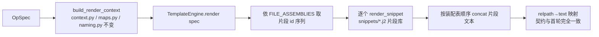

## 产品概述

对 CANN_OpHelper 的 template 子包做第二轮改造（apply-pipeline 轮）：将 template-engine 首轮产出的三个「整文件」Jinja2 模板（kernel.cpp.j2 / tiling.h.j2 / host.cpp.j2）重构为「片段拼装（snippet assembly）」体系，为后续「读取已生成工程→按片段定位填空 Compute/Tiling」打地基。

## 核心功能

- 将三个整文件模板按官方自然段落拆成带稳定 ID 的语义片段，存入 `template/templates/snippets/`
- 新增片段注册表与「产物文件→片段序列」装配表（assembly 声明），引擎改为装配驱动渲染
- 渲染契约不变：`TemplateEngine.render(spec)` 仍输出 `relpath→文本` 映射，**不写盘、无副作用**
- 渲染产物与官方 S1–S3（归一化后）及既有 golden 快照**逐字一致**，既有测试不得破坏
- 提供 `render_snippet(snippet_id, spec)` 等公共 API，便于片段级测试与后续 apply 定位
- 不动 `context.py` / `maps.py` / `model.py`（render context 仍是模板变量契约唯一来源）

## 边界

- 仅 AddCustomTemplate 单点（2 入 1 出）验证；本轮不做 for 泛化注册链、不做写盘、不做已生成工程的文本识别替换
- 本地无 C++ 编译器，仅文本级验证（golden + 官方实样对齐双保险）

## 技术选型

- 沿用既有技术栈：Jinja2（PackageLoader + `keep_trailing_newline=True` + `trim_blocks=True` + `lstrip_blocks=False`）、pathlib、pytest
- 改造范围限定 template 子包内部；**不引入新依赖**

## 实现方案（总体策略）

片段化采用「**行级切分 + Python 侧 concat 装配**」，而非 Jinja2 `` 嵌套：

1. **片段 = 带稳定 ID 的独立 .j2 子模板**：在官方行序列上按自然段落切分（license 头、includes 与常量、各方法、入口函数、struct、注册链段落等），片段内逐字保留官方文本与 `{{ }}` 插值，空行随切分归属相邻片段，**渲染后直接 concat 即还原整文件**。
2. **装配声明与渲染器分离**：新增 `assembly.py` 作为唯一事实来源——`SNIPPETS`（片段 id→模板逻辑路径）+ `FILE_ASSEMBLIES`（产物 relpath 模式→有序片段 id 序列）。`engine.py` 只负责「渲染片段 + 按装配表 concat」，不再持有任何文件级模板编排逻辑。
3. **为何不用 include 嵌套**：include 方案本质仍是整文件模板，片段无独立身份，且空白/上下文隐式耦合，对「后续按片段定位已生成工程」帮助有限。行级切分使每个片段可独立渲染、可独立测试，装配顺序一目了然，片段本身即可成为未来 apply 的文本定位单元。
4. **不为未来过度设计**：本轮片段只带「id + 模板路径 + 用途注释」，不做锚点识别逻辑；「片段→已生成文本定位/替换」留待 apply-pipeline 写盘轮（届时以片段 id 与片段首行特征为锚）。不 for 泛化注册链（保持官方文字块原样），规避输出漂移风险。
5. **不变量（测试锁死）**：对任一产物 relpath，`concat(render_snippet(s) for s in FILE_ASSEMBLIES[id序列]) == render(spec)[relpath] == golden == 官方归一化文本`。



## 实施要点（执行细节）

- 既有三处整文件模板的 license 版权块逐字相同，可抽为**共享片段 `license.j2`**（DRY，由 golden 三件套兜底验证）。
- 建议片段粒度（行号/空行归属以官方样本实测为准，M2/M3 迁移时逐行核对）：
- **kernel**：`kernel_includes`（include+常量）→ `kernel_class_head`（template+class+public+ctor）→ `kernel_init` → `kernel_process` → `kernel_copyin` → `kernel_compute`（后续 apply 重点填空锚点）→ `kernel_copyout` → `kernel_members`（私有成员+类收尾）→ `kernel_entry`（`__global__` 入口）
- **host**：`host_includes` → `host_tiling`（optiling 命名空间）→ `host_infer`（ge 命名空间）→ `host_opdef`（ops 注册链整段文字原样保留）
- **tiling**：`tiling_body`（guard+include+struct+endif）
- 片段模板用同一 Environment（同一 trim_blocks 行为），片段文件内允许自带 `` 局部绑定；渲染路径只需把 PackageLoader 取值从 `op_kernel/kernel.cpp.j2` 改为 `snippets/<id>.j2`。
- **兼容导出**：`TEMPLATE_OUTPUTS` 由 `FILE_ASSEMBLIES` 派生，保持「3 条、唯一、指向 op_*/」既有测试契约不变。
- **文档演进**：docs/official-patterns.md §7.4「后续改造约定」原写「只改 templates/ 与 engine.py」——本轮实现为「片段文件限 templates/snippets/、装配声明在 assembly.py、渲染在 engine.py，仍不动 context/maps/model」，需在 docs 新增 §8 显式记录该边界修订与片段切分表。
- **测试**：既有 golden/official/determinism/content-smoke 全部保留且必须继续全绿；新增片段/装配层单测。全量命令：`p:\Dev\CANN_Learning_Refs\penv\Scripts\python.exe -m pytest CANN_OpHelper\tests -q`（收尾 WinError 448 属已知坑，exit 0 即视为通过）。

## 架构设计

层次（无环、每层可独立测）：`engine(渲染) → assembly(片段/装配声明) → snippets/*.j2(模板) ← context(变量契约) ← model`。装配表作为渲染器与模板之间的唯一编排事实，后续 apply 轮可直接复用同一 `SNIPPETS` 语义做文本定位。

## 目录结构

```
src/cann_ophelper/template/
├── assembly.py                 # [NEW] 片段注册表 SNIPPETS(id→模板路径+用途注释) 与文件装配表
│                               #   FILE_ASSEMBLIES(relpath 模式→有序片段 id 序列)；纯声明、无渲染逻辑；
│                               #   派生 TEMPLATE_OUTPUTS 兼容导出；含装配表完整性校验辅助函数
├── engine.py                   # [MODIFY] 改为装配驱动：render(spec) 契约不变；新增 render_snippet(id, spec)/
│                               #   render_file(relpath, spec) 公共 API；docstring 同步更新
├── __init__.py                 # [MODIFY] 导出新增公共面：SNIPPETS/FILE_ASSEMBLIES/render_snippet
├── templates/
│   ├── op_kernel/kernel.cpp.j2 # [M2 后删除] 整文件被 snippets 取代
│   ├── op_kernel/tiling.h.j2   # [M3 后删除]
│   ├── op_host/host.cpp.j2     # [M3 后删除]
│   └── snippets/               # [NEW] 片段库（行级切分、逐字保留官方文本+插值）
│       ├── license.j2          # 共享 license 块（三产物复用）
│       ├── kernel_includes.j2 / kernel_class_head.j2 / kernel_init.j2 / kernel_process.j2
│       ├── kernel_copyin.j2 / kernel_compute.j2 / kernel_copyout.j2 / kernel_members.j2 / kernel_entry.j2
│       ├── host_includes.j2 / host_tiling.j2 / host_infer.j2 / host_opdef.j2
│       └── tiling_body.j2
tests/
├── test_template_engine.py     # [保留] 契约不变；必要时仅更新对装配派生的断言
└── test_template_snippets.py   # [NEW] 片段层单测（见下）
docs/
└── official-patterns.md        # [MODIFY] 新增 §8 apply-pipeline 片段基准：切分表/拼接不变量/
                                #   片段编写约定/边界修订（§7.4 指向 §8）
```

## 关键代码结构（示意，落地以官方行序列实测为准）

```python
# assembly.py —— 装配声明契约（sketch）
SNIPPETS: dict[str, str] = {
    "license": "snippets/license.j2",
    "kernel_includes": "snippets/kernel_includes.j2",
    # ... 每个片段 id -> PackageLoader 相对模板路径
}
FILE_ASSEMBLIES: tuple[tuple[str, tuple[str, ...]], ...] = (
    ("op_kernel/{op_snake}.cpp", ("license", "kernel_includes", ..., "kernel_entry")),
    ("op_kernel/{op_snake}_tiling.h", ("license", "tiling_body")),
    ("op_host/{op_snake}.cpp", ("license", "host_includes", "host_tiling", "host_infer", "host_opdef")),
)
def snippet_ids_for(relpath: str) -> tuple[str, ...]: ...   # 未知 relpath 抛错
```

## 测试要点（新增 test_template_snippets.py）

- 注册表完备：`FILE_ASSEMBLIES` 覆盖且仅覆盖 3 个产物；每个引用的片段 id 均存在于 `SNIPPETS`；无重复、顺序稳定
- 拼接不变量：`concat(render_snippet(s)) == render(spec)[relpath]`（三个产物逐一断言）
- 片段独立性：每片段对参考 spec 渲染非空、以换行结尾、可独立调用不抛错
- 未知片段 id / 未知 relpath 的错误路径
- `TEMPLATE_OUTPUTS` 派生后与既有契约一致（长度 3、唯一）

## Agent Extensions

### SubAgent

- **code-explorer**
- Purpose: M1 启动时核实官方 S1–S3 样本与现有三个整文件模板的行级结构（行号序列、空行归属、三处 license 块是否逐字相同、Compute/注册链段落边界），产出片段切分的行号依据，避免凭模板外观臆断切分点
- Expected outcome: 一份可执行的片段切分表（产物 relpath → 片段 id 序列 → 对应官方行号区间），license 共享可行性结论，作为 assembly.py 装配表与 snippets 迁移