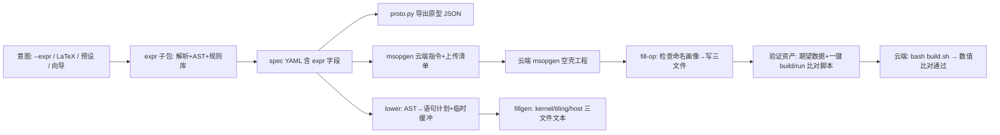

## 产品概述

扩展 CANN_OpHelper，新增「**计算意图 → 可运行 CANN 内核工程**」能力：仅凭 CANN_OpHelper + 云端 msopgen 两样工具，从零（无任何文件）出发即可生成能直接在 CANN NPU 上运行的完整算子工程——用户描述期望运算（含张量与表达式），工具自动把 msopgen 空壳工程（如 AscTry）填充为真实内核实现，并附一键「编译 + 数值比对」验证指令。

## 核心功能

- 意图输入多通道（按优先级全做）：

1. 命令行表达式串，如 `A+2/sigmoid(B)=C`，张量/算子/常量一次给全；
2. 交互向导（沿用 new-op 的 typer 逐问 + 注入式 asker 风格）分步组公式；
3. 预设/规则库名（add/mul/sigmoid/relu 等）；
4. LaTeX 数学式子集直接解析（如 `\frac{2}{sigmoid(B)}`）。

- v1 计算范围：逐元素表达式族 f(A,B,…)→C，输入输出同 shape，支持常量与基础算子（四则、负号、sigmoid/exp 等）。规约、广播留待后续迭代，架构需为此预留扩展点。
- 两条主链路：
- `gen-op`（生成阶段，无需空壳）：意图 → spec YAML（含表达式）+ msopgen 原型 JSON 导出 + 内核生成计划预览 + 云端 msopgen 指令与上传清单；
- `fill-op`（填充阶段）：读 msopgen 空壳工程，校验命名与张量后整体写入 op_kernel/op_host/tiling 三文件（其余文件不动）。
- 跑通验证：helper 本地用 Python 按同一表达式求期望输出（确定性输入），在工程内生成验证资产 + 一键 build/run 比对脚本，云端一次跑通即证明内核正确。
- 约束：不改现有 add-family 渲染路径（无表达式 spec 的产出与 golden 逐字节不变，164 条既有测试保持全绿）；允许引入 lark 轻量解析库（pyproject 声明，由用户亲自装入 penv）；本地不编译 C++，所有 AscendC API 事实必须出自官方文档/样例，禁止臆造。

## 技术选型

- 沿用现有技术栈：Python 3.11+（src 布局）、typer/rich/Jinja2/PyYAML、pytest；路径全部 pathlib。
- 新增依赖：`lark`（解析中缀与 LaTeX 子集的文法驱动解析器；用户选择允许轻量解析库，pyproject 声明后由用户装入 penv，AI 不代装）。
- 代码生成：三文件文本由新生成器模块（纯 Python、确定性、可测）产出，不复用 add 专用片段——理由：表达式驱动的产物结构与命名随意图变化，不是官方 add 文本的逐行切片，硬套片段体系会破坏「片段=官方行切片」不变量。

## 实现方法

整体策略 = 在现有「spec → proto → msopgen → render」链路上新增一层**表达式 IR 与降级（lowering）**，并用「整文件重写三产物」而非「锚点定位替换」填充空壳——后者依赖官方空壳版本文本布局，脆弱；前者只需从空壳读出命名画像（入口名、tiling struct 名、张量名/dtype），稳定性高，且天然满足「填任意 msopgen 工程」。

数据流（Mermaid）：



关键决策与理由：

- **IR 中央化**：AST（数字/张量引用/一元/二元/函数调用）→ 唯一中间表示；解析器、规则库、lower、Python 求值器都围绕它，保证「生成的内核」与「期望值」来自同一语义。
- **规则库为事实表**：每个可识别符号登记数学名/LaTeX 别名、元数、AscendC 指令方案（可能是一行矢量 API，也可能是多语句小片段）、Python 参考实现。签名与 dtype 支持以官方文档/样例为准（首任务调研锁定并写入 docs），未收录符号一律报双语错误而非猜 API。
- **临时缓冲**：Compute 内每个内部节点分配独立 scratch LocalTensor（v1 朴素、正确优先；节点数即表达式深度量级，内存远低于 UB 上限），常量标量按官方支持方式表达（标量融合 API 或常量填充，取决于调研结论）。
- **命名画像抽取**：fill-op 以文本模式（不搞 C++ 语义分析）从空壳 op_host/op_kernel 抽取入口函数名、tiling struct 名、Input/Output 张量名与 DT_ 类型，再与 spec 交叉校验，不一致即双语报错。
- **验证闭环**：helper 用确定性种子生成输入并 Python 求期望 → 落盘（规范二进制/文本）→ 生成云端 run 脚本按调研到的最小单算子运行样例执行并比对，实现「一键跑通=数值正确」。

## 实施要点（防回归）

- 向后兼容硬约束：OpSpec 增加可选 `expr` 字段后，`yamlio.dump` 仅在非空时输出该键（旧 spec/golden 文本逐字节不变）；proto 导出忽略 expr；add 无 expr 渲染路径与官方对齐不变量全部保持。
- 生成文本统一 `write_text(..., newline="")`、云脚本用 LF；Windows 无法置可执行位，运行方式固定 `bash <script>` 并在提示中说明。
- 性能：解析 O(n)、lower 线性、v1 每节点一缓冲（说明 UB 占用上限）；期望求值为 Python 逐元素循环，测试用中小 shape（如 8×2048），避免本地热路径开销。
- 安全：张量名/op_type 白名单校验（防注入生成代码）；表达式深度/长度上限；非 ND、非 float32/float16、多输出、整除性不符等情况给出明确双语错误或警告（v1 假设总元素可被核数整除，同官方 add 教程口径）。
- 日志/输出沿用现有 rich 面板 + i18n zh/en 双键 + `_c()` 新 Console 模式；新文案键按 `expr.* / gen_op.* / fill_op.*` 分层补齐，删键前先 grep。

## 架构设计（模块划分）

- `expr` 子包：解析与语义（AST/grammar/parse/presets/evaluate/lower），零 CLI 依赖、纯函数可单测。
- `fillgen + apply`：三文件文本生成器 + 空壳工程检查与写盘（含验证资产生成）。
- CLI 层：注册 `gen-op`、`fill-op` 两个子命令；复用 `_load_spec/_fail/_print_note`、wizard 注入 asker、i18n。
- docs/tests：`docs/expr-rules.md`（规则表与出处）、官方模式文档增补、fixture 化 AscTry 空壳、各层 pytest。

## 目录结构

```
CANN_OpHelper/
├── pyproject.toml                       # [MODIFY] 增加 lark 依赖声明
├── README.md                            # [MODIFY] 命令矩阵+gen-op/fill-op 零到跑通流程
├── docs/
│   ├── official-patterns.md             # [MODIFY] 增补 expr 功能与 fill-op 写盘约定
│   └── expr-rules.md                    # [NEW] 符号→AscendC 指令/别名/出处规则表（调研锁定）
├── src/cann_ophelper/
│   ├── model.py                         # [MODIFY] OpSpec 增可选 expr 字段与校验（单输出/ND/白名单名）
│   ├── yamlio.py                        # [MODIFY] expr 非空才 dump 该键；load 解析；proto 忽略
│   ├── wizard.py                        # [MODIFY] 收集尾声可选录入表达式（含预设规则名快捷方式）
│   ├── cli.py                           # [MODIFY] 注册 gen-op/fill-op；复用既有帮助/提示设施
│   ├── i18n.py                          # [MODIFY] 新增 expr.*/gen_op.*/fill_op.* 双语键
│   ├── expr/
│   │   ├── __init__.py                  # [NEW] 公共面导出（parse/lower/eval/presets）
│   │   ├── ast.py                       # [NEW] ExprNode(Number/Ref/Unary/Binary/Call) 冻结 dataclass+canonical 文本
│   │   ├── grammar.lark                 # [NEW] 中缀+LaTeX 子集文法（\frac{}{}/\cdot/^/函数名/负号）
│   │   ├── parse.py                     # [NEW] Lark transformer→AST；张量引用/符号/深度校验，双语错误
│   │   ├── presets.py                   # [NEW] 规则库与命名预设（add/mul/sigmoid/relu/div/…）零参工厂
│   │   ├── lower.py                     # [NEW] AST→ExprProgram（有序语句+scratch 分配+dtype 标注）
│   │   └── evaluate.py                  # [NEW] 纯 Python 参考求值器（确定性期望输出）
│   ├── fillgen.py                       # [NEW] 由 ExprProgram+命名画像+dtype 生成三文件文本与预览
│   └── apply.py                         # [NEW] inspect_project(空壳画像)/apply(写三文件)/verify_assets(期望+run 脚本)
└── tests/
    ├── fixtures/shell_asc_try/          # [NEW] AscTry 空壳三文件 fixture（读 msopgen 现场落库）
    ├── test_expr_ast.py                 # [NEW] AST/规范化/深度与引用校验
    ├── test_expr_parse.py               # [NEW] 中缀+LaTeX+预设解析（含用户示例式）
    ├── test_expr_lower.py               # [NEW] 语句序列/缓冲数/dtype 标注
    ├── test_evaluate.py                 # [NEW] 求值器与参考值
    ├── test_fillgen_apply.py            # [NEW] 三文件生成与 fixture 空壳填充（仅三文件被改）
    ├── test_cli_expr.py                 # [NEW] gen-op/fill-op zh/en/错误路径（CliRunner）
    └── test_*.py（既有）                 # 保持全绿
```

## 关键结构（跨模块契约）

```python
# model.py 增量：仅当非空才进 YAML/渲染无关，proto 忽略
@dataclass
class OpSpec:
    expr: str = ""          # 元素级计算意图文本，如 "A+2/sigmoid(B)=C"

# expr/ast.py —— 解析、lower、求值共用的唯一中间表示
@dataclass(frozen=True)
class ExprNode:
    kind: str               # "number"|"ref"|"unary"|"binary"|"call"
    value: object           # 数字字面量/张量名/算子符号/函数名
    args: tuple["ExprNode", ...] = ()

# expr/lower.py —— 生成器与求值器共同依赖的语句计划
@dataclass(frozen=True)
class ProgramStmt:
    op: str                 # 规则库符号（add/mul/sigmoid/…）
    dst: str                # 目标 LocalTensor 标识（含临时缓冲槽）
    srcs: tuple[str, ...]   # 输入张量/临时槽
    scalar: float | None = None   # 常量操作数（按官方标量/填充方式表达）
```

（若调研发现需扩展，仅增规则表条目与 lower 分支，公共面不变。）

## Agent Extensions

### SubAgent

- **code-explorer**
- Purpose：在 `Documentation_for_Developers\` 与 `CANN_Learning_Hub_(for_dev)\` 中跨目录检索官方 AscendC 矢量 API 签名（Add/Sub/Mul/Div/Reciprocal/Exp/Log/Sigmoid、标量融合 Adds/Muls、常量填充方式）、dtype/格式与对齐约束，以及最小「单算子编译→运行→比对」样例形态，锁定规则表出处。
- Expected outcome：产出可引用的规则表与最小运行样例基准，写入 `docs/expr-rules.md`，确保后续代码生成不臆造任何 AscendC API。