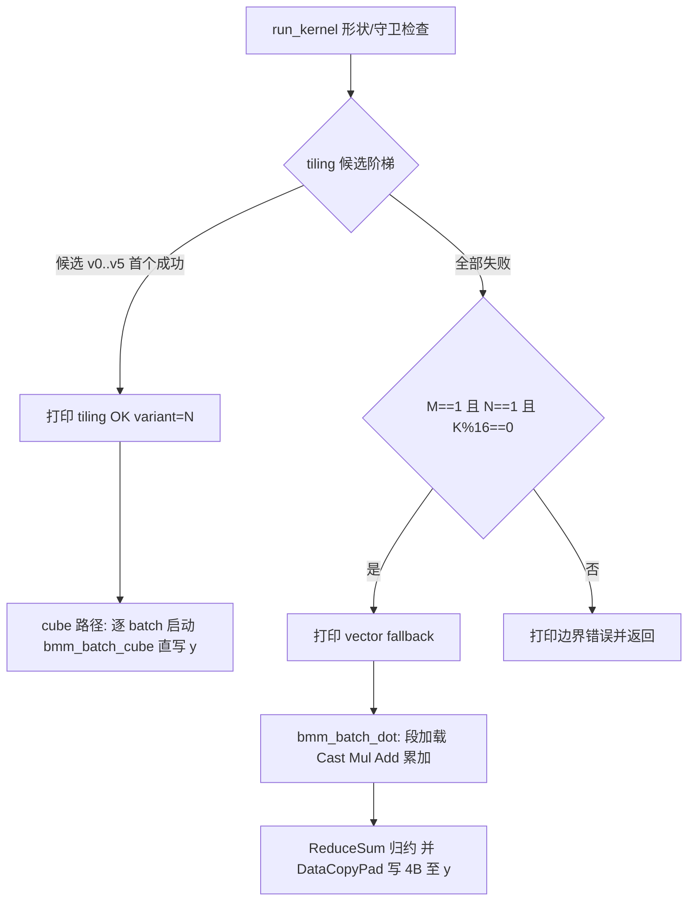

## 需求概述

修复 P2 垂直切片工程 `bmm_p2_slice` 的云端运行失败：编译已通过，但 host 侧 `MultiCoreMatmulTiling.GetTiling` 对 case0（M=1,N=1,K=32,fp16×fp16→fp32）返回 -1，导致 `GenMatmulTiling failed` 且 case0 无输出。目标：使 case0 在云端 `bash run.sh` 达到 `=== PASSED ===`（y fp32，rtol=atol=1e-4 严格判据）。

## 已确认约束与决策

- 先做 git 快照：在 `P:\Dev\CANN_Learning_Workspace\Projects` 仓库新建分支 **fix/p2a-gm-tiling**，仅提交并推送 `bmm_p2_slice/`（其余 untracked 目录不动）。
- 修复采用**混合方案**：cube tiling 参数放宽候选阶梯逐级探测并打印；全部失败且形状满足守卫时走 Vector 点积兜底内核，保证 case0 数值 PASS；日志明确标明实际路径。
- 本地无编译器，不进行任何本地编译/运行；改动仅限 `kernel.asc` 一个文件；不臆造 API，一律复用本地官方语料已核实的范式（DataCopyPad、ReduceSum、__aicore__ vector 结构）。
- 保留现有 P2a 硬边界：仅 M==N==1、fp16 输入、非 transpose、y 4B 精确缓冲、`__gm__` 限定符端到端不可丢、禁止 host 侧 D2D 写入 GM_ADDR。

## 验收标准

- 云端单轮上传后 `bash run.sh` 输出 `=== PASSED ===`（无论走 cube 阶梯候选还是 vector 兜底）。
- kernel.asc 日志明确打印：tiling 各候选结果、实际执行路径（cube 或 vector fallback）。
- 分支 fix/p2a-gm-tiling 已推送 origin，包含修复前的 P2a 快照。

## 技术栈

- 无新增依赖。全部改动在现有工程内：Ascend C Direct Invocation（`kernel.asc`，bisheng 编译，CANN 9.0.0 云端环境）。
- Git：Windows 下操作 `P:\Dev\CANN_Learning_Workspace\Projects` 仓库，每次命令携带 `-c safe.directory="P:/Dev/CANN_Learning_Workspace/Projects"`（与 CANN_OpHelper 仓库同款 dubious ownership 问题）。

## 实现方案

### 总体策略

1. 快照先行（用户明确顺序要求）：在 Projects 仓库从 master 切出 `fix/p2a-gm-tiling`，仅 add 并 commit `bmm_p2_slice/`，随后 `git push -u origin fix/p2a-gm-tiling`。保护 P2a 现状后开始试错，commit 信息建议 `chore(p2a): snapshot before small-shape GM tiling fix`。
2. `GenBatchMatmulTiling` 改为确定性候选阶梯：每个候选重建 `MultiCoreMatmulTiling` 对象（其余配置与官方一致，仅 `SetFixSplit` 参数不同），首个 GetTiling 成功即采用并返回；全部失败打印每个候选的失败信息。候选顺序：v0 官方 (128,128,-1)（当前失败项，仍先试以确认）；v1 不调用 SetFixSplit；v2 自适应 base（各维取 min(shape,128)，shape≥128 时与 v0 相同则跳过）；v3 (16,16,-1)；v4 (8,8,-1)；v5 (1,1,-1)。不改 SetDim(1)、不改 SetBias(true)、不改 dtype 配置，避免 host/kernel 语义错位。
3. 新增 Vector 兜底内核 `bmm_batch_dot`（__global__ __aicore__，host 以单核启动，B 批循环在核内），仅在 cube 阶梯全失败且守卫满足时启用：

- 守卫：M==1 && N==1 && K 为 16 的倍数（保证每 batch GM 段基址与每段长度均 32B 对齐，可用普通 DataCopy；K≡8(mod16) 留 P2b，本文件打印边界错误）。
- 计算链：逐 batch 将 a/b 按段（段容量取 8192 halfs 量级、长度恒为 16 倍数）DataCopy 入 UB；Cast 为 fp32；Mul 得逐项积；Add 累加到清零后的 fp32 累加缓冲；段循环完成后用 ReduceSum 归约为单标量；最后用 DataCopyPad 以 DataCopyExtParams{1,4,0,0,0} 精确写 4 字节至 y 对应 GM 槽（CopyOut 侧无需 padParams，覆盖非对齐 4B 写，杜绝越界）。
- 缓冲布局按官方范式（TPipe + 队列/TBuf），fp32 缓冲容量为 half 的 4 倍，UB 256KB 充裕；不追求本轮性能，只保证正确。

4. run_kernel 分流：现"tiling 失败即 return"改为——阶梯成功则走既有逐 batch cube 路径（打印实际采用的候选号）；失败且守卫满足则打印 fallback 提示并启动 `bmm_batch_dot`；否则打印边界错误返回。bias/ws 分配仅 cube 路径需要，可移入 cube 分支避免浪费（次要整理，不改变行为）。
5. 不修改 main.asc（y 缓冲 4B、输出 4B 均由兜底核精确写满足）、run.sh、gen_data.py、verify_result.py、CMakeLists.txt、data_utils.h。

### 数据流（改造后 run_kernel）



### 目录结构（改动清单）

```
Projects/bmm_p2_slice/
├── kernel.asc   # [MODIFY] 唯一改动文件：tiling 候选阶梯 + bmm_batch_dot 兜底内核 + run_kernel 分流
├── main.asc     # 不动（case0 形状、y 4B 缓冲、输出逻辑）
├── run.sh       # 不动
├── CMakeLists.txt  # 不动
├── data_utils.h # 不动
└── scripts/     # 不动（gen_data.py / verify_result.py / BatchMatmulMaxSum.py）
```

### 关键实现约束（防回归）

- 保持 `__gm__` 端到端：兜底内核参数类型为 **gm** uint8_t*，内部经 GlobalTensor(半/浮点) 访问，禁止任何去限定符 reinterpret_cast。
- 新增注释与日志使用英文，前缀统一 `[bmm]`，便于云端日志检索；日志含每个候选的失败/成功与最终路径。
- DataCopyPad 用法严格对齐本地语料（skills/ascendc-ops-project api_best_practices.md 与 as_strided 示例）：CopyIn 侧 DataCopyPadExtParams 置 blank，CopyOut 侧 DataCopyExtParams 的 blockLen 单位为字节。
- ReduceSum/Add/Cast/Mul/Duplicate 调用与 rmsnormquant 官方博客范式一致（元素计数语义），段容量控制在合理范围避免单次 repeat 溢出风险。
- 函数/全局命名与既有 bmm_batch_cube 不冲突；文件保持单翻译单元可被 main.asc include 的结构（不加 main/头文件保护）。
- 兜底内核与 cube 核并存于同一文件：二者任一编译失败即整文件失败，故改动后必须做逐行静态自检（本地无编译器，不自测运行）。

### 风险与边界（如实记录）

- 无法本地确定 GetTiling 对 (1,1,32) 失败根因；阶梯结果由本轮云端日志一次给出（这正是混合方案价值）。
- 若 cube 阶梯成功且运行 PASS，则记录该候选配置为"小 shape 可用项"；但仍需警惕"tiling 成功但 4B C 写运行时异常"的隐性风险，若出现 FAIL/挂起，下一轮强制 (M==N==1) 直走 vector 兜底。
- 若 vector 兜底 PASS，即达成 P2a 门禁；结论"cube 引擎 1x1 需 padding 式布局或不可用"归档为 P3 子-16 维度议题，cube 数值适用面留待 P2b 真 shape 再议。