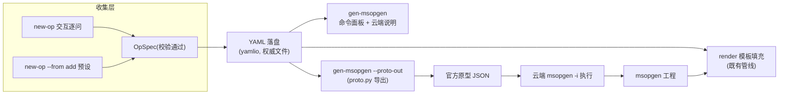

## 产品概述

为 CANN_OpHelper 增加「从需求到 msopgen 原型 JSON」的自动生成能力：通过交互式问答或预设模板收集算子需求，产出权威的 OpSpec YAML，并可一键无损导出官方 msopgen 原型 JSON，打通「需求 → YAML → JSON → 云端 msopgen」闭环，让用户不必再手写官方原型文件。

## 核心特性

- 新增 `new-op` 子命令：默认交互式逐问收集算子需求（算子类型名、SoC、描述、输入/输出张量数量与逐张量的 name/param_type/dtype×format 组合、可选 shape），每步即时校验，rich 汇总确认后落盘 OpSpec YAML；支持 `--from add` 预设预填、`--yes` 跳过确认、`--out` 指定 YAML 落盘路径。
- `gen-msopgen` 新增 `--proto-out <路径>`：把已校验 OpSpec 无损转译为官方格式原型 JSON（顶层数组、op/input_desc/output_desc、键序与 4 空格缩进对齐官方 add_custom.json）并写盘，供上传云端作 msopgen `-i` 输入。
- 工作区规则 6.4 措辞更新：允许基于已校验 OpSpec 的原型 JSON 机械导出；禁止凭空捏造无官方依据的字段。
- 本轮边界：预设 v1 仅注册 add（官方有出处的逐元素骨架，可改 op_type 复用）；mul/sigmoid 待 Compute 模板族扩展后加入；向导不收 attr，OpSpec.attrs 非空时 JSON 导出直接报双语错误，不臆造格式。

## 技术栈选择

沿用项目既有技术栈，不引入新依赖：

- Python 3.11+（兼容嵌入式 3.14），typer + rich + PyYAML + pathlib 不变。
- 新增 `proto.py` 仅用标准库 `json`，与 `yamlio.py`（PyYAML）保持对称职责：YAML 是 OpSpec 的权威持久化，JSON 是其 msopgen 输入视图。
- 测试沿用 pytest + typer.testing.CliRunner，全部经由 `p:\Dev\CANN_Learning_Refs\penv\Scripts\python.exe` 运行。

## 实现方法

### 总体策略

把「生成 JSON」定义为**基于已校验 OpSpec 的无损转译**而非凭空捏造：向导只负责把需求收集并校验进 `OpSpec`（与官方原型 JSON 双射的模型），`proto.py` 做机械序列化，规则 6.4 相应放宽。全程复用 `model.validate()`，错误统一走 `OpSpecError` + i18n 双语 hint。

### 关键设计决策

- **OpSpec YAML 为唯一权威表示**：JSON 信息量不足（无 shape/soc/描述），render 等下游全靠 YAML；JSON 仅作导出视图，避免两条管线脱节。
- **JSON 输出格式对齐官方**：顶层数组；`op` → `input_desc`/`output_desc`；entry 键序 `name → param_type → format → type`；`format`/`type` 并行数组；4 空格缩进。官方 add_custom.json 即 golden。
- **attrs 拒绝**：官方 JSON 样例无 attr 表达依据，`OpSpec.attrs` 非空即抛双语 OpSpecError，防止产出臆造格式。
- **预设用工厂函数**：`PRESETS` 值改为 `Callable[[], OpSpec]`，每次调用返回全新对象，避免 import 期共享可变 list 的别名污染。
- **向导纯逻辑与交互分离**：收集/解析（如 shape 文本 "8, 2048" → [8,2048]）与 typer prompt 解耦，便于 CliRunner 注入与单测。
- **`--proto-out` 不改动现有命令面板默认值**：仅落盘并提示「上传云端后可替换 -i 参数」，向后兼容既有行为与 12 条 CLI 测试。

### 性能与可靠性

- 转换与收集均为小数据 O(n) 操作，无性能瓶颈；golden 测试按官方文本归一化（换行/EOF）比较锁死格式，防漂移。
- 回归保持原 123 条测试全绿；新增约 18–20 条。

## 实施注意

- **i18n 双键纪律**：新增 `proto.*`/`wizard.*`/`cli.*` 文案与改写 `ci.step1`（"原型 JSON 需自行准备"→"可经 new-op / gen-msopgen --proto-out 生成或手工准备"）必须 zh+en 成对提交；`--help` 保持静态英文。
- **cli.py 惯例不可破坏**：`_root_callback` + `main()=app()`；Console 每次新建 `_c()`；`Panel.fit` 前先 `rich.markup.escape`；失败走 `_fail()`。
- **规则 6.4 引用点需全同步**：先 search_content 搜「6.4」「禁止从零生成」定位所有引用（.codebuddy/rules/CANN_OpHelper_Main_Dev_Rules.mdc、msopgen.py docstring、official-patterns.md、README 等）再逐一改写，避免自相矛盾。
- **render 边界提示**：mul/sigmoid 暂不入预设，避免生成 Add 计算语义的错误代码；文档中写明预设扩展随 Compute 模板族进行。
- **git 提交**：`-c safe.directory="P:/Dev/CANN_Learning_Refs/CANN_OpHelper"`，按 `<type>(<scope>): <subject>` 格式逐功能点提交（如 feat(cli) / feat(proto) / docs）。

## 架构设计



数据流：向导/预设收集 → `OpSpec.validate()` 把关 → YAML 权威落盘 → `proto.py` 无损转译出官方 JSON 供云端 `-i` → 生成的工程再回本地由 render 填充。新模块只做文本处理与代码生成，不编译不执行 C++。

## 目录结构

```
CANN_OpHelper/
├── src/cann_ophelper/
│   ├── proto.py        # [NEW] OpSpec→官方原型 JSON 导出。prototype_json_text(spec)->str 与
│   │                   #   dump_prototype_json(spec, path)->Path（错误面仿 yamlio.dump_op_spec）；
│   │                   #   attrs 非空抛 OpSpecError；纯 stdlib，docstring 注明规则 6.4 新依据。
│   ├── wizard.py       # [NEW] 向导层。PRESETS: dict[str, Callable[[], OpSpec]]（v1 仅 add，
│   │                   #   对齐 examples/add.yaml）；collect_op_spec(...) 交互逐问（dtype×format
│   │                   #   循环加组、shape 文本解析、逐项校验重问）；confirm_and_dump(...)
│   │                   #   rich 汇总表 + --yes 确认 + yamlio.dump_op_spec 落盘。
│   ├── cli.py          # [MODIFY] 注册 new-op（--from/--yes/--out）；gen-msopgen 增 --proto-out；
│   │                   #   复用 _print_overview 呈现汇总；写入反馈用 i18n。
│   ├── msopgen.py      # [MODIFY] 顶部 docstring 改写「rule 6.4 工具不生成 JSON」的旧表述，
│   │                   #   指向 proto.py（attrs 暂不支持）。
│   ├── i18n.py         # [MODIFY] 新增 proto.*/wizard.*/cli.new_op.* 键；改写 ci.step1 文案。
├── .codebuddy/rules/CANN_OpHelper_Main_Dev_Rules.mdc  # [MODIFY] 6.4 措辞放宽（以实际定位为准）
├── tests/
│   ├── test_proto.py   # [NEW] golden 对齐官方 add_custom.json（归一化比较）、dump 落盘、键序、
│   │                   #   attrs 拒绝、无效 soc/dtype 透传校验错误。
│   ├── test_wizard.py  # [NEW] PRESETS 工厂每次返回全新且 validate 通过；收集逻辑注入回答
│   │                   #   覆盖 dtype×format 循环/空结束/非法重问/shape 解析。
│   └── test_cli.py     # [MODIFY] 新增 new-op --from add --yes --out（含文件存在断言）、
│                       #   gen-msopgen --proto-out 落盘 JSON 可回读且结构同官方。
├── README.md           # [MODIFY] 命令矩阵补 new-op/--proto-out；更新工作流与 6.4 说明。
└── docs/official-patterns.md  # [MODIFY] 新增「原型 JSON 可由 OpSpec 导出」小节与出处。
```

## 关键代码结构

```python
# src/cann_ophelper/proto.py（导出接口；实现细节以官方键序与 4 空格缩进为准）
def prototype_json_text(spec: OpSpec) -> str: ...
    """Validate spec, then serialize the official msopgen prototype JSON text."""
def dump_prototype_json(spec: OpSpec, path: Union[str, Path]) -> Path: ...
    """Validate, then write the prototype JSON; raise OpSpecError on failure."""

# src/cann_ophelper/wizard.py（预设与收集入口）
PRESETS: Dict[str, Callable[[], OpSpec]]   # v1: {"add": ...}，工厂防共享可变 list
def collect_op_spec(seed: Optional[OpSpec] = None, ...) -> OpSpec: ...
def confirm_and_dump(spec: OpSpec, path: Path, *, yes: bool) -> Path: ...
```