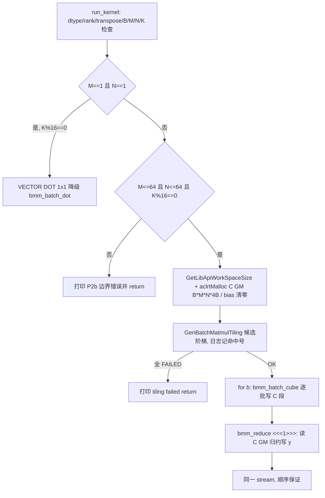

## 需求概述

推进 P2b 垂直切片：把 `bmm_p2_slice` 从 P2a 的 case0-only（B=1、M=N=1、K=32，vector dot 兜底）推进到**真 M/N 的 Cube 垂直切片**，使 P2 门禁完整化（fp16、全对齐、transpose 均 false 的最小可验证场景），云端 `bash run.sh` 达到 `=== PASSED ===`（y fp32，rtol=atol=1e-4）。

核心诉求：

- 单 case 先行（用户采纳推荐）：首个目标 shape = **B=1、M=64、N=64、K=64**（fp16×fp16→fp32，全对齐）。验证 **cube MatMul 在真 M/N 下 GetTiling 与执行均可行**（P2a 已证 1x1 判死：GetTiling OK 但运行崩 ret=507015，故真 shape 可行性必须实测）。
- kernel 形态：cube MatMul 逐 batch 输出 C 至 GM 中间缓冲（B×M×N fp32），再由专用 **vector 归约核**读 C 完成「逐行 Sum over N → Max over M」写 y[b]（C 中间量 GM 往返，融合优化属 P4，本轮不做）。
- 保留 P2a 的 `bmm_batch_dot`（M==N==1 时 vector dot 降级路径）与 cube tiling 候选阶梯日志。
- 数据链（main.asc / scripts/gen_data.py）随 shape 泛化，去掉硬编码字节数。

范围外（明确不做）：CANN_OpHelper 工具回流（用户已确认留后续轮）、多 case 数据链、transpose/bf16、多核并行与 tile 性能、C 中间量融合（P4）、M/N>64 与 K≡8(mod16) 等边界。

## 验收标准

- 单 case（64×64×64）云端 `bash run.sh` 输出 `=== PASSED ===`，日志含 `run path` 与 cube tiling 探针命中号。
- 若 cube 真 shape 执行崩溃（507015 类）或 tiling 全失败 → 如实记录决策（二轮补 vector 全 shape 兜底），P2b 门禁由兜底达成。
- 改动提交推送至新分支 `fix/p2b-cube-real-shape`（基于 P2a 分支 9000434）。

## 技术栈

- 无新增依赖。全部改动在实测区 Direct Invocation 工程内：`P:\Dev\CANN_Learning_Workspace\Projects\bmm_p2_slice\`（Ascend C，bisheng 编译，CANN 9.0.0 云端 Lab；本地不编译）。
- Git：Projects 仓库（`-c safe.directory="P:/Dev/CANN_Learning_Workspace/Projects"`，AI 侧跳过 status 防卡顿）。
- API 权威：`cann_ascendc_headers_9.0.0`（P2a 已核 ReduceSum<float,true>/DataCopyPad{1,4,0,0,0}/Duplicate/Cast 参数序；ReduceMax 与 Maximum 本轮实现前必须补核）。

## 实现方案

### 总体策略（单 case 垂直切片，决策点先行）

真 shape 是否可走 cube 属**云端运行期事实**（本地无法预知执行是否复现 507015），故首轮即实现完整 CUBE→REDUCE 链并以云端结果仲裁；vector 全 shape 伪 MatMul 兜底不预先实现（YAGNI），若 cube 崩再于二轮补入——与 P2a 同型决策树。

### 数据流

### 文件改动明细（改动清单）

**bmm_p2_slice/kernel.asc（核心，[MODIFY]）**

1. `run_kernel` 形状分流重排（现 L337-341 的 `M!=1||N!=1 return` guard 需解除）：

- M==N==1 && K%16==0 → 保留既有 `bmm_batch_dot <<<1>>>`（日志 `run path: VECTOR DOT (1x1)`）。
- 真 shape（守卫 M≤64 && N≤64 && K%16==0，其余打印边界错误返回）→ 激活 P2a 脚手架 cube 块（L370-432）：`aclrtMalloc` C 缓冲 `B*M*N*sizeof(float)`（64³ 时 16KB）+ bias（N fp32 清零）+ ws；阶梯 `GenBatchMatmulTiling` 成功后逐 batch `bmm_batch_cube<<<1>>>` 直写 C 段（**cBatch 改为指向 C GM 而非 y**，区别于 P2a stand-in）；再 launch 归约核；同一 stream FIFO 保证先 cube 后 reduce。全程 `__gm__ uint8_t*` 端到端，禁降级 cast。

2. 新增归约核 `bmm_reduce`（`__global__ __vector__`，单核批循环）：

- 语义 = `y[b] = max_{i∈[0,M)} rowsum_i`，其中 rowsum_i = Σ_j C[b][i][j]（fp32 累加）。
- 实现：逐 batch，逐行 `DataCopy`（C 行 N fp32=256B、32B 对齐，用 count=N 元素版）入 VECIN 单槽 → `ReduceSum<float,true>`（N=64=单 repeat 上限）→ 标量 `SetValue(rowSums, i)` 收 M 个行和（M=64）；batch 末对 rowSums 做 Max 归约得 y[b]（实现二选一：优先 `ReduceMax<float,true>`——须先以头库核对签名/isSetMask/上限；若无/不适则用标量循环比较 `GetValue`，零新 API 风险），经 VECOUT 队列 `DataCopyPad{1,4,0,0,0}` 精确写 4B。
- UB 缓冲：inQ 1×256B + rowSums TBuf M×4B + tmp 8×4B + outQ 1×256B（量级 ≪256KB）。队列 EnQue/DeQue 兼作 V→MTE3 排序。
- 日志：`[bmm] run path: CUBE->REDUCE (B=.. M=.. N=.. K=..)`；每 batch 可选单行 trace（防刷屏只打汇总或默认关闭）。
- 文件头 P2 里程碑注释同步更新（P2b 已落地、守卫与云证记录）。

3. 保留：`bmm_batch_cube`、`GenBatchMatmulTiling` 阶梯（真 shape 下可达，日志已含命中号）、`FixSplitProbe` 工具函数。

**bmm_p2_slice/main.asc（[MODIFY]，最小化）**

- shape 数组改为 `{1,64,64}`/`{1,64,64}`/`{1}`；x1/x2 输入 8192B、y 输出 4B——**字节数一律由 shape 常量推导**（constexpr 计算或 CASE_* 宏），消除 L66-76 硬编码 64/64/4 与 L82-83 写回长度，杜绝 shape/字节错位。

**bmm_p2_slice/scripts/gen_data.py（[MODIFY]）**

- case0 尺寸改 `(1,64,64)`×`(1,64,64)`（seed 42+0 不变），golden 仍由 `BatchMatmulMaxSum.impl` FP64 生成写 `output/golden_case0/golden_y.bin`。run.sh / verify_result.py / CMakeLists.txt / data_utils.h 不动。

### 关键实现约束（防回归）

- 直启核标注只用 `__cube__`/`__vector__`；`__gm__` 限定符端到端（形参 `__gm__ uint8_t*` → `GlobalTensor` 访问）；新增注释标「已与头库核对」。
- 归约顺序 = 先 Sum(N) 后 Max(M)，与题面语义一致（不可交换）；MaxSim 语义防 0 陷阱由「行和数组 + Max」天然满足（全负行返回最大负数，本轮为正向验证、P3 全负矩阵覆盖）。
- 归约核与 dot 核并存单翻译单元（被 main.asc include，不加 main/头文件保护）；命名与既有 `bmm_batch_cube`/`bmm_batch_dot` 不冲突。
- 本地无编译器：改动后必须逐行静态自检（见 todo 4），不自测运行；lint 无诊断（无 bisheng 属预期）。

### 风险与决策点（如实记录）

- **cube 真 shape 执行可行性是唯一不确定点**：GetTiling 成功（预期 v1 no-fix / v2 base(64,64) 命中）后运行仍可能崩。决策树：a) CUBE->REDUCE PASSED → P2b 门禁达成，记录探针号，cube 真 shape 可用性确认；b) 执行崩/tiling 全失败 → 二轮在 run_kernel 补 vector 全 shape 伪 MatMul + 归约兜底保 PASSED，cube 议题按证据归档（子-维度/对齐上限）。
- ReduceMax 属新调用：实现前须头库核实（intf 签名/isSetMask 默认/M≤64 单 repeat 上限），不符则退标量比较，不臆造。
- git 基线 = P2a 分支 `fix/p2a-gm-tiling`（9000434，尚未合 master），P2b 在其上开新分支，勿基于 master。

## Agent Extensions

### SubAgent

- **code-explorer**
- Purpose: 在归约核实现前，检索本地官方语料（light 03.03/03.05、rmsnormquant 博客）与 cann_ascendc_headers_9.0.0 头库，核 VerifyReduceMax/Maximum/DataCopy 行加载的确切签名与 2201 平台限制，并确认 C 行 256B DataCopy 与归约缓冲布局范式。
- Expected outcome: 归约核 API 用法与缓冲布局获得官方语料/头库背书（注释标注出处），杜绝臆造；ReduceMax 若不可用给出标量比较替代结论。