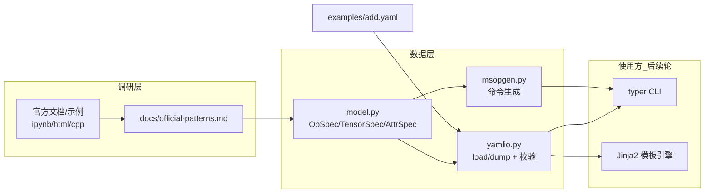

## 产品定位

CANN_OpHelper 是 Windows 本地运行的 Python CLI 工具,辅助生成 CANN Ascend C 算子工程模板代码。工具不编译、不运行 C++(本地无编译器/CANN 套件/NPU),编译验证均在云端 CANN Lab 完成。工作流:用户描述算子 → 工具生成完整 `msopgen` 命令 → 用户到云端执行获得初始工程 → 拷回本地 → 工具读取工程并按模板填充/修改 → 输出完整工程供上传。

## 本轮功能范围(Phase 1 前段:official-patterns + core-models)

1. **官方模式调研沉淀**:通读 `Documentation_for_Developers\ascendc_operator_development(_light)` 与 `CANN_Learning_Hub_(for_dev)\tutorials` 中 Element-Wise(Add 等)相关章节,产出 `docs/official-patterns.md`,内容须逐条源自官方文档/示例并标注出处,包括:

- msopgen 命令的真实参数与用法(子命令、`-i/-c/-out/-t` 等选项、soc 版本写法、典型示例);
- msopgen 生成算子工程的标准目录/文件布局(Kernel 侧、Host 侧、op_host/op_kernel 等);
- Kernel 侧固定代码模式(必要头文件、核函数签名、Compute 流程、Add 样例);
- Host 侧 Tiling 与算子原型注册相关固定写法。

2. **算子元信息模型 + YAML 读写 + msopgen 命令生成**(core-models):

- `OpSpec` 元信息模型:算子名、描述、SOC 版本、输入/输出 Tensor(名称、shape、dtype、format、param_type)、标量属性(attr)、tiling 预留字段、表达式等;含默认值与字段校验;
- YAML 读写:OpSpec ↔ YAML 序列化/反序列化,格式友好、校验错误信息清晰;
- msopgen 命令生成:依据模型字段与用户提供的算子原型 JSON 路径,输出一条完整、可复制、含云端执行说明的 msopgen 命令行。

3. **配套产物**:`examples/add.yaml` 示例、`tests/` 下最小测试骨架(模型/YAML 往返/命令生成),便于用户装好 `.penv` 后直接冒烟。
4. **明确不做**:cli.py(typer 入口)、Jinja2 模板引擎、tiling 策略、apply 流水线、端到端 pytest——均留后续轮;不创建 `.penv`、不安装依赖(由用户执行)。

## 规约红线

- 依赖官方 msopgen 生成框架,不从零生成完整 JSON 算子原型(原型 JSON 由用户提供,工具只引用其路径);
- 写任何 CANN 相关代码/文档前先读官方文档,冲突时以本地文档为准;
- 参考目录只读;文档标注出处,不凭空编造命令与代码模式。

## 技术栈

- Python 3.11+(兼容嵌入式 3.14.5);本轮模块仅用 stdlib(`dataclasses`、`pathlib`、`enum`)与 `PyYAML`(声明于 pyproject,但代码层只做顶层 import,不阻塞语法级自检)。
- typer/rich/jinja2 已声明依赖但**本轮不使用**(后续 CLI/模板轮才接入);因此用户未装 `.penv` 前,纯文本产出与 stdlib 语法自检不受影响。

## 实现策略

1. **先调研、后建模**:用官方文档深挖结果驱动模型字段与 msopgen 命令格式,避免凭空设计。msopgen 参数以官方章节实测为准(候选源:ascendc_operator_development 的算子工程/msopgen 相关章节、03_intermediate_vector_operator_development、CANN_Learning_Hub tutorials 对应 ipynb 与 merged_all.html)。
2. **分层解耦,便于后续轮接入**:`model.py`(纯数据+校验)→ `yamlio.py`(持久化)→ `msopgen.py`(命令文本生成)。三者互不反向依赖,后续 template-engine/apply/cli 只需导入模型与 I/O,不产生架构返工。
3. **msopgen 与规约 6.4 的边界**:命令生成器接收用户提供的原型 JSON 路径(`op_type.json`),仅校验路径存在与可读,不解析/不生成 JSON 内容;命令输出附带 SOC 版本与输出目录,保证一条命令即可在云端执行。
4. **错误处理**:YAML 解析/字段校验/文件缺失均抛带上下文的自定义异常(如 `OpSpecError`),消息同时给出原因与修正建议,为后续 rich 渲染预留结构化字段。

## 实现注意

- 全部文件以 UTF-8 写盘;若本轮产出任何 `.ps1`,必须 UTF-8 with BOM(PowerShell 5.1 GBK 解码坑),尽量本轮不产脚本。
- 路径一律 pathlib,兼容 Windows;不得硬编码绝对路径。
- YAML 输出采用块式结构、字段顺序稳定(按 dataclass 定义序),便于 diff 与人工阅读。
- `docs/official-patterns.md` 每个关键结论标注来源文件相对路径(如 `Documentation_for_Developers/ascendc_operator_development/...ipynb`),便于复核。
- 冒烟验证:本阶段结束给出引导命令由用户执行,再运行 `tests/`;此前仅做 stdlib 语法检查,不自行装包。

## 架构设计



## 目录结构

本轮所有改动集中在 `CANN_OpHelper\`,参考目录只读不动:

```
CANN_OpHelper/
├── docs/
│   └── official-patterns.md        [NEW] 官方模式基准:msopgen 命令格式、Add 工程文件布局、
│                                         Kernel/Host 固定模式、Tiling 模式,逐条标注出处
├── examples/
│   └── add.yaml                    [NEW] Add 算子描述示例,字段与 OpSpec 完全对齐
├── src/cann_ophelper/
│   ├── __init__.py                 [MODIFY] 保留 __version__;导出 OpSpec/TensorSpec 等便于使用
│   ├── model.py                    [NEW] dataclass 模型:OpSpec(顶层)、TensorSpec(输入/输出)、
│   │                                     AttrSpec(标量属性)、SOC 与 dtype 枚举/常量;
│   │                                     字段默认值 + validate() 校验 + OpSpecError
│   ├── yamlio.py                   [NEW] load_op_spec(path)->OpSpec、dump_op_spec(spec,path),
│   │                                     含缺失文件/格式错/非法字段的清晰报错
│   └── msopgen.py                  [NEW] build_msopgen_command(spec, proto_json, out_dir) 依官方
│                                         实测参数拼装命令;show_cloud_instructions() 云端执行说明
└── tests/
    ├── test_model.py               [NEW] 默认值、必填校验、dtype/soc 合法值用例
    ├── test_yamlio.py              [NEW] 往返一致、非法 YAML/缺失字段错误信息用例
    └── test_msopgen.py             [NEW] 命令拼装断言(参数顺序、引号、路径透传)
```

## 关键数据结构(接口级)

```python
# src/cann_ophelper/model.py  —— 示意,最终以官方调研结果校准字段
@dataclass
class TensorSpec:
    name: str            # 形参名,如 "x"
    shape: list          # 如 [1024, 1024],支持 -1 动态
    dtype: str           # 如 "float16" / "int32"
    param_type: str      # "input" | "output"
    format: str = "ND"   # 默认 ND

@dataclass
class AttrSpec:
    name: str
    dtype: str
    value: object

@dataclass
class OpSpec:
    op_type: str         # 算子类型名,如 "Add" / "Sigmoid"
    soc_version: str     # 如 "ascend910B3"
    inputs: list[TensorSpec]
    outputs: list[TensorSpec]
    attrs: list[AttrSpec] = field(default_factory=list)
    tiling: dict = field(default_factory=dict)   # 预留,本轮不实现策略
    description: str = ""
```

## Agent Extensions

### SubAgent

- **code-explorer**
- 用途:对体量庞大(数百 ipynb/html/cpp)的官方文档与示例目录做定向检索,定位 msopgen 命令用法、Add/Element-Wise 算子工程文件布局、Kernel/Host 固定代码模式与 Tiling 写法,并回传带出处的原始摘录。
- 预期结果:产出可供 `docs/official-patterns.md` 直接引用的事实集合(命令样例、文件树、代码片段+来源路径),避免人工逐文件翻读造成遗漏。